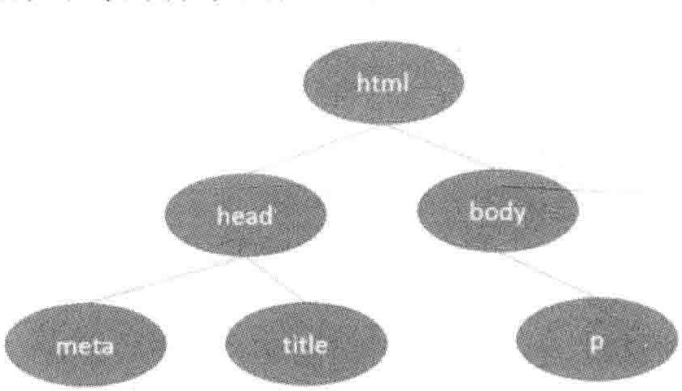

<div class="book-original" markdown="1">

## DOM 是什么

DOM（文档对象模型）是 Web 前端里最基础、最常用的一个模型。例如，一个网页其实就是一个 HTML 文件，经过浏览器的解析，最终呈现在用户面前。HTML 语言是由很多标签组成的，代码如下所示：

```html
<!DOCTYPE HTML>
<html lang="en">
<head>
<meta charset="UTF-8">
<title>程序员天天说的 DOM 到底是什么</title>
</head>
<body>
<h1>我的第一个标题</h1>
<p>我的第一个段落</p>
</body>
</html>
```

上述代码中，head 和 body 是标签。这些标签不是随意摆放，它们有自己的规则。首先，它们是嵌套的，一层套一层，比如 html 套 body，body 又套 h1。其次，每一层可以同时存在很多标签，比如 head 和 body 属于同一层，它们被外面的 html 套着。这样的结构很像计算机里的文件夹。例如，“我的电脑”是最外层，里面套着 C、D、E、F 盘，每个盘里又有很多文件夹，文件夹里又有文件夹，逐个打开后才能看到具体的文件。

为什么要按照这种结构来组织呢？目的其实是方便解析和查询。解析的时候，从外向里循序渐进，好比按照图纸盖房子，先盖围墙，再盖走廊，最后才盖卧室。查询时候，会遵循一条明确的路线，例如“D 盘/文化交流/影视作品/给产品经理讲技术.avi”，一层一层地缩小范围，查找效率会非常高。所以，浏览器在解析 HTML 文档时，会把每个标签抽象成代码里的对象，按照这种层次分明的结构组织，这就是 DOM。

如[图1-2](#figure-1-2)所示为数据结构里典型“树”结构。程序员经常说的 DOM 树，其实就是这个意思。浏览器在解析 HTML 时，会在它的内部构建这样一棵 DOM 树，然后按照这棵树上的层次顺序解析每个标签。解析完成后，用户就看到了网页的内容。

<figure id="figure-1-2" tabindex="-1" markdown="1">

<p markdown="span" style="margin:0">
{ width="838" height="481" }
</p>

<figcaption markdown="span" style="margin:0.5em auto;font-size:0.8em;font-style:normal;line-height:1.5">
图1-2
</figcaption>

</figure>

浏览器解析完 HTML，就要开始解析 HTML 里的 JavaScript 代码。程序员可以通过 JavaScript 代码实现一些动态的网页效果。例如，从服务器拉取一段数据来展示，或做一个酷炫的动画效果，都要用到 DOM。

举个简单的例子（代码如下所示），想要在网页里显示一行字“this is from javascript”，首先要找到那个可以显示文字的标签。这是非常容易，因为浏览器已经把 DOM 都交给 JavaScript 了。DOM 里的对象，正好就是 JavaScript 语言里的对象。JavaScript 可以通过下面的方法修改 DOM 树上的标签对象。

```html
<body>
<p id="display">hello world</p>
<script type="text/javascript">document.getElementById("display").innerText="this is from javascript";</script>
</body>
```

随着对前端知识学习的深入，读者会发现 JavaScript 操纵 DOM 是非常普遍的事情。例如，很多网页一开始加载出来的只是个架子，只显示出一个 loading 图标似的转圈动画，只有等 JavaScript 从服务器上请求到真正的数据后操纵 DOM 来显示数据，才能看到内容，这就是典型的异步加载。以 HTML5 的游戏为例，里面的人物要随着手指或鼠标运动，普遍的做法是通过 JavaScript 操纵 DOM 改变元素的位置来实现。可以说，DOM 使得 JavaScript 在前端世界里几乎无所不能。

但是，有一点要注意：操纵 DOM 本身是一件效率非常低的事情。一个网页往往很复杂，浏览器构造出来的 DOM 树往往很庞大，有的甚至有几千个节点。在这么庞大一棵树上频繁地改动，对浏览器（尤其是移动浏览器）来说是不小的工作量，稍不注意就会出现卡顿。

于是，有人发明了一种便捷的方法，叫作虚拟 DOM。简单来说，就是用 JavaScript 模拟了一棵简单的 DOM 树，然后在这上面演练所有的 DOM 操作，等时机成熟时再把虚拟 DOM 树和真正的浏览器的 DOM 树做对比，算出差异，一次性地改变真正的 DOM 树。这两个步骤从整体上大大提高了 JavaScript 操纵 DOM 树的效率。

</div>
