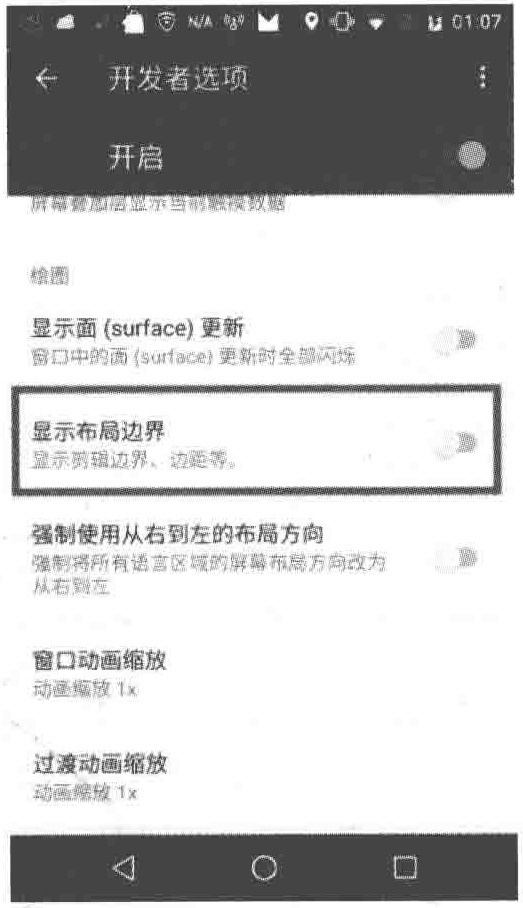
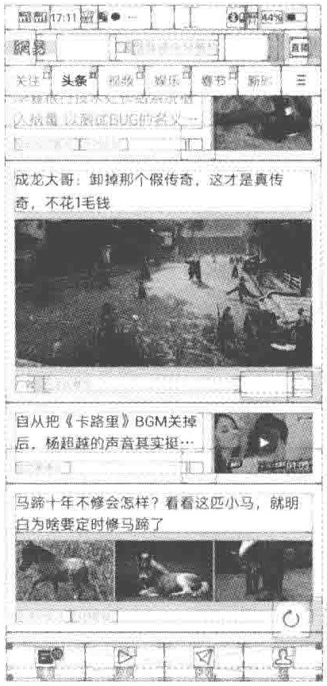
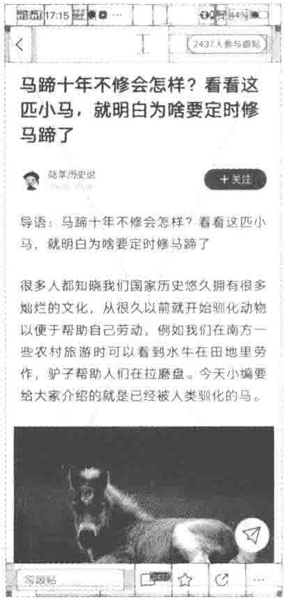

## Hybrid APP

现在，移动端上的很多应用都采用了 Hybrid APP 的架构。所谓 Hybrid APP，就是指使用原生和 H5 两种 UI 呈现内容。很多读者可能有这样的困惑：如何抉择何时使用原生 UI，何时使用 H5？回答这个问题前，不妨先看看其他软件是如何做的。

在 Android 系统的“开发者选项”界面里，有一个名为“显示布局边界”的功能，通过使用这个功能，读者可以很快地分辨出哪些是原生 UI，哪些是 H5，如[图2-2](#figure-2-2)所示。

<figure id="figure-2-2" tabindex="-1" markdown="1">

{ width="523" height="908" }

<figcaption markdown="span" style="margin:0.5em auto;font-size:0.8em;font-style:normal;line-height:1.5">
图2-2
</figcaption>

</figure>

当“显示布局边界”的功能开启后，所有的原生控件都会被一个框框住。用于显示 H5 页面的 WebView 是一个原生控件，也有一个框，但它与其他原生控件的区别是 WebView 展示的内容比单一的原生控件复杂得多。例如，原生的 TextView 用来显示文本内容、ImageView 用来显示图片等；而 WebView 可以显示一个网页的内容，我们可以把它看作精简版的浏览器。

原生页面为了展示丰富的内容，一般需要利用大量控件进行组合，所以当读者看到某个页面布满了框时，就可以判断出这部分肯定是基于原生 UI 呈现的，比如网易新闻的新闻列表页（如[图2-3](#figure-2-3)所示）。

<figure id="figure-2-3" tabindex="-1" markdown="1">

{ width="412" height="864" }

<figcaption markdown="span" style="margin:0.5em auto;font-size:0.8em;font-style:normal;line-height:1.5">
图2-3
</figcaption>

</figure>

一般说来，原生 UI 可以提供比 H5 页面更好的操作体验，就拿网易新闻客户端页面和它的网页版对比，从列表的滑动到多 TAB 的切换，网页版的体验都“完败”。如果一个页面显示的内容很丰富，页面中却只有一个大大的框，那么这个框内的内容很可能就是由 WebView 显示的。例如，网易的新闻详情页（如[图2-4](#figure-2-4)所示）。

<figure id="figure-2-4" tabindex="-1" markdown="1">

{ width="412" height="864" }

<figcaption markdown="span" style="margin:0.5em auto;font-size:0.8em;font-style:normal;line-height:1.5">
图2-4
</figcaption>

</figure>

这个大大的框里有各种字体和图片，不是 WebView 是什么？了解了 WebView 和普通控件的这些特征，我们就可以很轻松地从任意一个 APP 中找到哪些是原生 UI，哪些是 H5 页面。了解了 Hybrid APP 结构后，相信何时使用原生 UI，何时使用 H5 页面这个问题也能得出答案了。

### 何时使用原生 UI

- 对流畅性体验要求较高的场景
- UI 样式相对固定，不会频繁变化
- 交互复杂

### 何时使用 H5 页面

- 较强动态运营需求
- UI 样式复杂多变
- 交互简单
- 多平台复用

如果根据上面的条件还不足以确定应该选择哪种技术，不妨用“显示布局边界”功能看看竞品是如何实现的！

