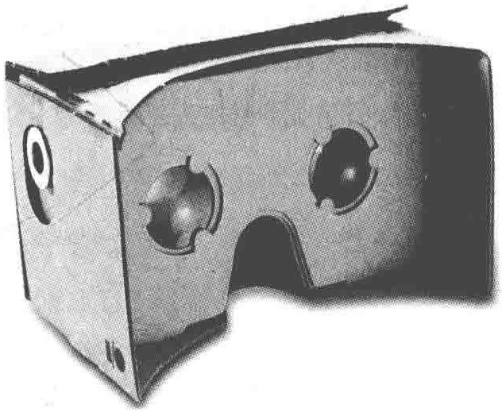

## 手机传感器知多少

智能硬件已经火了好长一段时间，作者也在跟风学习，而且还斥“巨资”买了一个谷歌推出的 Cardboard VR 眼镜，体验中产生了不错的沉浸感，很佩服谷歌只利用现有手机自带的一些传感器，就打造出了这款物美价廉的 VR 设备（如[图2-5](#figure-2-5)所示）。

<figure id="figure-2-5" tabindex="-1" markdown="1">

{ width="632" height="519" }

<figcaption markdown="span" style="margin:0.5em auto;font-size:0.8em;font-style:normal;line-height:1.5">
图2-5
</figcaption>

</figure>

接下来，作者详细介绍手机上的各种传感器，以及它们的功能。

### 磁场传感器

磁场传感器可以测定出手机在 x、y、z 三个方向上的磁场强度，用户旋转手机，直到只有一个方向上的值不为零时，手机就指向了正南方。很多手机上的指南针应用，都利用了这个传感器的数据。同时，可以根据三个方向上磁场强度的不同，计算手机在三维空间中的具体朝向。

### 加速度传感器

加速度传感器返回的是当前手机在 x、y、z 三个方向上的加速度值。如果手机水平放置，那么 z 方向上的值，就是当前的重力加速度 G，可以通过判断 G 值的不同，推测用户是在南北极还是赤道，当然获取 GPS 信息更直接一些。加速度传感器的另一个用处是计步。当用户拿着手机运动时，手机会随着身体上下摆动，加速度传感器就会检测出加速度在某个方向上来回改变，通过计算来回改变的次数，可以得出步数。

### 三轴陀螺仪

三轴陀螺仪可以测定出当前手机在 x、y、z 三个方向上的角加速度，这个功能主要用来检测手机的旋转方向。常见的翻转手机就可以接听电话的功能，就是利用三轴陀螺仪测定角加速度变化的功能实现的。

### 指纹传感器

指纹解锁已经是智能手机的标配功能，它的实现完全依赖于手机中嵌入指纹传感器。指纹传感器按技术可以分为光学式、电容式及射频式 3 种。手机上普遍采用的是电容式指纹传感器。

### 近距离传感器

顾名思义，它能够检测手机附近物体距手机正面的距离，它依靠一个小型雷达实现，通过发射一些脉冲信号并检测返回时间计算距离。这个传感器对脸大的用户来说是个福音，因为在接电话时，手机可以检测到脸靠近了，然后关闭屏幕，以避免脸对屏幕的误触。

### 光线传感器

光线传感器检测手机正面接收到的光照强度，从而对应地改变手机屏幕的亮度，让用户在不同光照下都能看清屏幕。现在，很多阅读类应用都有夜间模式，但都需要手动切换。

### 气压传感器

气压传感器可以检测当前的大气压强，从而推测出用户所在位置的海拔高度。iOS 中的健康应用可以计算出用户爬了几层楼，作者猜测它就是利用不同海拔大气压强不一样的原理来推测用户上升的楼层的。

### 温度传感器

有的手机自带温度传感器，可以获取当前环境的温度。

除了这些几乎已经成为标配的传感器，随着科技的进步，更多的传感器将会被集成到手机中，这些传感器能否再一次改变用户的生活，请拭目以待。

