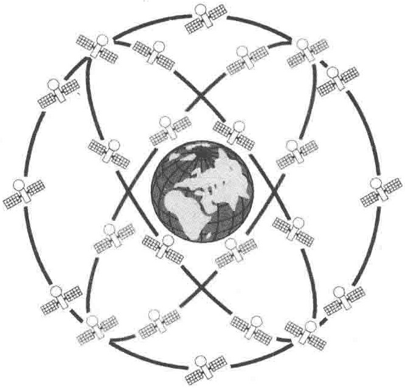
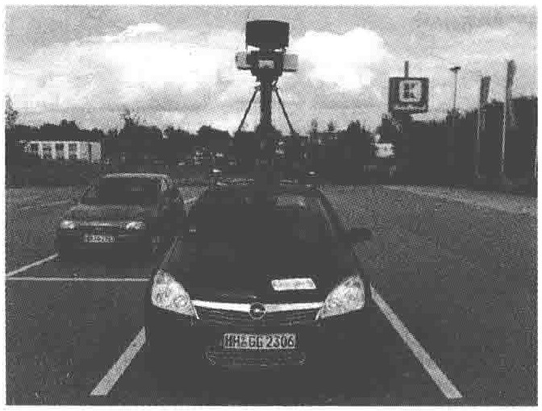

## 定位终端设备位置的方法有哪些

越来越多的 APP 拥有定位设备位置的能力，像百度地图等导航软件自不必说，就连新闻客户端也需要获取设备地理位置以进行周边新闻的精确推送。微信的“摇一摇”加好友功能也需要用到设备的位置信息。

用到定位功能的 APP 几乎随处可见。这些 APP 获得了定位权限后，就会通过系统接口获取当前手机的经纬度，上传给服务器。有的服务器拿到位置后，会查询一些附近的商家推荐给用户，这就是团购 APP 的原理。有的 APP 检索一些附近的人推荐给用户，这就是交友 APP 的原理。还有的查找了一些附近的出租车推荐给用户，这就是打车 APP 的原理。

如何获取经纬度？我们首先想到的就是 GPS。GPS 定位靠的是天上卫星（如[图2-6](#figure-2-6)所示），这些卫星会不断地广播自己的信号。定位时，GPS 信号接收器收集至少 4 颗卫星发出的信号，用收到信号的时间乘以光速可以算出手机和每颗卫星之间的距离，再加上每颗卫星的位置已知，就可以确定手机的位置。这里省略了很多细节，但究其基本原理，只要能找到一个参照物，并且知道它的位置，定位就成功了。古人说：“众里寻他千百度，蓦然回首，那人却在，灯火阑珊处。”所以说定位的关键是参照物。

<figure id="figure-2-6" tabindex="-1" markdown="1">

{ width="666" height="638" }

<figcaption markdown="span" style="margin:0.5em auto;font-size:0.8em;font-style:normal;line-height:1.5">
图2-6
</figcaption>

</figure>

很多事情并没有想象的那么简单。手机里的 GPS，在出厂前都要添加一个加偏芯片，作用是人为地给定位到的原始经纬度造成一点偏移，生成所谓的“火星坐标”。这样做目的可能是防止军事设施等关键地标的 GPS 信息被恶意获取等。那么，为什么平时使用的地图软件可以精确定位呢？答案是这些地图软件中的地图也做了同样的偏移调整。

GPS 虽强，但也不是“走遍天下都不怕”。到了室内，卫星信号会变得很弱，GPS 就没有用武之地了。针对这种场景，还有两套定位方案可以用：基站定位和 Wi-Fi 定位。它们的原理很相似。定位的关键是参照物，基站定位的参照物就是基站。运营商通过查询手机连接的基站的位置，就能找到设备的具体位置。Wi-Fi 定位的参照物是无线路由器。将手机连接到无线路由器时，上传了该路由器的 MAC 地址，服务器通过查询公开的 MAC 地址对应的经纬度找到设备的具体位置。基站在建造之初就确定了它的地理位置，而且在很长一段时间内不会发生改变，可以说基站先天就拥有地理位置信息。但路由器就没有这种特性了，所以路由器的地理位置信息是后天采集的。看到路上的街景采集车（如[图2-7](#figure-2-7)所示）了吗？如果读者以为它们只是采集街景就想错了。它们在大街上漫游时，就记下了附近无线路由器的 MAC 地址和 GPS 信息。日复一日年复一年，一个庞大的 Wi-Fi 定位数据库就建立起来了。

<figure id="figure-2-7" tabindex="-1" markdown="1">

{ width="672" height="510" }

<figcaption markdown="span" style="margin:0.5em auto;font-size:0.8em;font-style:normal;line-height:1.5">
图2-7
</figcaption>

</figure>

操作系统统一实现了定位需要的复杂的系统。当应用程序需要确定当前设备的地理位置时，只需要添加两三行代码，直接从系统中获取即可。

