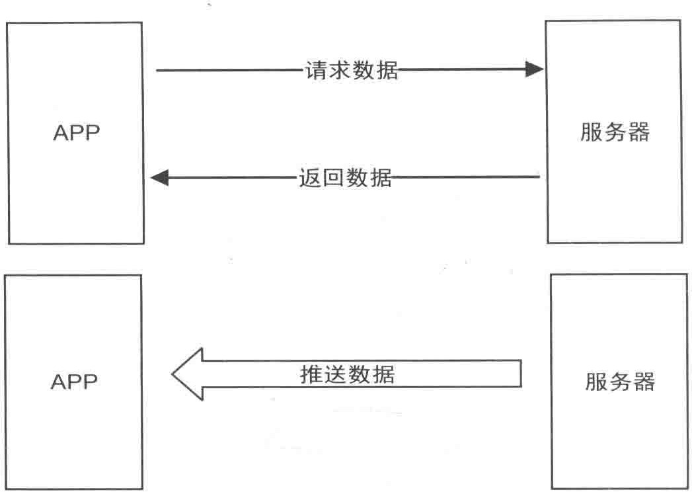
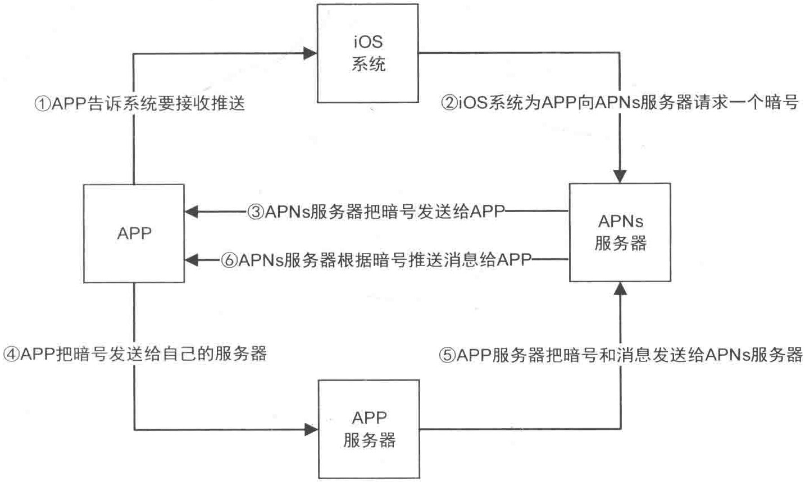

## 客户端推送实现方式

读者对推送这项技术肯定不陌生。读者睡觉前明明关闭了淘宝、网易新闻等 APP，为什么第二天它们又自动出现在手机的通知栏上了呢？这其实就是推送系统做的事：在用户睡觉时，服务器悄悄地向手机推送了一条消息，唤醒了已经关闭的 APP。事实上，无论用户愿意与否，现在大多数 APP 都已经内置了推送系统，并时刻准备着登上手机通知栏的“头条”，如[图2-8](#figure-2-8)所示。

<figure id="figure-2-8" tabindex="-1" markdown="1">

{ width="614" height="711" }

<figcaption markdown="span" style="margin:0.5em auto;font-size:0.8em;font-style:normal;line-height:1.5">
图2-8
</figcaption>

</figure>

传统的 APP 架构里，通常是 APP 主动向服务器请求数据，服务器被动地提供数据。以新闻客户端 APP 为例：APP 被用户打开的时候，会通过网络（无论 4G 还是 Wi-Fi）连接到服务器，向服务器请求最新的新闻。服务器收到请求，从自己的数据库里查询最新的新闻，并将其返回 APP。APP 收到服务器返回的数据，经过一系列的解析处理操作，最终将新闻呈现给用户，一次通信就完成了。如果此时服务器上又有了新的新闻，无论这条新闻多么重要，在用户没有主动刷新的情况下，是没有办法让用户看到的。推送就是为了解决这样的困境，它给了服务器一个展示自我的机会，主动连接所有 APP，要求客户端再发起一次请求，于是收到推送的 APP（即使此时已经被用户关闭）又去服务器请求最新的新闻，这样用户就能看到最新的新闻了，如[图2-9](#figure-2-9)所示。

<figure id="figure-2-9" tabindex="-1" markdown="1">

{ width="1047" height="747" }

<figcaption markdown="span" style="margin:0.5em auto;font-size:0.8em;font-style:normal;line-height:1.5">
图2-9
</figcaption>

</figure>

从技术上来讲，实现一个推送系统需要服务端和客户端的配合。一种方法是轮询，也就是不停地向服务器发起请求。这其实很好理解，APP 既然不知道何时会发生新的新闻，就一遍一遍地问，这是种一定会成功的办法。显而易见，若使用这种方法，APP 端费时费力不说，电量和流量也扛不住，服务器要处理如此大量的请求，必然也非常头疼。另一种方法是建立一条长时间连接服务器和 APP 的通道，通过这条通道，不仅 APP 可以向服务器请求数据，服务器也可以向 APP 发送数据，看起来非常完美，但是如果 APP 被用户关闭，通道就断了。好在 Android 系统给 APP 提供了一个良好的运行环境，APP 可以启动后台服务来维持这条通道，即使 APP 被关闭，服务依然可以运行，通道依然在工作。回到前面的例子，用户在睡觉前关闭了淘宝 APP，但是并没有关闭淘宝的后台服务，淘宝依然可以接收服务器推送指令，将自己唤醒。那么，如何维持这样一条长时间连接的通道呢？就好比两个人打电话，一开始聊得热火朝天、有来有往，后来慢慢沉默下来，几分钟之后，电话另一头没有任何动静，如何知道那边的人还在呢？很简单，只需要另一头的人每隔几分钟说一个字。同样的道理，APP 每隔一段时间会向服务器报告自己“还活着”，就像心跳一样有规律，服务器收到后，就知道这条通道是可以继续使用的了。

天下没有免费的午餐，发送心跳包是有代价的。为了省电，手机锁屏之后，CPU 是处于休眠状态的，然而发送心跳包就会唤醒 CPU，必然会增加电量的消耗。这还只是一条长连接通道的情况，如果手机里装了二三十个带有推送的 APP 呢？聪明的 Android 工程师和 iOS 工程师早就想到了这一点，他们分别设计了 GCM（Google Cloud Messaging）和 APNs（Apple Push Notification service）来解决多个 APP 有多个长连接通道的问题。以 APNs 为例，iOS 开通了一条系统级别的长连接通道，通道的一端是手机的所有 APP，另一端是苹果的服务器。APP 的服务器如果有新的消息要推送，需要先把消息发送到苹果的服务器上，再利用苹果的服务器通过长连接通道发送到用户手机，然后通知具体的 APP。这样就做到了即使手机中安装了 100 个 APP，也只需要向一条通道发送心跳包，如[图2-10](#figure-2-10)所示。

<figure id="figure-2-10" tabindex="-1" markdown="1">

{ width="1433" height="859" }

<figcaption markdown="span" style="margin:0.5em auto;font-size:0.8em;font-style:normal;line-height:1.5">
图2-10
</figcaption>

</figure>

Android 系统提供的 GCM 只能在 Android 2.2 以上版本中使用，Android 3.0 以下版本必须安装 Google Play 并登录谷歌账号才能支持。国内发行的手机大多不支持谷歌服务。因此，对 Android 系统来说，各家 APP 只能各显神通，开发自己的专用长连接通道。这时会遇到 APP 的天敌：应用管理类 APP。前文说了，APP 想要及时收到服务器推送的消息，关键在于自己与服务器的长连接通道不被关闭，也就是自己后台服务可以一直在后台运行，而应用管理类 APP 的一键清理功能专治这种“毒瘤”。

道高一尺，魔高一丈，APP 在与这些“管家”和“卫士”的长期斗争中，总结了一系列躲避被清理的方法，例如定时自启、相互唤醒、前台进程等。当然，这就是另一个话题了。

总结起来，APP 和后台的连接方式有两种，一种叫 pull，也叫轮询，就是定期地不断向后台请求，缺点是耗电，费流量，不环保；另一种叫 push，APP 和后台一直维持了一条通信通道，不定期地发送心跳包，也能携带信息。缺点是要维持一条长连接通道，这条通道如果不用一些特殊手段保持连通性，很容易受系统或其他安全软件的影响而断开。

