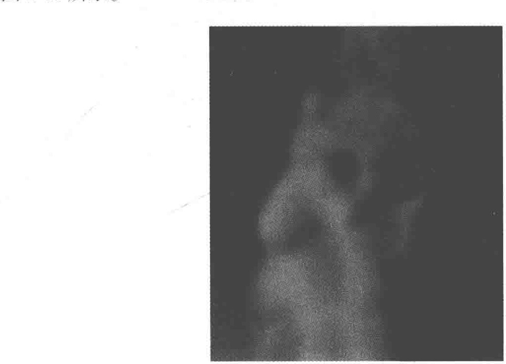

## 为什么美颜 APP 可以美颜

在作者的印象中，美颜是一些图片美化类 APP 提供的功能，有些主打拍照的手机也在系统的相机 APP 里内置了美颜功能。

为什么美颜 APP 可以美颜呢？那些美白、磨皮功能又是依靠什么原理呢？美颜从根本上讲是一种图像处理的手段，使用 Photoshop（PS）软件也能实现同样功能，只不过 APP 把 PS 需要的步骤单独抽取出来，做了精简和优化，让不会使用 PS 的普通用户也能一键看到效果。

用 PS 实现美白、磨皮，一般要用到相应的滤镜。滤镜最早指的是放在相机镜头前面用来过滤光线的镜头，很多专业的摄影师用它调色或者实现一些其他的效果，一般来说不同的滤镜有不同的功能。后来，大家用 PS 处理拍出来的照片，也需要对图片做一些调色之类的加工，于是就产生了软件滤镜，通过一些算法模拟真实的滤镜镜头。这些算法有的是非常成熟的通用算法，比如灰度处理、图片锐化、调整对比度等，也有的是高深的算法和精细的参数调整，例如 Instagram 内置的一些滤镜，它们的加工效果很出色。

下面介绍一个最简单的滤镜——灰度处理是如何实现的。一副彩色图上，每个像素都是由 RGB（红、绿、蓝）3 个颜色通道混合而成的，每个通道都有 256 种颜色可能，这样一个像素就有 256x256x256 种颜色可能。而灰度图片的每个像素最多只能表示 256 种颜色，所以将彩色图片处理成灰度图片最简单的办法是，对于每个像素，取三个通道的平均值。例如，处理前 R=100、G=150、B=200，那么处理后就变成 R=150、G=150、B=150，彩色图片就成了一张灰度图片。

再来介绍一下美颜里的磨皮效果是如何实现的。磨皮就是把照片中人物粗糙的皮肤变成光滑的皮肤，有个很简单暴力的方法就是做模糊处理。想象一下，如果高度近视的人摘掉眼镜去看一个满脸痘痘的人，看到的可能是一张光滑的面孔，因为他看到的图像非常模糊，与原物相比丢失了很多细节。比较常见的模糊算法是高斯模糊，如[图2-11](#figure-2-11)所示。

<figure id="figure-2-11" tabindex="-1" markdown="1">

{ width="1027" height="740" }

<figcaption markdown="span" style="margin:0.5em auto;font-size:0.8em;font-style:normal;line-height:1.5">
图2-11
</figcaption>

</figure>

[图2-11](#figure-2-11)中猫咪的眼睛和鼻子都一起被模糊了，严重失真，所以我们一般选用一种特殊的高斯模糊算法：双边滤波。它的好处是可以保存边缘，比如皮肤和眉毛的交接处，经过双边滤波后眉毛没有变化，只有皮肤做了高斯模糊处理。在实际应用过程中，还会用到肤色检测、人脸识别等技术。

美颜没什么神秘的，其原理就是利用了图像处理中的几个滤镜算法。如今，视频直播也用上了美颜，其原理是实时地对摄像头里采集到的视频画面应用滤镜。需要注意的是，千万不要用 CPU 做滤镜算法的运算，而要用 OpenGL 充分发挥 GPU 的能力，因为 GPU 的设计原理最适合这种工作量大又没有难度的重复计算任务。

