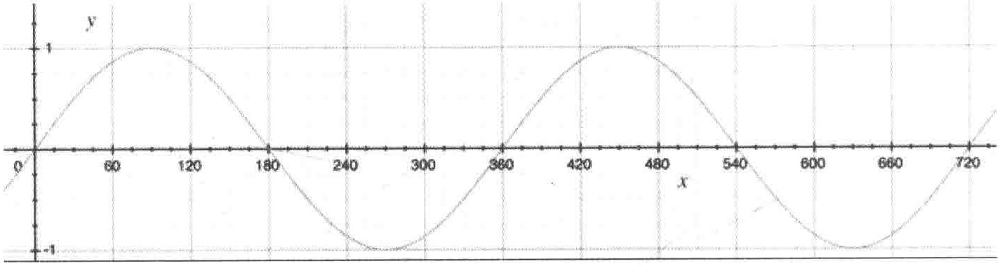
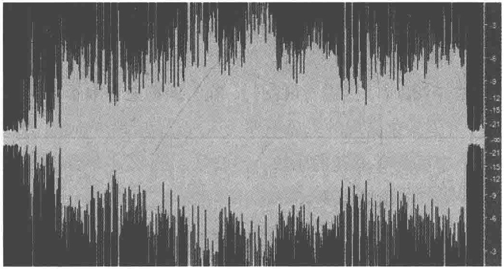
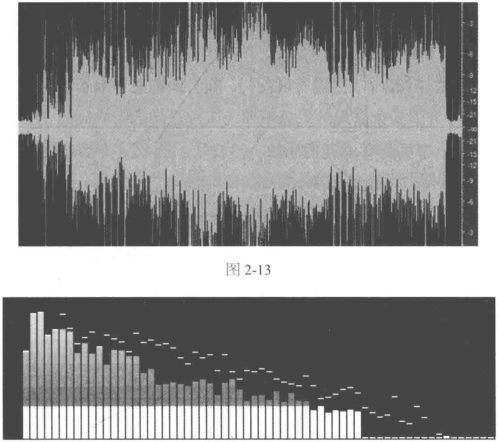
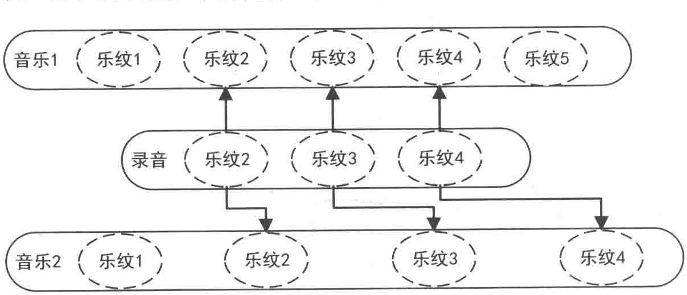

## 听歌识曲的基本原理

听歌识曲和在百度上搜索一个关键词的技术原理并没什么区别，最大的难题在于歌曲本身是二进制数据，无法直接与后台数据库中的数据做对比，所以如何判断两个音频相互匹配是问题的关键。“以图搜图”的功能通过对图片进行缩放、灰度处理，最后提取出一个 64 位的散列值作为特征码，用它去做匹配。同样，要识别一首歌曲，也要先找到它的特征，也就是音乐的“指纹”，简称“乐纹”。

找乐纹的第一步，就是要把一首歌或者一段录音转换成单声道、低采样率的 WAV 格式。这一步和“以图搜图”先要缩放图片类似，目的是排除其他干扰，保留音乐的整体特征。音频是由声卡对声波的采样生成的。我们拿到一个音频文件，很自然地就可以画出它的波形图，如[图2-12](#figure-2-12)所示。

<figure id="figure-2-12" tabindex="-1" markdown="1">

{ width="1425" height="380" }

<figcaption markdown="span" style="margin:0.5em auto;font-size:0.8em;font-style:normal;line-height:1.5">
图2-12
</figcaption>

</figure>

在波形图上，波的起伏表示了音量大小，起伏幅度越大，声音越响亮。这样的波越密越拥挤，表示它的变化越快、频率越高，人听到的声音也越尖锐。所以描述一段音频需要音量和频率两个要素。

以凤凰传奇的《最炫民族风》为例，女声的频率快，音调比较高，男声的音调低。歌曲从前奏到达高潮，音量也会不断提高。但是真正的音频波形图并不是这么简单的，如[图2-13](#figure-2-13)所示。

<figure id="figure-2-13" tabindex="-1" markdown="1">

{ width="1051" height="563" }

<figcaption markdown="span" style="margin:0.5em auto;font-size:0.8em;font-style:normal;line-height:1.5">
图2-13
</figcaption>

</figure>

它更像是很多波形图堆叠而成的。在一段音频里的某个时刻，有人声有伴奏，有男声有女声，这些声音的频率都不同，在波形图上无法分辨出来。所以，采集音频的乐纹时，要把波形图转换成频谱图，如[图2-14](#figure-2-14)所示。

<figure id="figure-2-14" tabindex="-1" markdown="1">

{ width="1126" height="1001" }

<figcaption markdown="span" style="margin:0.5em auto;font-size:0.8em;font-style:normal;line-height:1.5">
图2-14
</figcaption>

</figure>

[图2-14](#figure-2-14)表示某个时刻的频谱。横轴是频率（单位是 Hz），纵轴是音量。假如在音频《最炫民族风》里只有两个频率，即男声的低频和女声的高频，那么[图2-14](#figure-2-14)里就只有两根“柱子”在震动。很明显，频谱图既有音调又有音量，便于我们从中提取乐纹。

乐纹就是最能表现一首歌特征的数据，而且一首歌的乐纹不止一个。一首歌可以分成很多片段，每个片段都有自己的乐纹。规则是从每张频谱图里选取音量最大的几个频率作为特征点，由它们生成这个片段的乐纹。怎么理解呢？在某个小的音频片段里，如果某个频率的音量很大，例如《最炫民族风》里的女声唱的高潮部分，这个点会凸显出来，而且不容易识别错，所以很适合做特征点。现在，假设后台服务器上有几百万首歌曲，每首歌都分成很多片段，也就有很多乐纹。用户上传了一段录音，经过相同的分析，服务器也从录音中提取了若干乐纹，如何通过录音的乐纹，查找最合适的歌曲呢？

用我们熟悉的例子类比一下：现在后台服务器上有几百万个网页，每个网页有很多关键词。用户提交了一句话，服务器从中提取了若干个关键词，如何通过这些关键词找到最合适的网页呢？没错，听歌识曲和搜索引擎的做法一样。不同之处是，假如一段录音匹配到了两首音乐，也就是说，在这两首歌中都有录音的乐纹，如何评价谁更相似呢？方法其实很简单，当进行匹配时，除了保证录音中所有的乐纹都能在音乐中找到，还要综合考虑乐纹出现的先后顺序及乐纹之间的时间间隔。如[图2-15](#figure-2-15)所示，虽然音乐 1 和音乐 2 里都有录音的乐纹，但音乐 1 的乐纹排列和录音的乐纹排列集合几乎一模一样，所以这段录音更有可能出自音乐 1。

<figure id="figure-2-15" tabindex="-1" markdown="1">

{ width="1202" height="517" }

<figcaption markdown="span" style="margin:0.5em auto;font-size:0.8em;font-style:normal;line-height:1.5">
图2-15
</figcaption>

</figure>

总结一下，听歌识曲的实现方式是对数据库里的所有音乐提取乐纹。对每一首音乐，先算出它的频谱图，然后把它分成几个片段，每一段都在频谱图上找几个点作为特征点，从而生成这一片段的乐纹。一首歌通常有很多乐纹，都以倒排索引的形式存储在数据库里。对于上传的录音，也是先提取它的乐纹，然后在数据库里进行检索，最后考虑乐纹的排列、时间间隔等因素，找到最相似的音乐。

