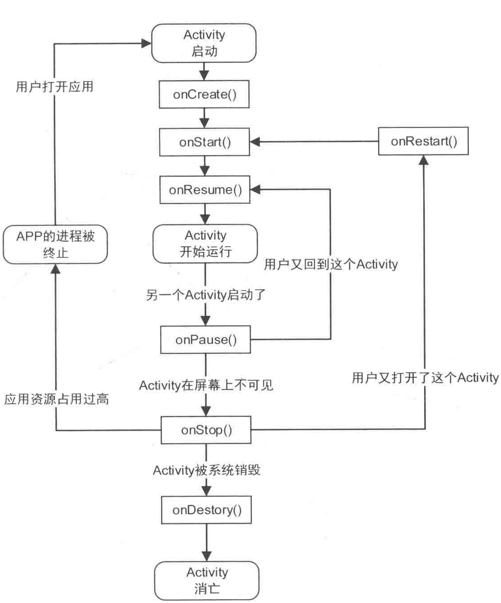

## 应用的生命周期

本节要介绍的应用生命周期不是指项目层面上，一个应用从研发到上线的生命周期，而是指应用自身运行的生命周期。虽然它们的概念不一样，但是都包含从产生到消亡的过程，二者在这点上是一致的。

应用的生命周期是对应用在宿主的环境中从创建、运行到消亡的一种过程描述。对用户来说，直观的感受是应用的启动、前台运行和退出。从技术上讲，一个应用在实际运行过程中会有很多生命周期的状态描述，[图2-16](#figure-2-16)所示为一个 Android 应用的例子。

<figure id="figure-2-16" tabindex="-1" markdown="1">

{ width="1120" height="1347" }

<figcaption markdown="span" style="margin:0.5em auto;font-size:0.8em;font-style:normal;line-height:1.5">
图2-16
</figcaption>

</figure>

可以将[图2-16](#figure-2-16)中的 Activity 简单地理解为呈现给用户的应用界面。我们可以看到这里有 8 种状态在按照一定的顺序进行切换，上半部分属于创建，下半部分属于消亡，但是整个过程并不是完全不走回头路，消亡路径上的一些状态，也可以在一些条件下转换成创建路径上的状态。应用的生命周期不是由应用开发者控制的，开发者只可以发出一些指令给宿主系统，比如启动或退出一个 Activity。宿主系统接到指令后就开始操控 Activity 或创建或销毁，并将整个过程中的关键节点通知应用开发者。

这里的每个节点都有自己的意义。onCreate() 表示应用开始创建了，但这时应用界面并没有展现给用户，开发者可以在这里创建需要展现的数据，以及构建视图。

其实，系统处理应用绘制的速度是比较快的，但是用户会发现点击一些应用后响应速度慢，过了好一会才弹出界面，问题就出在很多应用在开发时将大量耗时操作写在了这个生命周期中，卡住了后续界面绘制的相关操作。例如，一个软件中有大量的数据存储在数据库中，开发者希望应用一启动就能将数据以列表的形式展现给用户，因此在 onCreate() 中读取了大量的数据，并构建了一个很长的列表，在这一切准备好之前，用户看到的现象就是点击应用图标后，经过很长时间才“打开”应用，这种体验自然不好，但是没有准备好数据和视图就将界面展示给用户，用户不就看到空白的界面了吗？是的，在设计程序时通常会采用一些方法进行规避，在卡顿和空白页之间寻找一个平衡点，例如只读取少量的数据，构建少量的视图，尽快将界面展现给用户，再加载更多的数据和视图。还有一种简单粗暴的办法就是前文介绍过的闪屏，在 onCreate() 这个生命周期内，首先将闪屏创建好，尽快让程序进入绘制流程，等用户看到闪屏再慢慢加载数据视图，这样至少不会让用户无聊地等待。

onStart()、onResume() 依次在 onCreate() 后被调用，但是应用还未进入运行状态，为什么还要拆出这细分的中间状态呢？这就需要结合 onPause() 和 onStop() 一起介绍。从[图2-16](#figure-2-16)中可以看到，onCreate() 是不可重入（在一个完整生命周期中反复调用）的，而 onStart()、onResume()、onPause()、onStop() 是可以重入的。当界面已经呈现给用户，但是有个弹框挡住了部分应用界面时，应用就会从 onResume() 进入 onPause() 状态，弹窗消失后，应用又会从 onPause() 状态进入 onResume() 状态。如果不是弹窗，而是其他应用启动完全挡住了当前的应用界面，那么当前应用就进入了 onStop() 状态。当遮挡的应用消失后，被遮挡的应用又会回到 onStart 状态（中间还有一个 onRestart() 状态，和 onStart() 状态的区别在于它不会在这个生命周期开始过程中被调用）。在很多优化中，当应用不可见时，开发者会主动释放应用的部分资源，减少系统消耗，让出更多资源给其他应用。

onDestroy() 是 onCreate() 的对立面，一旦应用到了 onDestroy() 的阶段，就没法像 onPause()、onStop() 那样走回头路了。通常，当用户退出应用程序时，应用程序会进入 onDestroy() 状态。而退出应用时也很容易出现像 onCreate() 一样的问题，例如，我们经常看到在退出时应用先卡一下，才关闭。类比之前对 onCreate() 的分析，这里原因也很容易理解：用户点击了退出按钮，应用开发者向系统发出了关闭 Activity 指令，同时做了许多销毁资源的耗时操作，而这时应用界面仍然是可见的。销毁资源的操作阻止了后续的界面销毁流程，所以用户会感受到卡顿。解决办法也很简单，先将界面销毁，将屏幕尽快地交还给用户，再去做耗时操作，这样界面没有挡住用户做其他事儿，用户就感觉不到卡顿了。

产品经理了解了应用的生命周期后，再去使用应用时，就可以判断出程序设计的优劣，偶尔还能提一些建设性的意见。

