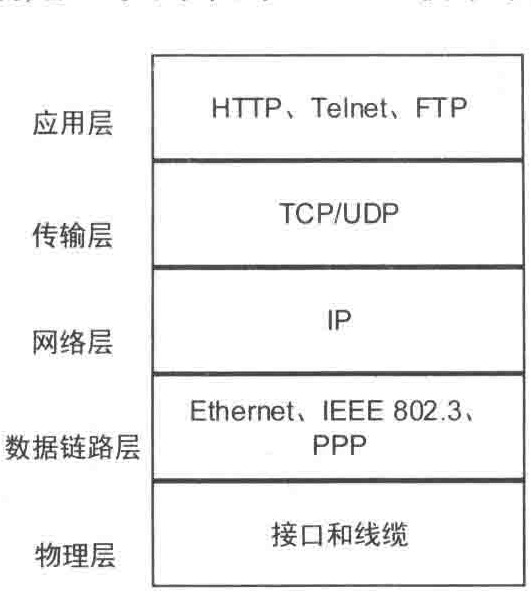
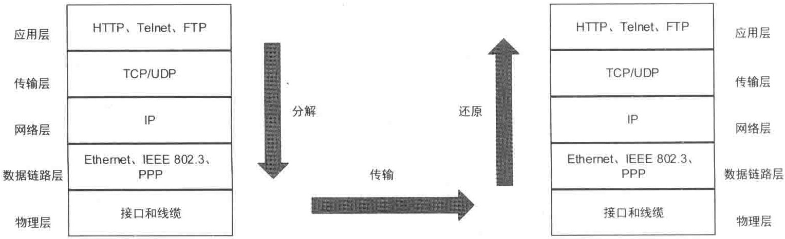

## 网络基础之协议栈

看过《星际迷航》的读者一定对剧情中瞬间传送的情节有深刻印象：柯克船长和史波克从企业号的甲板上逐渐消失，他们再次出现时，已经是在遥不可及的未知行星表面。

这种酷炫的瞬间传送功能采用的是量子传输技术，这种技术是利用量子纠缠现象实现的。当然，现实世界中的量子传输技术还远远没有发展到这个层次。如果要实现电影中的场景，理论上需要经过以下三步：

（1）将人体在传送端分解成量子。

（2）通过量子通道将量子传送到接收端。

（3）将接收到的量子还原。

在计算机网络中，数据传输的流程也大致如此。原始数据首先被拆解并编码，然后转化为电平或者光信号，最终在物理介质上传输。原始信息“分解”和“还原”都是在计算机网络协议栈中进行的。

[图4-1](#figure-4-1)中的协议栈模型就是互联网中的 TCP/IP 协议栈。它包含了以下 5 个层次。

<figure id="figure-4-1" tabindex="-1" markdown="1">

{ width="531" height="592" }

<figcaption markdown="span" style="margin:0.5em auto;font-size:0.8em;font-style:normal;line-height:1.5">
图4-1
</figcaption>

</figure>

- 应用层：为应用程序提供数据传输的网络接口，常见的 HTTP、Telnet、FTP 等协议都工作在这一层；
- 传输层：传输层提供端到端的连接，例如让 A 主机上的程序 a 找到 B 主机上的程序 b。TCP 和 UDP 都工作在这一层，端口号的概念也定义在这一层；
- 网络层：用于寻址，它能让两台主机在互联网的茫茫“机海”中找到彼此；
- 数据链路层：网卡就工作在这一层，负责将数字信号转化成可供物理层传输的电信号或者光信号；
- 物理层：物理层是信号传输的物理通道，网线和配套的接口都属于物理层。

协议栈中的每一层都起着承上启下的作用。

应用程序产生的数据，经过这 5 层协议栈模型自上而下逐层分解，最终变成可供物理介质传输的信号，当到达目的主机后，再自下而上还原成应用程序数据，如[图4-2](#figure-4-2)所示。

说到这里，肯定有读者感到疑惑：“为什么要划分出 5 层？直接用一层把应用层数据转化成物理信号，不也能实现数据传输吗？”

其实，网络协议栈分层后，使得一些有特殊功能的网络设备可以只实现协议栈的子集，即只完成对应的功能。例如，路由器只需要实现网络层、数据链路层和物理层即可实现路由功能，如果它想额外添加针对某个端口的屏蔽功能，就需要实现传输层的功能。

<figure id="figure-4-2" tabindex="-1" markdown="1">

{ width="1528" height="467" }

<figcaption markdown="span" style="margin:0.5em auto;font-size:0.8em;font-style:normal;line-height:1.5">
图4-2
</figcaption>

</figure>

分层的另一个好处是使得每一层都可以被独立设计，只要保证与上下两层的“接口”（数据传输方式）保持一致即可。假设应用层新出现了一种 HTTPX，在不改变下面 4 层功能的前提下，该协议依然可以在网络上正常传输。

