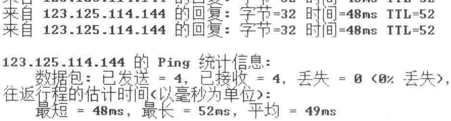
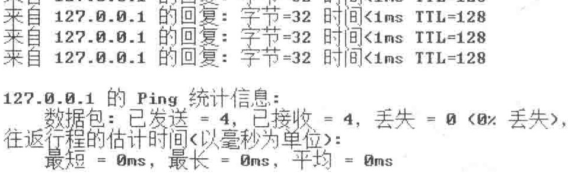
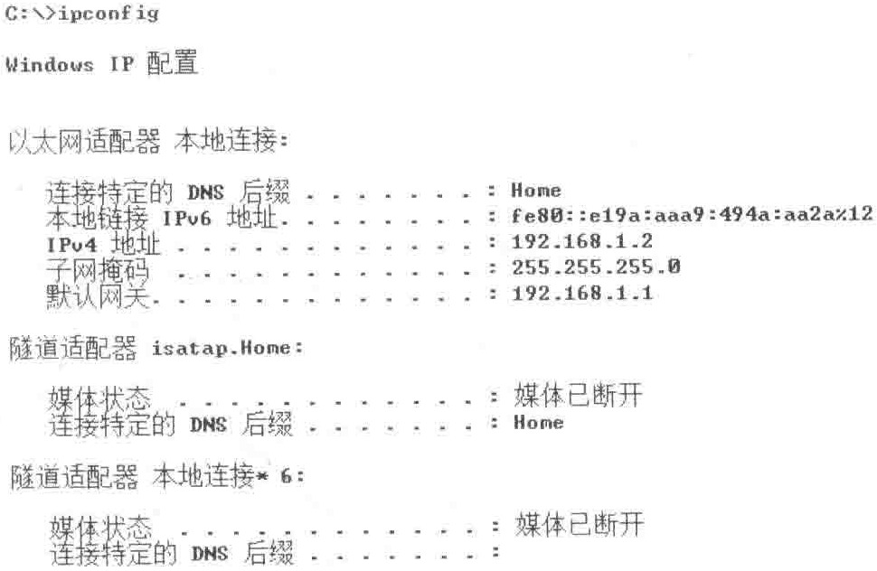

## PING 和网关

随着互联网的普及，网络设备接入互联网越来越简单。在用电话拨号上网的时代，作者还要经常检查 PC 的网络是否连通。

网络连通是一个极其朴素的需求，在任何一个网络应用或系统中，它都是网络功能正常使用的前提与条件。在 Windows、Linux、UNIX 这些系统中早已有了网络诊断工具：PING（Packet Internet Groper），意为互联网包探测器。

PING 是 TCP/IP 协议簇中的一部分，它的原理是向目标 IP 地址发送一个数据包，如果对方返回一个同样大小的数据包，则证明连通，并且整个过程能够测试时延。

我们一起做个试验。首先，在命令行模式下输入 ping baidu.com，如[图4-3](#figure-4-3)所示。

<figure id="figure-4-3" tabindex="-1" markdown="1">

{ width="930" height="251" }

<figcaption markdown="span" style="margin:0.5em auto;font-size:0.8em;font-style:normal;line-height:1.5">
图4-3
</figcaption>

</figure>

其中“字节=32”表示发送出去的数据包是 32 个字节，时间表示发包到收到数据包的耗时（48ms 到 52ms 不等），TTL 表示这个包可以“存活”的时长。

从[图4-3](#figure-4-3)中可以看到作者家中的网络连接到 baidu.com 的平均时延是 49ms，丢包率为 0，网速较好。

网络管理员通常利用这个命令来诊断网络，检查本机的 TCP/IP 设置是否正确，所以经常要 Ping 127.0.0.1 这个回环地址，如[图4-4](#figure-4-4)所示。

<figure id="figure-4-4" tabindex="-1" markdown="1">

{ width="958" height="292" }

<figcaption markdown="span" style="margin:0.5em auto;font-size:0.8em;font-style:normal;line-height:1.5">
图4-4
</figcaption>

</figure>

这个被称为“回环地址”的 IP 地址有时也被叫作“本机地址”。用户访问的网站所在的服务器一般在各大数据中心或云服务厂商处，可能与用户的终端相隔千万里，而这个 IP 地址就是用户的终端本身，所以 PING 自己机器的时延都小于 1ms，与连通其他网站相比更快。程序员经常用这个命令查看网络耗时，做连通性检查。这与现实生活中，大家在微信 APP 里发红包，利用群聊中好友们抢红包的速度测试大家是否在线是异曲同工的。

当我们使用 PING 发现网络异常时，首先要查看网络配置是否正确。

如何查看自己本地的网络配置呢？先在命令行中输入命令：ipconfig（如[图4-5](#figure-4-5)所示）。

<figure id="figure-4-5" tabindex="-1" markdown="1">

{ width="970" height="632" }

<figcaption markdown="span" style="margin:0.5em auto;font-size:0.8em;font-style:normal;line-height:1.5">
图4-5
</figcaption>

</figure>

我们主要介绍以太网适配器，也就是常说的“网卡”。这里会涉及一个不太常见的概念——网关。我们可以把它理解成网络的关卡，是两个网络之间的“门”。

古诗云：“劝君更尽一杯酒，西出阳关无故人。”阳关是古时候的国门，类似现在的海关。在逻辑上，网关的概念与其类似，是两个网络之间的桥梁；在物理上，网关是一个网络设备，拥有 IP 地址，也就是[图4-5](#figure-4-5)所示 192.168.1.1。在家庭局域网内，这个地址通常就是路由器的 IP 地址。

读者应该已经理解网关的概念了，但网关除了连通两个不同的网络，还有没有其他的功能呢？我们利用下面这个场景一起联想：

小明很喜欢小红，经常打电话找小红出去玩儿，可是小红的爸爸害怕女儿早恋，家里的一切电话都要先由他接听，再转给小红。小红爸爸就相当于网关，起到转接的作用；如果来电者是小明，小红爸爸有时还会把来电过滤掉，所以网关还具备过滤的作用。

