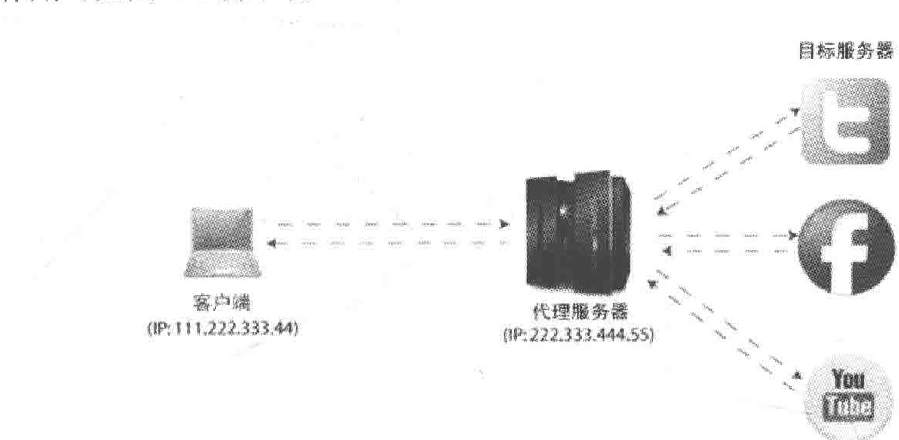
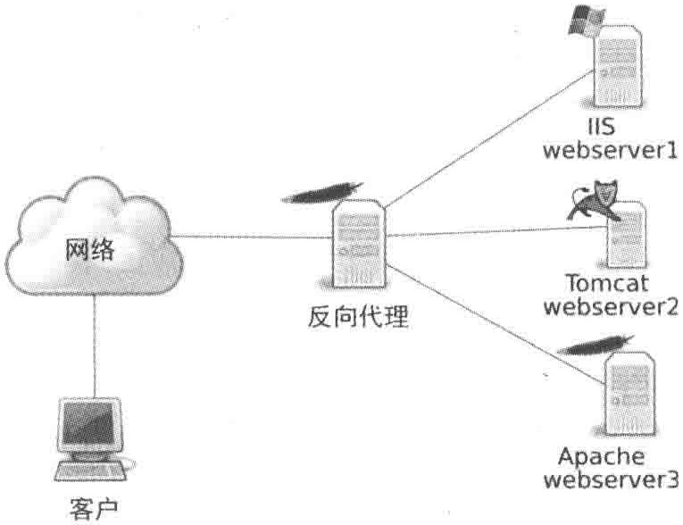

## 什么是反向代理

我们通常说的“代理”，都是指客户端向外界发起请求时，并不直接与目标服务器连接，而是将所有请求交给一个代理服务器，由它负责连接外界目标服务器。同时，从服务器返回的数据，也经过代理服务器返回客户端。在外界看来，所有请求都来自这台代理服务器，这样，它就成功地将客户端隐藏在自己背后，起到了保护客户端的作用（如[图4-6](#figure-4-6)所示）。

<figure id="figure-4-6" tabindex="-1" markdown="1">

{ width="1171" height="573" }

<figcaption markdown="span" style="margin:0.5em auto;font-size:0.8em;font-style:normal;line-height:1.5">
图4-6
</figcaption>

</figure>

而反向代理却恰恰相反，它是针对服务器的一种代理技术。反向代理服务器可以接受客户端的请求，然后将它分发到被代理的服务器上，待这些服务器处理完请求后，再将结果转发给客户端。它是将服务器隐藏在自己背后的。从客户端的角度看，它面对的只有一台服务器，但是背后可能有 1000 台服务器在提供服务（如[图4-7](#figure-4-7)所示）。

<figure id="figure-4-7" tabindex="-1" markdown="1">

{ width="765" height="588" }

<figcaption markdown="span" style="margin:0.5em auto;font-size:0.8em;font-style:normal;line-height:1.5">
图4-7
</figcaption>

</figure>

反向代理有什么意义呢？

首先，它可以实现负载均衡。有多台服务器可以为同一个 Web 服务提供服务，但是每台服务器的负荷不太一样，如果请求被发送到负荷较高的服务器，它处理时间可能较长，但是客户端并不知道哪一台服务器比较空闲，所以将请求发送到反向代理服务器。反向代理服务器知道每台服务器的负载量，会将请求转发到相对空闲的服务器，以便更快地响应客户端。

反向服务器还可以减轻后端服务器的一些压力，例如很多静态资源或者缓存数据，可以直接放在反向代理服务器上，不用将这些请求传递到后端服务器，这样就减轻了相同的请求对后端服务器产生的压力。

另外，它还可以对请求做进一步的封装和解封。如果我们想把所有请求升级到 SSL 加密连接，却不想改造后端服务器，那么可以只在客户端-反向代理服务器之间使用 SSL 加密连接，而代理服务器-后端服务器之间仍旧使用普通的 HTTP 连接，这样就事半功倍了。

同时，反向代理服务器还可以为后端服务器阻挡一些网络攻击，提升后台服务器的安全性。总之，反向代理服务器对于后端服务器，就是一个接口人的角色，它接洽了所有客户端的请求，并进行简单的处理，然后分发到后端服务器。

