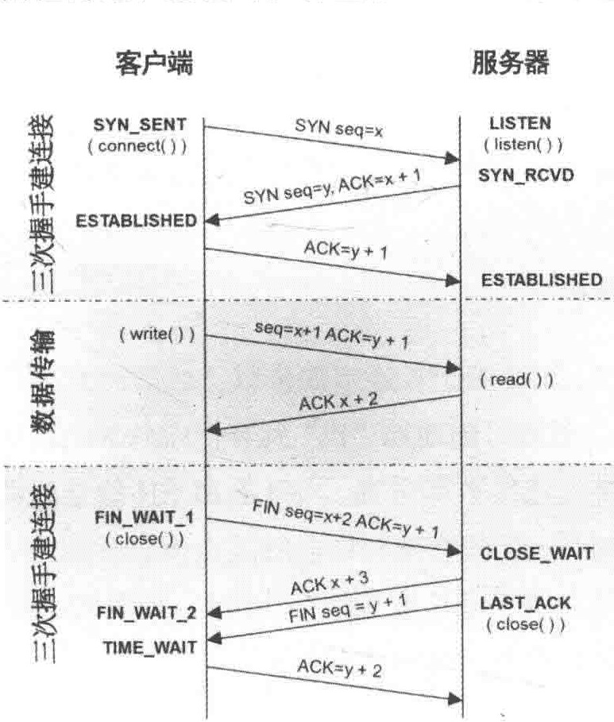

## 推送服务的核心：长连接

推送服务已经是各大 APP 的“标配”功能，长连接是推送服务的技术核心，推送服务的所有功能都是基于长连接实现的。

一般情况下，我们在讨论长连接时，都基于 TCP/IP（如[图4-9](#figure-4-9)所示）。

<figure id="figure-4-9" tabindex="-1" markdown="1">

{ width="773" height="909" }

<figcaption markdown="span" style="margin:0.5em auto;font-size:0.8em;font-style:normal;line-height:1.5">
图4-9
</figcaption>

</figure>

客户端用 TCP/IP 从服务器上获取数据时，需要一个连通客户端和服务器的连接，连接通过“三次握手”建立，通过“四次握手”释放。如果每次获取数据都创建一个独占的连接，并在数据传输完毕后释放，这种连接就叫作“短连接”。而一个能够供多个请求多次传输数据，并在数据传输后不会立即释放的连接称为“长连接”。有两种场景会使用长连接：

**1. 短时间内，向同一个服务发起多次数据请求**

小明在餐馆里点餐时，服务生会站在旁边，等小明点完所有的菜后才离开。试想下，如果某一次小明遇到了一个不耐烦的服务生，小明在选每一道菜前，他都会自己走到大堂里玩手机，小明选好一道菜后，需要再把他叫回来，如此反复直到点完。这么一来，肯定会加长点餐的时间，影响用餐心情。

这个场景很像用浏览器加载网页。一个网页通常由多个元素组成，每个元素都需要一个 HTTP 连接去拉取。如果每个元素下载完毕后都把 HTTP 对应的 TCP 连接关闭，那么下载下一个元素时又需要重新建立和断开 TCP 连接，而连接的建立和断开都需要耗费大量资源，有时建立连接的开销甚至比数据传输本身还大。

但是如果浏览器和网站的服务器支持 HTTP 的 Keep-Alive，这个窘境就会得到大大的改善：TCP 连接会在第一个 HTTP 连接创建时建立，并在最后一个 HTTP 连接关闭后的一段时间内结束，所有元素的传输过程都在这个 TCP 连接上完成。这样不仅优化了网页的加载速度，也降低了服务器的压力，服务器不必再为客户端的多次请求向系统频繁申请、释放资源。

**2. 实现 PUSH 功能**

PUSH 功能的实现，正是基于长连接的全双工通信能力。当客户端与服务器建立“长连接”后，服务器就能随时随地地“找”到客户端并 PUSH 数据。衡量一个 PUSH 服务器的关键指标是并发连接数和带宽。当每条 PUSH 信息数据量一定时，服务器的并发连接数和带宽越高，越能在短时间内触达全体目标用户。PUSH 系统客户端则需要利用最低频率的心跳保证长连接的存活时长。频繁的心跳和重连都会增大服务负担而导致断链，影响消息送达的实时性。

