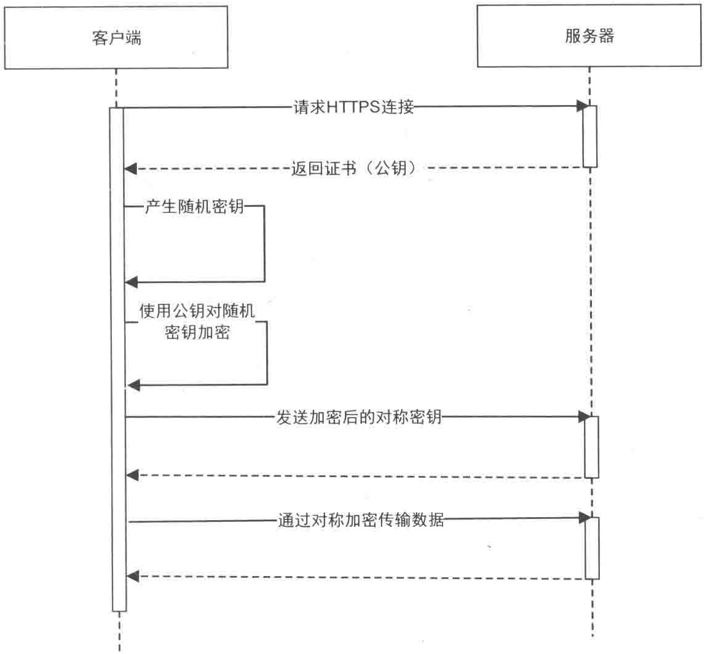

## HTTPS 技术简介

HTTPS（Hyper Text Transfer Protocol Secure，超文本传输安全协议），比 HTTP 多了个“安全”。HTTPS 是如何实现“安全”的呢？

我们先来看看 HTTP 是怎么传输数据的：HTTP 将应用程序提供的数据封装后，明文交给位于运输层的 TCP，而后发送到网络上。由于是明文传输，发送的信息可以在传输过程中被任意篡改，甚至被完全替换，安全性低，这就是 HTTP 的主要缺点。

为了解决这个问题，HTTPS 在 HTTP 和 TCP 之间添加了一层 SSL 协议。SSL 是用来保障网络上数据传输安全的一套协议，它在传输层对 HTTP 进行封装加密，然后将数据交由 TCP 发送到网络上。

使用 HTTPS 的服务器，需要在受信任公司申请一套数字证书，也就是密码学中的“公钥”和“私钥”，用于进行非对称加密。公钥加密的数据需要用私钥解密，私钥加密的数据需要用公钥解密。

准备好数字证书后，我们就可以使用 HTTPS 进行数据传输了。

HTTPS 建立连接的流程如[图4-10](#figure-4-10)所示。

<figure id="figure-4-10" tabindex="-1" markdown="1">

{ width="1147" height="1065" }

<figcaption markdown="span" style="margin:0.5em auto;font-size:0.8em;font-style:normal;line-height:1.5">
图4-10
</figcaption>

</figure>

（1）客户端发起 HTTPS 请求。

（2）服务器将公钥发送给客户端，客户端可以根据公钥验证服务器身份。

（3）客户端生成一个加密密钥，公钥加密后，将密钥传输给服务器，服务器用私钥解密报文，获得客户端密钥。

（4）服务器和客户端数据传输都通过客户端密钥进行加解密。

让下面这个小故事帮助我们加深对上述过程的理解：抗日战争时期，我方两个指挥部之间需要通过电报通信的方式安排作战计划，但是两方用的都是非加密电码本（明文传输），通信内容很容易被敌方破解。正巧，指挥部 A（服务器）有一个便携保险箱（公钥）和一把钥匙（私钥），于是便派通信员小张单独将保险箱秘密送达了指挥部 B（客户端），保险箱的钥匙还是被保存在指挥部 A。指挥部 B 收到箱子后，一看上面印着的五角星，便知其来由，于是将加密后的电码本（客户端加密密钥）放在了箱子里，将箱子锁好，由小张带回了指挥部 A。指挥部 A 收回箱子后，用钥匙将保险箱打开，这样，两个指挥部便都有了加密后的电码本（客户端加密密钥），后续的作战计划电报报文都用新的密码本编码，保证了信息安全传递！

综上所述，HTTPS 可以保证信息在网络中传输的可靠性，主要用于对传输安全敏感的场景，如网上银行、支付宝、财付通等。另外，HTTPS 也可以有效地防止页面被网络中的第三方（比如运营商）篡改，如果你的网站经常被运营商改得乱七八糟，可以让开发人员尝试使用 HTTPS。

