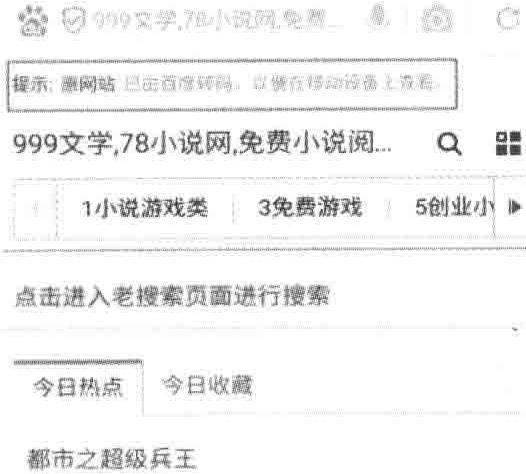
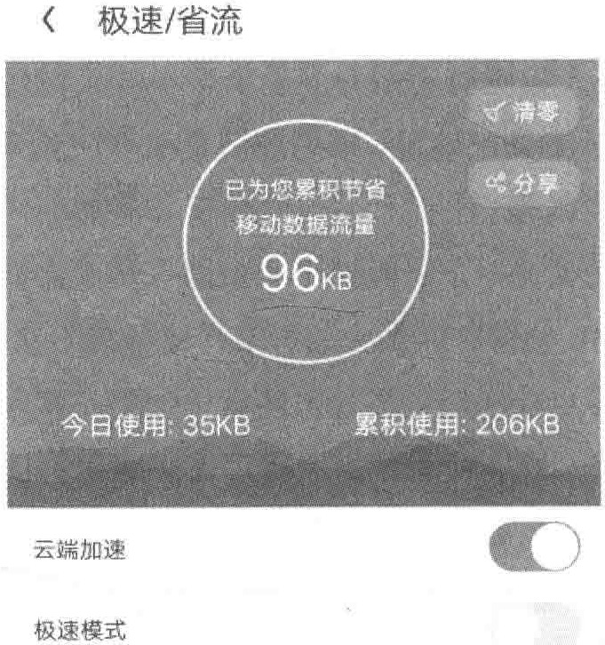

## 讲讲代理服务器

代理就是“代为处理”。代理都有个共同特点，那就是代理和本人干的事情完全一样。我们看到别人名片上写着“阿迪达斯北京总代理”，就会知道他是替阿迪达斯公司卖鞋的。

所谓代理服务器，是指在我们上网的过程中访问某个服务器时，并不是访问真正的服务器，而是先找了一个“代理”，由它向真正的服务器发出请求。请读者们想象一下这个场景：当小明兴致勃勃地出门准备去马大姐烧烤店吃烤串的时候（请求准备发往服务器），忽然发现楼下开了一家张大姐烤串代理店（代理服务器），这家代理店和马大姐烧烤店挂着一样的牌子，但是店里既没有食材，也没有烤串师傅。无论小明点什么菜（请求什么样的数据），张大姐烧烤店都会去马大姐烧烤店里现买来给小明上菜。所以对小明而言，两家烧烤店并没有区别。到这里，读者应该明白了：代理服务器架在客户端和真正服务器中间，作用是替客户端访问真正的服务器。

可能有读者要问：两点之间线段最短，为什么不直接去真正的服务器拿数据，而是要到代理服务器绕个路呢？这里可能有几种情况：一是真正的服务器藏于千里之外，用户连接不上。就好像马大姐烧烤店因为卫生审查不过关，被城管赶到城乡接合部了。小明找不到马大姐烧烤店的真正地址，以后就只能去张大姐那里吃烤串了。二是用户访问真正的服务器的速度太慢，比不上访问代理服务器加上代理服务器访问真正服务器的速度。用上文的例子类比一下：假如小明走路去马大姐烧烤店要一个小时，去楼下张大姐烧烤店只需要 10 分钟；而张大姐开着“火三轮”去马大姐那里，只需要 20 分钟就到了，加起来只需半个小时。张大姐还有可能把一些菜储备起来，就没有必要每次都去马大姐那里取了。还有一种情况：通过代理服务器访问真正服务器可以隐藏访问者的身份，保护访问者。就好比小明多次在马大姐店里吃饭不给钱，上了马大姐的“黑名单”，这时就可以委托马大姐信任的张大姐去点菜。

光说理论太枯燥，一起来看几个例子。

如[图4-11](#figure-4-11)所示，我们通过百度搜索点开一个网站，上面提示“原网站已由百度转码，以便在移动设备上查看”。也就是说，这时用户访问的并不是这个网站真正的服务器，而是百度提供的代理服务器。这个代理服务器把真正服务器的内容返回给用户时，把原网页的内容改成了现在的样子，还插入了自己的广告。

<figure id="figure-4-11" tabindex="-1" markdown="1">

{ width="526" height="474" }

<figcaption markdown="span" style="margin:0.5em auto;font-size:0.8em;font-style:normal;line-height:1.5">
图4-11
</figcaption>

</figure>

很多手机浏览器的省流加速功能，其实就是通过代理服务器达到节省流量目的（如[图4-12](#figure-4-12)所示）。假如用户要访问的原网页 A 需要 800KB 的流量，开启了省流加速功能后，浏览器会帮用户自动连接上 A 的代理服务器 B，B 从 A 处拿到数据后进行压缩操作，我们再访问代理服务器 B 时，可能只花费 100KB 流量就能浏览网页 A 的内容了。

<figure id="figure-4-12" tabindex="-1" markdown="1">

{ width="681" height="726" }

<figcaption markdown="span" style="margin:0.5em auto;font-size:0.8em;font-style:normal;line-height:1.5">
图4-12
</figcaption>

</figure>

