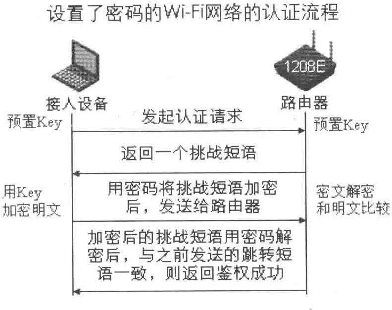

## 聊聊 Wi-Fi 技术

我们生活在一个无线网络高度普及的年代，在各位读者身边充斥着各种无线信号，本章介绍这些无线信号中的一种：Wi-Fi，

Wi-Fi 的中文名称是“无线保真度”，是 Wi-Fi 联盟持有的一个品牌，这个联盟专门解决各个符合 IEEE 802.11 标准产品间的联通性问题，Wi-Fi 对应的技术就是 IEEE 802.11 标准。其中 802.11ac 标准就是我们日常说的“5G 网络”，它的理论传输速度可以达到 6.93Gbit/s，目前市面上的 5G 路由器标称的传输速度在 1Gbit/s 左右。5G 网络的频带较高，所以它的“穿墙”能力略差。

用一张无线网卡和一个无线网络接入点（Wireless Access Point）就可以组成一个 Wi-Fi 系统。家用的无线路由器，就是有无线网络接入点功能的路由器。

在 Wi-Fi 网络中，无线网卡与无线网络接入点建立数据连接之前，要经历两步：SCAN（扫描）和 Authentication（认证）。

拿家用路由器举例，当用户在路由器的设置界面配置了“启用 SSID 广播”后，需要接入 Wi-Fi 网络的设备（如手机等）才能识别到路由器创建的无线网络。识别的手段有两种：主动扫描与被动扫描。

- 主动扫描：接入设备向自己支持的所有 Wi-Fi 信道上发送广播，询问对应的信道上是否有无线接入点。无线路由器接收到接入设备的广播后，就会对接入设备做出回应，并告知对方自己的 SSID、支持的认证方式、加密算法等基本信息。
- 被动扫描：无线路由器定期向自己所在的信道上发送广播，广播的内容与主动扫描中的响应大致相同。一旦接入设备收到广播，就能识别出无线路由器建立的 Wi-Fi 网络。

接入设备确定要接入路由器的 Wi-Fi 网络后，就进入了 IEEE 802.11 标准的认证流程。即便 Wi-Fi 网络没有设置密码，也会执行认证流程，即“开放系统认证”。整个认证过程大概是这样：接入设备说“你好”，无线路由器说“请进”。

设置了密码的 Wi-Fi 网络认证流程会稍微烦琐，如[图4-13](#figure-4-13)所示。

<figure id="figure-4-13" tabindex="-1" markdown="1">

{ width="792" height="626" }

<figcaption markdown="span" style="margin:0.5em auto;font-size:0.8em;font-style:normal;line-height:1.5">
图4-13
</figcaption>

</figure>

成功认证后，接入设备就可以在 Wi-Fi 的海洋里无限畅游。

