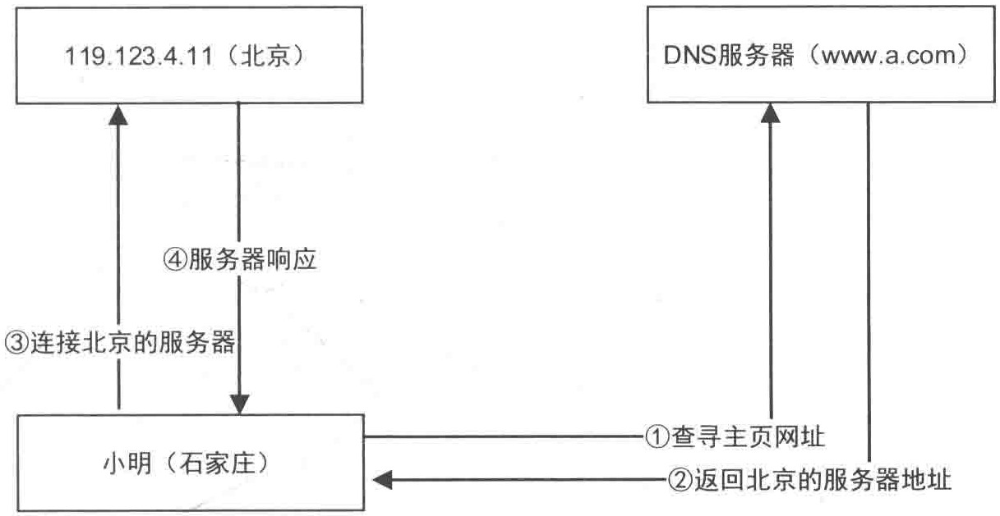

## 就近接入：怎样让用户找到最近的机房

读者平时在使用浏览器访问网站的时候，一定遇到过打开网站特别慢、网站经常打不开等情况。造成这些情况的原因之一，是触发了跨运营商访问。

跨运营商虽然能够相互通信，但速度和效率比较差。如果一个用户在联通网络下，最终访问的网页位于电信线路，那么这种跨运营商的使用体验有可能非常差，会导致网络延时增加、丢包率上升（丢包会导致网页打不开或者数据不完整）等不良结果。

所以，如何把不同运营商网络下的用户调度到其所在的运营商线路的机房，并使该机房离这个用户最近，就是最近接入问题。例如，若小明家里是 100MB 电信光纤，那么调度到离小明家最近的那个 IDC 机房，网速是最快的。

当小明访问 www.a.com 的时候，浏览器会首先发起 DNS 请求，主要作用就是将 www.a.com 转化为一个 TCP/IP 协议栈认识 IP 地址。计算机根本不认识域名，只认 IP 地址，就像小明并不知道“家里住 500 平方米大房子的总穿皮夹克的三叔二儿子”是谁，只认识 1 号院 5 楼 3 门的那个小胖子。有了 IP 地址，计算机才能发起连接。

每个 IP 段会被分配到不同的省、市、区，很多公司或者开源库都将它们打上标签，并将这些信息存到数据库，使 IP 地址具备了地理位置信息。随着这个库不断地更新和维护，这个 IP 表会变得相当强大。还记得很多年前，QQ 主界面显示的“我在哪里”那个功能吗？

就近接入就发生在 DNS 请求这一步，在这一步，DNS 服务器告知用户真正要去哪个 IP 访问该页面，这时到网站的请求还没有发起。由于 IP 是有位置的，DNS 服务器就把那个离用户最近的、同一个运营商线路的 IP 返回给用户，使用户跟最近服务器发生了连接，路近耗时就短。

如[图4-14](#figure-4-14)所示，小明经过 www.a.com 网站自建 DNS 服务，得到了离石家庄最近的北京机房的 IP，顺利地访问了 www.a.com 的主页。

中国地广人密，不管是大公司自建 IDC 机房，还是租用运营商机房，或是使用一些公司提供云服务，一个网站或程序是不可能单点部署的。如果只部署在北京，那对珠三角用户的服务质量肯定不达标。所以，为了提供高质量互联网服务，公司会针对不同的地区部署网站或程序，比如华北、华南、西南、华东几个大区都会部署很多服务器，令服务质量、用户体验都得到较大提升，也令这些程序有更好的腾挪空间。假设某地机房故障，那完全可以利用 DNS 配置，将一个地区的请求转移到另一地区的机房，实现流量的转移。

<figure id="figure-4-14" tabindex="-1" markdown="1">

{ width="1217" height="629" }

<figcaption markdown="span" style="margin:0.5em auto;font-size:0.8em;font-style:normal;line-height:1.5">
图4-14
</figcaption>

</figure>

就近接入，就是利用 DNS 服务找到离用户最近的机器，从而达到经由最短路径提供服务目的。DNS 服务还可以找到某公司的所有机房和 IP，从而进行流量调度。

