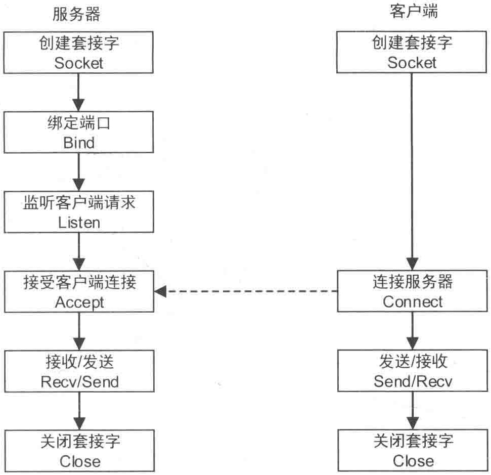

## Socket 简介

学生时代，作者学的是计算机科学与技术，英文名叫“CS”。这个专业说是叫“科学与技术”，实际上我的同级生们都去搞技术了，没有几个人专心搞科研。其实对计算机来说，科学和技术之间的界限并不是很清楚。哪位计算机科学家不会写两句代码？而高级程序员也能形成自己的理论，供后人膜拜。至于初级程序员，就只能在自己这一亩三分地天天和隔壁的产品经理“勾心斗角”了。

CS 专业有一门“计算机网络”课，使用的教材跟《英汉词典》一样厚，在这上面能找到关于网络的一切知识。书上当然也有我们接下来要讲的“Socket”，但作者不想用纯学术的语言去解释它，因为那简直像天书一样复杂。

Socket 是什么？它其实是一套 API，封装了 TCP/IP。

简单来讲，TCP/IP 是一套协议，规定了互联网上的两台计算机的通信套路。TCP/IP 是整个网络世界的基础，它规定了用户的通信手段，却没有告诉用户具体怎么去做。于是 Socket 出现了，它封装了 TCP/IP 的实现，并提供了一套标准 API 供调用，真正把 TCP/IP 的理论落了地。

我们举个例子来说明。假设有一本《大象冷藏协议》，书上写着，要把大象关进冰箱，一共需要三步：把冰箱门打开，把大象塞进去，再把冰箱门关上。然而，大家看了这本书，用了各种办法，还是没办法把大象塞到冰箱里。这时有人写了一套程序，实现了《大象冷藏协议》里规定的每一个细节，只需要调用其中 API，就能自动实现把大象装进冰箱的功能。大家欣然接受，从此以后再也没有人自己去实现《大象冷藏协议》了，直接用现成的 API，一头头大象就乖乖地进了冰箱。

Socket 又是如何实现两台计算机之间互相通信的呢？整个过程也很简单。它有一个服务端和一个客户端，服务端先设置好自己的 IP 地址和端口号，然后进入阻塞状态，客户端输入服务端的 IP 地址和端口号，就能把服务端从阻塞状态中唤醒。双方配对成功，就可以实现通信了。其中，服务端连接用的是服务端 Socket，客户端用的是客户端 Socket，两端都是 Socket，都具备连接千里之外的计算机能力。[图4-15](#figure-4-15)描述了客户端和服务器之间的交互流程。

HTTP 也是用 Socket 传输数据的。但是有一点需要区分开：基于 HTTP 的连接是短连接，客户端请求一次数据，就主动和服务器断开了，Socket 则不是，默认情况下，双方会一直保持联系。当用户在浏览器中浏览网页时，浏览器就会和服务器悄悄地建立 Socket 连接，然后传输 HTML 数据，呈现在用户面前。我们用微信发朋友圈时，微信客户端就是和他们的服务器建立 Socket 连接，从而把照片传上去。我们做推送时，需要终端和服务器建立一条长期有效不销毁的连接通道，以便服务器随时可以推送消息。这里用 Socket 最合适了。为什么？一方面是因为 Socket 是长连接，有先天的优势；另一方面，Socket 可以传输任何内容，不仅限于像 HTML 那样的文本。

其实，Socket 不光可以连接两台不同的计算机，同一台计算机上的两个进程，也是可以通过 Socket 找到对方然后进行通信的。在一般的操作系统中，进程之间是互相隔离的。例如，微信和支付宝是两个不同的 APP，是两个不同的进程。这两者间需要通信怎么办？我们可以让微信作为 Socket 的服务端，支付宝作为 Socket 的客户端，客户端连接服务端的流程与普通流程一致，唯一的区别就是两端都在同一台计算机上。

<figure id="figure-4-15" tabindex="-1" markdown="1">

{ width="971" height="939" }

<figcaption markdown="span" style="margin:0.5em auto;font-size:0.8em;font-style:normal;line-height:1.5">
图4-15
</figcaption>

</figure>

总结一下，Socket 不仅可以用来和别的计算机进行通信，还可以作为进程间通信的一种方式，让两个进程产生联系。

