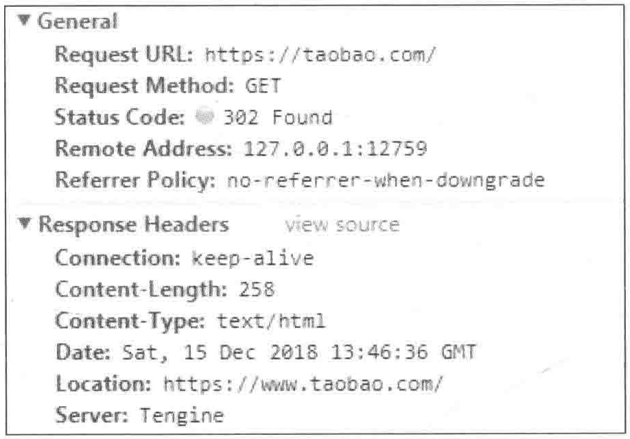

## 什么是 HTTP 302 跳转

网络传输中有很多不确定性，会导致传输失败或者其他非常规情况。网络协议为了识别这些不确定性，定义了一系列状态码，302 就是 HTTP 协议里的一个状态码。

HTTP 302 状态码对应的情况可以类比手机的呼叫转移功能：打进 A 手机的电话，均被转移到 B 手机接听。

302 状态码应用的典型场景是服务器页面路径的重新规划。假设一个 portal 页面换了新的域名，但仍有很多用户在使用旧的域名地址，就可以对它配置 302 状态码。用户输入旧域名，会自动跳转到新域名地址，保证服务的延续。另外，一些客户端预埋的 URL 链接，时间久了没人维护，也需要将旧地址配置 302 以跳转到新地址，这样就能全面兼容所有客户端版本。

为了对 302 状态码有一个全面的认知，我们做一个试验：在浏览器中输入 https://taobao.com，然后进行抓包。

如[图4-16](#figure-4-16)所示，访问 https://taobao.com 后，服务器吐回状态码“302 Found”，然后 Location 字段标识浏览器应该跳转到 https://www.taobao.com，从而打开淘宝网站。对于不同域名指向同一个地址的情况，我们大多是这么处理的。

<figure id="figure-4-16" tabindex="-1" markdown="1">

{ width="918" height="640" }

<figcaption markdown="span" style="margin:0.5em auto;font-size:0.8em;font-style:normal;line-height:1.5">
图4-16
</figcaption>

</figure>

互联网世界里已经存在数亿量级的网页，如何管理及标识每一个网页，以及方便浏览器寻址到此网页并展示呢？其中，每个网页都对应着一个 URL（Uniform Resource Location）地址，也叫网址。在现实世界中，门牌号标识了具体且唯一的物理地址（如北京市朝阳区某小区张大妈家的门牌号）。同理，网址标识了一个 Web 页面在互联网中的真实地址（例如，“www.baidu.com/file/1.html”这个地址表示的是处于 Baidu 服务器 file 路径下的 1.html 这个文件）。

用户点击一个页面链接，随即会看到一个新的网页展示在浏览器内。在这个过程中，浏览器其实是在不断地接收服务器端的应答（“应答”是服务器端的状态，所以返回码叫状态码），以此来决策下一步做什么（尽管大部分情况下，用户毫无感知地就打开了自己想要的页面）。这个应答即状态码（status code），在 HTTP 协议里以三位数标识，共分为 5 类，分别为 1xx、2xx、3xx、4xx 和 5xx，如表4-3所示。

表4-3

| 分类 | 分类描述 |
| --- | --- |
| 1xx | 信息，服务器收到请求，需要请求者继续执行操作 |
| 2xx | 成功，操作被成功接收并处理 |
| 3xx | 重定向，需要进一步操作以完成请求 |
| 4xx | 客户端错误，请求包含语法错误或无法完成请求 |
| 5xx | 服务器错误，服务器在处理请求的过程中发生了错误 |

301 和 302 表示重定向，301 表示这个网页已经永久地从服务器的 A 路径下移动到 B 路径下，而 302 表示临时移动到 B 路径下，对应到 URL 地址即从 http://baidu.com/file/A/1.html 移动到 http://baidu.com/file/B/1.html。当浏览器访问前面一个地址时候，服务器会告知浏览器到 B 路径下获取文件，随后浏览器重新发起网络请求 B 路径下的页面，该页面经过渲染，最终呈现给用户。

