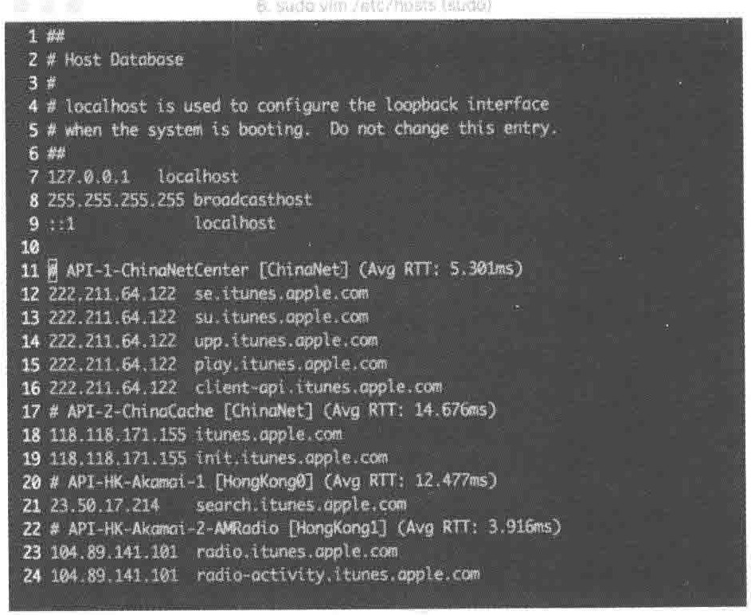

## 神奇的 Hosts 文件

在程序员交流平台 GitHub 上，有个很火的项目“AppleDNS”，它的作用是帮助用户更快地访问 Apple 服务。作者研究这个项目，发现它的原理其实很简单：Apple 有很多服务器遍布全球，AppleDNS 可以帮用户找到连接最快一台服务器的 IP 地址，然后将这个 IP 地址写入用户计算机的 Hosts 文件，以后用户就可以一直连接这台服务器了。

为什么要写入 Hosts 文件，才可以一直连接这台较快的服务器呢？这里就要说一下神奇 Hosts 文件了。要访问一个 URL，首先要将域名解析成对应的 IP 地址，再通过 IP 地址访问服务器。域名解析服务器一般由用户使用的运营商提供，如果它解析出一个连接比较快的 IP，用户就可以较快地打开网页，如果它解析出一个连接较慢的 IP，用户也只能认命。不过，Hosts 文件给了用户一个自己决定命运的机会：用户可以在 Hosts 文件中，指定某个域名对应的 IP 地址，系统在发起网络请求时，会优先使用 Hosts 文件中的 IP 地址，这样就达到自主决定使用哪台服务器的目的。

Windows 系统用户可以查看 C:\system32\drivers\etc\hosts，Mac OS 或者 Linux 系统用户可以查看 /etc/hosts。[图4-17](#figure-4-17)所示为作者的 Hosts 文件。

<figure id="figure-4-17" tabindex="-1" markdown="1">

{ width="943" height="772" }

<figcaption markdown="span" style="margin:0.5em auto;font-size:0.8em;font-style:normal;line-height:1.5">
图4-17
</figcaption>

</figure>

从[图4-17](#figure-4-17)中可以看到，作者计算机访问 se.itunes.apple.com 等域名都是指定了 IP 地址，可以达到加速的目的。

不过，如果用户在 Hosts 文件中给某个域名配置了一个错误的 IP，则会导致这个域名的网页都不能正常访问。例如，将 www.taobao.com 指定到 IP 127.0.0.1，这个 IP 的意思是将淘宝网指向自己的计算机，这样就阻止用户去访问淘宝网了。效果如[图4-18](#figure-4-18)所示。

<figure id="figure-4-18" tabindex="-1" markdown="1">

{ width="876" height="750" }

<figcaption markdown="span" style="margin:0.5em auto;font-size:0.8em;font-style:normal;line-height:1.5">
图4-18
</figcaption>

</figure>

