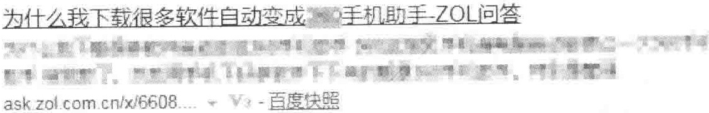
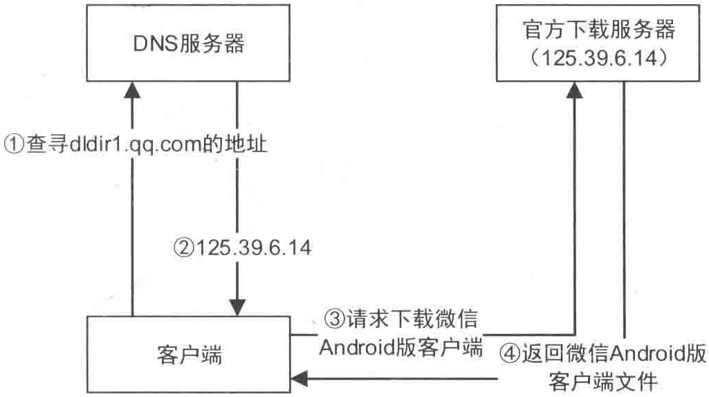
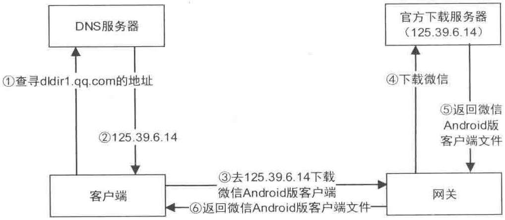
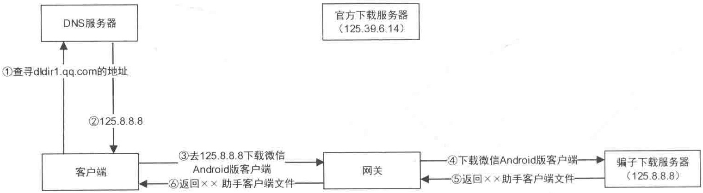
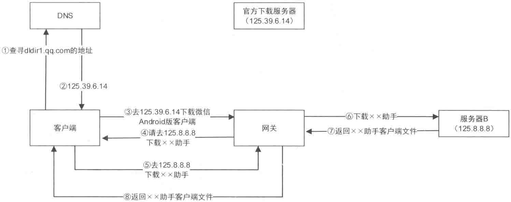

## 下载劫持简介

想必每逢“双十一”，广大“千手观音”们都会狠狠地“剁几只手”。然而，“剁手”换来的宝贝在漫漫快递路上也是命途多舛，难免发生磕磕碰碰，损毁包装。这些不可抗力造成的问题屡见不鲜，消费者碰到了也只能自认倒霉。有的人下了苹果 8 代的订单，却啃着寄过来的 8 袋苹果，个中滋味只有当事人能体会。其实，在 Android 应用分发领域，这种“苹果8代”变8袋苹果的情况也屡见不鲜，如[图4-19](#figure-4-19)所示。

<figure id="figure-4-19" tabindex="-1" markdown="1">

{ width="1131" height="138" }

<figcaption markdown="span" style="margin:0.5em auto;font-size:0.8em;font-style:normal;line-height:1.5">
图4-19
</figcaption>

</figure>

为什么会出现这种情况呢？其实一次网络下载的过程，就像一次“网购”，当用户单击“下载”按钮时，就从下载服务器下了一份“订单”，免费“订购”了一个文件，服务器确认“订单”后，会将文件在网络中“快递”（传输）到用户的终端（手机、PC 等）。下载劫持一般出现在“下订单”的过程中。

假设我们通过微信官网的链接下载微信 Android 版的客户端，整个流程大概如[图4-20](#figure-4-20)所示。

<figure id="figure-4-20" tabindex="-1" markdown="1">

{ width="1025" height="574" }

<figcaption markdown="span" style="margin:0.5em auto;font-size:0.8em;font-style:normal;line-height:1.5">
图4-20
</figcaption>

</figure>

单击“下载”按钮后，客户端会通过 URL 中的域名“dldir1.qq.com”向 DNS 服务器获取下载服务器的 IP 地址，它就相当于日常生活中的电话号码，有了它，就可以连接到这台服务器。而 DNS 服务器就像一个存储着大量姓名（域名）和电话号码（IP 地址）的黄页。当客户端获得了下载服务器的“电话号码”后，就会连接下载服务器，并告知下载服务器客户端需要获取服务器上的微信 Android 版客户端文件。一般情况下，服务器在这个阶段确认了“订单”后，就会向客户端“快递”对应的文件，客户端将文件下载完毕后，这次“网购”也就完成了。

下面，作者引入运营商（电信、联通等）网关的概念。运营商网关可以类比成日常生活中的总机，接入运营商的互联网设备想要上网，都需要经过总机（运营商网关）的转接。也就是说，用户并不能直接通过下载服务器的“电话号码”联系到下载服务器，而是需要先连接到“总机”（网关），并且告诉它，用户要向某服务器下“订单”，经过“总机”的转接，用户才能真正连接到下载服务器。整个过程如[图4-21](#figure-4-21)所示。

<figure id="figure-4-21" tabindex="-1" markdown="1">

{ width="1018" height="444" }

<figcaption markdown="span" style="margin:0.5em auto;font-size:0.8em;font-style:normal;line-height:1.5">
图4-21
</figcaption>

</figure>

可以发现，DNS 服务器和网关的决策，确定了客户端下载请求的走向。而下载劫持也就发生在这两个关键节点上。

如[图4-22](#figure-4-22)所示，假设客户端获取下载服务器“电话号码”的 DNS 服务器被篡改，那么客户端可能会通过“dldir1.qq.com”查询到一个“骗子”服务器“电话号码”（IP 地址）。当用户联系这个“骗子”服务器时，用户的“订单”（下载请求）可能会换来一些奇奇怪怪的“商品”。

<figure id="figure-4-22" tabindex="-1" markdown="1">

{ width="1520" height="418" }

<figcaption markdown="span" style="margin:0.5em auto;font-size:0.8em;font-style:normal;line-height:1.5">
图4-22
</figcaption>

</figure>

遇到这种情况时，用户可以通过手动修改 DNS 服务器的 IP 地址来解决。但是，当运营商的“总机”出了问题时，就没那么容易解决了。

假设当客户端拿着下载服务器“电话号码”要求“总机”转接到用户指定的下载服务器时，“总机”对客户端说：“不要去 A 家下载微信了，你去我给你介绍的 B 家下载‘xx 助手’吧，比微信好用”（这个过程在技术上是被一个叫作 302 跳转的机制完成的），客户端就被“引诱”到 B 家服务器上下载了。整个过程如[图4-23](#figure-4-23)所示。

<figure id="figure-4-23" tabindex="-1" markdown="1">

{ width="1497" height="595" }

<figcaption markdown="span" style="margin:0.5em auto;font-size:0.8em;font-style:normal;line-height:1.5">
图4-23
</figcaption>

</figure>

“总机”和服务器 B 就这样沆瀣一气，骗取客户端的下载量。

