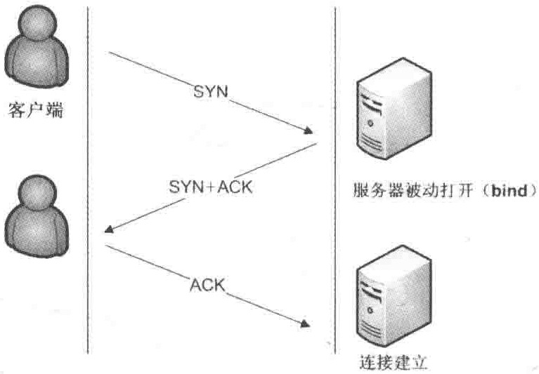

## DDoS 的原理

DDoS（Distributed Denial of Service）的中文译名是分布式拒绝服务。DDoS 的基本原理是通过对服务器发送大量无用的请求耗尽服务器资源（CPU、内存等），导致服务无法正常运行，正常请求无法得到响应。

要实现 DDoS 攻击，需要攻击者比被攻击者拥有更多的硬件资源（更好的 CPU 和更大带宽），一般 DDoS 攻击者有两种途径达到目的，一种是通过向流量平台租赁流量实现流量攻击，另一种是通过种植“肉鸡”构建僵尸网络，利用云控指令对被攻击者发起攻击。

我们可以通过在商铺买东西的例子理解 DDoS 攻击。假设小明在当地超市买了一桶无法食用的过期泡面，导致他“春运”途中饥肠辘辘。怀恨在心的小明决定好好教训一下该超市，便开始散布谣言：情人节时该超市有促销活动，当日到店购买巧克力或玫瑰都可享受买一送一的优惠。于是，2 月 14 日大量顾客来到该超市，抢完了货架上巧克力和玫瑰，在结账时却被告知没有此活动，导致收款通道出现大量排队后却没有购买任何商品的顾客。同时，由于排队等待时间过长，前来购买普通商品的顾客也都放弃在该超市消费，转到其他超市消费。最终，2 月 14 日该超市营业额严重下滑，经理被免职。该超市就相当于受到了一次 DDoS 攻击。

聪明的读者可能已经看出来了，DDoS 的可怕之处正是被攻击者（超市）无法正确区分哪些是攻击者发来的请求（被谣言欺骗的顾客），哪些又是正常的请求（没听过谣言的其他顾客），从而无法做出响应。

上面介绍的是 DDoS 的基本原理，攻击者真正使用的技术手段多种多样，但基本上都会利用 TCP 等协议栈缺陷或者系统本身缺陷达到最大化利用攻击资源的效果。

下面作者介绍一个比较典型的 SYN Flood 攻击方式。

说到 SYN Flood，就必须详细介绍一下 TCP 的三次握手过程（如[图5-1](#figure-5-1)所示）。

<figure id="figure-5-1" tabindex="-1" markdown="1">

{ width="767" height="533" }

<figcaption markdown="span" style="margin:0.5em auto;font-size:0.8em;font-style:normal;line-height:1.5">
图5-1
</figcaption>

</figure>

- 第一次握手，客户端向服务器发送一个 SYN 报文，意思是“Hi，我要跟你建立 TCP 连接”。
- 第二次握手，服务器向客户端发送一个“SYN+ACK”报文，ACK 是对第一次握手中 SYN 报文的确认，意思是“同意建立连接”。前两次握手过程中，服务器和客户端相互确认了 TCP 连接的一些参数，如 Seq 等。
- 第三次握手，客户端向服务器发送一个 ACK 报文，确认第二次握手中的 SYN 报文被成功接收，TCP 连接成功建立，服务器和客户端开始传输数据。

当遭到 SYN Flood 攻击时，客户端不发送第三次握手的 ACK 报文，使得服务器停滞在第二次握手时的状态，我们称之为“半连接”。服务器维护半连接状态需要一定的资源，并且在较短的时间内，还会向客户端重新发送“SYN+ACK”报文，持续等待 30~120 秒后，如果还没有收到客户端的 ACK 报文，服务器才会关闭这个半连接。DDoS 攻击者就是利用这段等待时间，用“肉鸡”产生数量巨大的半连接，占尽服务器的 CPU 和内存资源。一旦出现这种情况，其他正常的 TCP 连接就无法建立了。

综上所述，DDoS 攻击技术成熟，实现简单。作为普通网站的管理员，应如何应对 DDoS 攻击呢？方案一：硬扛，增加服务器的硬件和带宽资源，将攻击者的流量全部接受后，还能服务正常用户，但是这会消耗大量的财力物力，中小型网站都无力承担这样的成本。方案二：寻找专业的流量清洗服务，使用对抗 DDoS 的软硬件系统将攻击流量和正常流量区分开，将正常流量回源到网站继续服务，同时把攻击流量屏蔽丢弃，相当于给网站做了一层 DDoS 防火墙。

