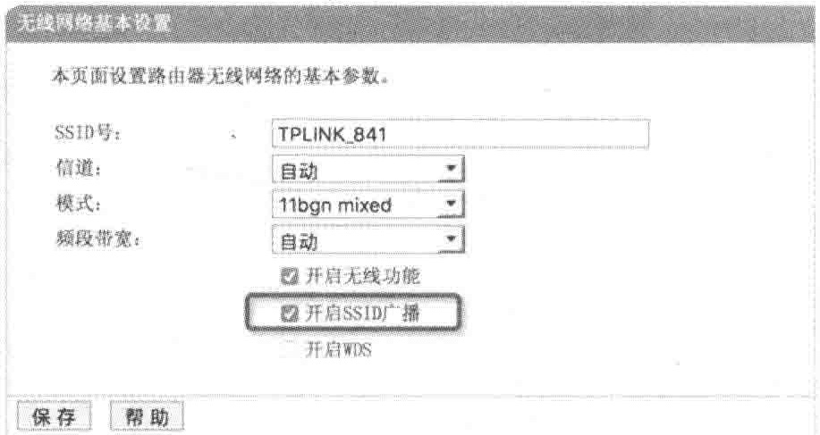

## 家庭 Wi-Fi 防“蹭网”指南

某日，作者发现家里的网络越来越卡顿，打开普通网页都要十来秒，一开始以为这是运营商要作者升级宽带的“套路”，可是宽带前不久才刚升级过。作者好好思考了一番，打开路由器管理界面，找到当前连接设备列表，震惊地发现家里的 Wi-Fi 已成“公共汽车”，被好几个陌生的设备连接上，这网速还能快得起来吗？

于是作者果断行动，更改了 Wi-Fi 密码。效果立竿见影，陌生的设备全被“踢”掉，网速也恢复正常。事后作者反思了一下：Wi-Fi 密码有多种被泄露的可能，或许是被哪位高人破解，或许是被哪位来访客人不小心分享出去了。因为 Wi-Fi 密码很长时间以来都没有变动，所以很可能被人长期利用来“蹭网”。

家庭 Wi-Fi 被蹭网的危害很大，首先就是网速受到了严重的影响。同一根水管，放水的人多了，水流量自然就小了。其次就是陌生人进入了家庭局域网，可以随意发起 ARP 攻击或其他中间人攻击，达到窃取隐私的目的。最严重的就是作者作为一名程序员，家里的 Wi-Fi 还被别人“蹭”了，严重影响作者的家庭地位。

因此，作者总结了几种防“蹭网”的方法。

### 1. 定期更换 Wi-Fi 密码

读者可以尝试一个月更换一次密码。怀疑 Wi-Fi 被人“蹭”了时，就要立即更换密码。这是一种“简单粗暴”的办法，可以阻止邻居利用如“Wi-Fi 万能钥匙”这类 Wi-Fi 密码分享软件“蹭网”。

### 2. 使用更好的加密方式

如果你的邻居是个民间高手，拥有一套可以破解密码的“蹭网神器”，那么你就得改一下你的 Wi-Fi 加密方式了。现在大部分路由器支持的 Wi-Fi 加密方式有 WEP、WPA/WPA2 和 WPA-PSK/WPA2-PSK 三种，其中 WEP 的加密方式较弱，很多“蹭网神器”在抓取一些 WEP 加密的数据包后，可以迅速破解密码。WPA/WPA2 虽然不易被破解，但是需要一台额外的认证服务器，常被用于大型企业的无线网络。最适合普通家庭的加密方式是 WPA-PSK/WPA2-PSK，它具备更强的加密效果，同时也不容易被破解。如果你再设置一个较复杂的密码，那么要破解它就更难了。

### 3. 隐藏无线网络 SSID

通常，我们在设置一个 Wi-Fi 时，会给它取个名称，以便连接 Wi-Fi 时从候选列表里找到它，这个名称就叫 SSID。如果这个 SSID 只有我们自己知道，那么别人即便知道我们的 Wi-Fi 密码，也连接不上我们的 Wi-Fi，因为他连输密码的入口都找不到。所以，我们需要将路由器里的 SSID 广播关闭（如[图5-2](#figure-5-2)所示），这样该 Wi-Fi 就不会出现在 Wi-Fi 连接的候选列表里了。当我们自己需要连接 Wi-Fi 时，手动输入 SSID 即可，输入一次后设备会自动记住它，不必每次都输入。

<figure id="figure-5-2" tabindex="-1" markdown="1">

{ width="917" height="487" }

<figcaption markdown="span" style="margin:0.5em auto;font-size:0.8em;font-style:normal;line-height:1.5">
图5-2
</figcaption>

</figure>

### 4. 关闭 DHCP 服务

如果我们的 Wi-Fi 密码和 SSID 不幸同时被别人知道了，那么还可以通过控制 IP 地址的分配来防止“蹭网”。当 Wi-Fi 设备连上路由器后，会申请一个 IP 地址，而这个 IP 地址由路由器的 DHCP 服务分配。如果我们将 DHCP 服务关闭，然后手动给自己的设备配置 IP 地址，那么陌生的设备即便是连上了 Wi-Fi，也拿不到正常的 IP 地址，因为局域网网段只有我们自己知道。所以关闭 DHCP 也是防“蹭网”的有效手段，只是也给我们自己带来了一些不方便。

### 5. 开启 MAC 地址过滤功能

如果出现更加不幸的情况，我们的 Wi-Fi 密码、SSID、局域网网段都被别人知道了，那么我们只好使出撒手锏——开启 MAC 地址防火墙。每台网络设备都有一个独一无二的 MAC 地址，我们开启 MAC 地址过滤功能，只允许自己设备的 MAC 地址通过路由器，拒绝其他全部设备，也能达到防“蹭网”的目的。

正所谓“魔高一尺，道高一丈”，我们总是有手段来制约“蹭网”群众的。本节最后提及的这几种方法有些复杂，一般情况下，普通用户只要定期更换 Wi-Fi 密码就可以防“蹭网”了。

