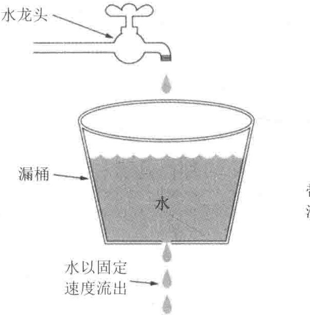
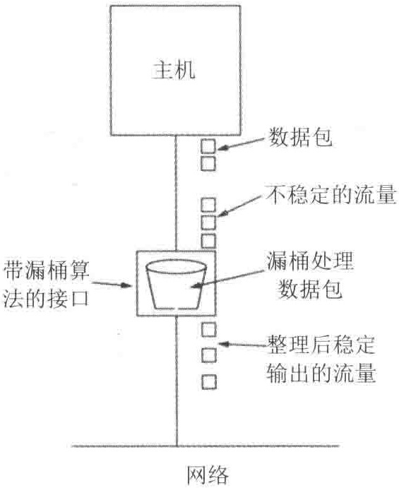
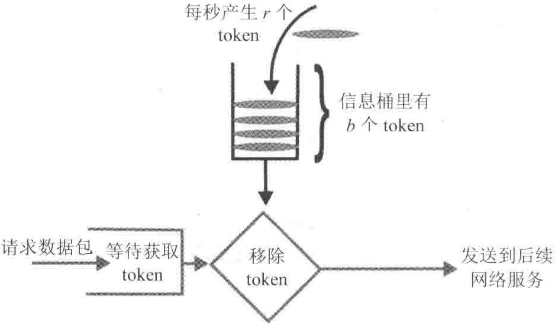

## 后台服务之流量控制

后台开发人员最讨厌的就是商品抢购活动，一到抢购时间，流量就是平时几十倍甚至上百倍，如果哪个模块没扛住，就会导致整个服务崩溃，影响用户的正常使用。因此，我们开发后台服务时需要考虑如何控制流量，当流量到达某一服务极限时将其引流到其他服务或者直接拒绝服务，以保持该服务的可用性。

如何判断当前流量达到极限呢？本节介绍两种后台开发常用的限流算法。

第一种是“漏桶算法”。我们把用户请求看作水，这些水会流进一个底部有洞的水桶，而我们的服务真正处理的是从底部洞里流出的水（如[图5-3](#figure-5-3)所示）。当流量突然暴涨，桶中注满水后，再流入的水就会直接溢出，而对应的就是拒绝服务，如[图5-4](#figure-5-4)所示。

<figure id="figure-5-3" tabindex="-1" markdown="1">

{ width="608" height="618" }

<figcaption markdown="span" style="margin:0.5em auto;font-size:0.8em;font-style:normal;line-height:1.5">
图5-3
</figcaption>

</figure>

<figure id="figure-5-4" tabindex="-1" markdown="1">

{ width="565" height="691" }

<figcaption markdown="span" style="margin:0.5em auto;font-size:0.8em;font-style:normal;line-height:1.5">
图5-4
</figcaption>

</figure>

漏桶算法的特点是，底部洞口流出水的速率是恒定的，所以漏桶的输出也是稳定的，相应地，后面服务接收的流量也是稳定的。不过，对于某些要求服务能够处理有限度的突发流量的场景（如抢购活动），更合适的是第二种算法——“令牌桶算法”。

令牌桶算法中，系统以固定的速度（如每秒产生 n 个令牌）产生令牌（token），产生的令牌都扔进一个桶里，如果令牌把桶塞满了（最多能装 6 个令牌），就会被扔掉。当用户请求到达服务的时候，去桶里取一个令牌，如果取到了，就给后面的模块继续处理；如果这个时候桶里一个令牌都没有了，就拒绝服务该请求，具体流程如[图5-5](#figure-5-5)所示。

<figure id="figure-5-5" tabindex="-1" markdown="1">

{ width="938" height="549" }

<figcaption markdown="span" style="margin:0.5em auto;font-size:0.8em;font-style:normal;line-height:1.5">
图5-5
</figcaption>

</figure>

两个算法看似差不多，都是将流量控制在一定速度范围内。它们的区别就在于，对于限流模块后面的服务模块来说，漏桶算法给到的流量是稳定的，而令牌桶算法给到的流量是在一定范围内波动的，来一个请求就处理一个，除非拿不到令牌，服务处理能力的峰值就是令牌桶的大小。

总而言之，对于后台服务来讲，保证稳定性和可用性是第一要务。流量到达服务处理极限时，对部分流量提供有损服务也是合理的。

