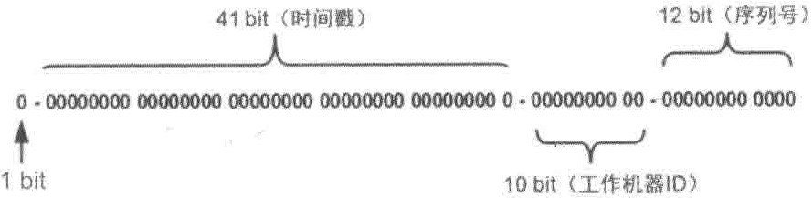

## 后台服务如何生成唯一 ID

在后台系统中，很多地方都会用到 ID 作为唯一标识，比如某条微博、某个用户、某条评论等，同时还可能加上一些附加属性，比如要按照生成时间递增，或者是出于反爬虫的考虑不能是连续数字等。我们来看一些常见的 ID 生成方案。

### 1. 数据库

常见的数据库都提供自增长 ID 的功能，也就是每插入一条新数据，这条数据的 ID 就在前一条数据的 ID 上加 1，从而保证唯一性。它的优点是简单，不用自己实现 ID 生成逻辑，缺点就是过于依赖数据库，一旦数据库异常，整个系统都无法工作。通常，在分布式系统中，数据库和业务都不在同一台机器上，因此还伴随着网络耗时，导致生成效率不高。

### 2. UUID

UUID（Universally Unique IDentifier）是一种不依赖于中央服务器的 ID 生成方案，它包含了 32 个十六进制的数字，以连字号分为五段，形式为 8-4-4-4-12，如 550e8400-e29b-41d4-a716-446655440000。它的特点就是生成的 ID 长度很长，长到重复的概率趋近于零。同时，它的生成主要依赖本机的硬件信息的多样性，而不依赖中央服务器，因此没有网络耗时，生成效率很高。

### 3. 雪花算法

雪花算法最初由 Twitter 公司发明，它产生的背景就是 Twitter 公司面临每秒产生的上万条信息，要为这些信息分配唯一的 ID，同时还需要根据时间来排序。雪花算法的思想就是将 64 位的数字按二进制位划分为不同的区段，而每一区段都有不同的意义。如[图5-6](#figure-5-6)所示，其中有 41 bit 由生成 ID 时的时间戳填充，还有 10 bit 由当前机器的 ID 填充，以区分分布式系统中的不同机器。最后 12 bit 由本机自增长序列号填充，它可以保证同一毫秒内同一机器产生的 ID 都是不同的。

<figure id="figure-5-6" tabindex="-1" markdown="1">

{ width="889" height="217" }

<figcaption markdown="span" style="margin:0.5em auto;font-size:0.8em;font-style:normal;line-height:1.5">
图5-6
</figcaption>

</figure>

雪花算法的特点就是，在保证唯一性的同时，生成的 ID 的长度比 UUID 减少了一半，因而更加节省空间，同时它时间戳填充在高位，因而 ID 越晚产生，其长度就越长，保证了 ID 按时间递增的要求。

这三种 ID 生成算法各有优劣，当然，我们还是要根据产品需求选择更适用的方法。

