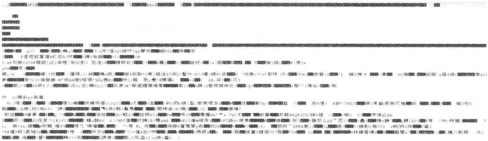

## 二进制文件

程序员经常说：“别用明文写文件，至少也要写成二进制文件。”

程序员经常说：“这篇文章数字较多，不要写成文本文件，太占空间。”

程序员经常说：“你不明白文本文件和二进制文件区别。”

让我们带着程序员的教诲，一起看看文本文件和二进制文件的本质区别及使用场景。

计算机中的文本文件指的就是常见的记事本文件（.txt），能在 Windows 系统中打开，是可直接阅读并可解释其含义的。而二进制文件通常是不能用文本打开工具打开的，即便用记事本工具强行打开，也是一团乱码（如[图6-1](#figure-6-1)所示）。

<figure id="figure-6-1" tabindex="-1" markdown="1">

{ width="1409" height="408" }

<figcaption markdown="span" style="margin:0.5em auto;font-size:0.8em;font-style:normal;line-height:1.5">
图6-1
</figcaption>

</figure>

从广义的存储的角度看，计算机中本没有文本文件和二进制文件的区别，在计算机的硬盘上存储的文件都是以二进制存储的，也就是由数字 0 和 1 组成的数字串。那为什么程序员口中又要分这两种类型呢？它们区别何在？

从狭义的角度划分，文本文件是按照字符存储，二进制文件按照数据类型存储。作者举例进行说明：要记录“π=3.1415926”，如果按照文本文件存储（在桌面上新建一个 .txt，然后输入 3.1415926 并保存），这个文件就被存储为一个文本文件，其中有“3”“.”“1”“4”“1”“5”“9”“2”“6”共 9 个字符，这几个字符按照其对应的 ASCII 码分别为十进制 63、56、61、64、61、65、71、62、66，每个字符占用一个字节，一共占用了 9 个字节的空间。3.1415926 是一个浮点数，如果按照二进制文件存储，最终只需占用 4 个字节。

由此，可以推导出一个结论：用二进制文件存储数字要比用文本文件存储省空间。

计算机存储的所有内容都是二进制，文本文件也不例外，所以文本文件在存储的时候需要将明文文本转换成对应的二进制，而普通二进制文件的存储不需要转换。举一个吃火锅的例子，文本文件就像把蔬菜放进清汤锅、肉放进辣锅的大家闺秀，效率当然低，而二进制文件像是不按任何规则，不管三七二十一把菜品全部倒入锅里的人。就像程序员说的，文本文件打开就是明文，而二进制文件是“乱码”，而且因为不知道程序员的写入规则，破解难度会增加。

总结起来，二进制文件更省空间，写入速度更快，因为可读性很差，所以还有一定的加密保护作用。从存储的角度看，文本文件和二进制文件都是二进制存储，但为了迎合用户阅读文件的需求，文本文件委曲求全，作为二进制文件的子集，开辟了一个新的文件品类。这种品类下，文件每个字符都是经过了特殊处理（比如转成 ASCII 码）再存储为二进制的，这样的二进制可以直接对应为 ASCII 码，供人们阅读。

综上所述，二进制文件并不神秘，读者今后再遇到二进制文件时，将其当作一个普通文件即可。

