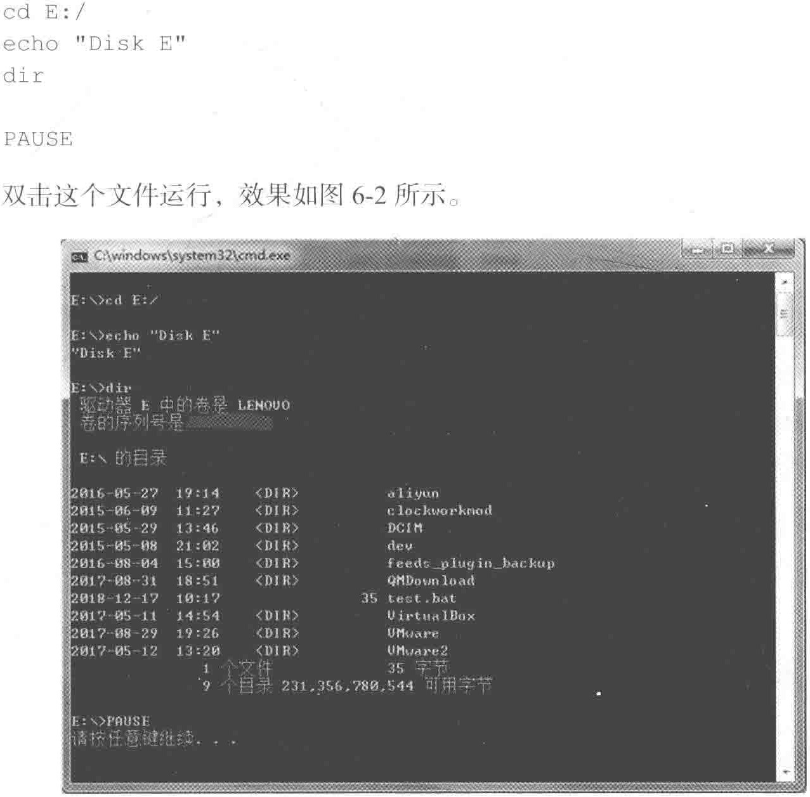

<div class="book-original" markdown="1">

## 脚本

程序员经常说“这个问题是 JavaScript 脚本运行出错了”“这个好计算，跑个脚本就行了”“这个 Bug 需要在云端进行脚本修复”。有时测试员也在说：“现在效率有提升，都是用自动化脚本解决问题。”还有数据分析师说：“这个数据，要重新写个脚本，用 Hadoop 再运行两天。”

脚本，是使用一种特定的描述性语言，依据一定的格式编写的可执行文件。包括程序员在内的很多人每天都把“脚本”挂在嘴边，却好像并不知道它名字的来源和含义。

脚本的英文是 Script，名词词义是剧本。提到剧本，我们脑中的印象是一摞已经被翻得起黑边儿的 A4 纸，上面密密麻麻地写着字，详尽地描述了一部剧的整个流程和节奏。一部剧的演出效果，应该忠实于剧本描述。

生活中按照“剧本”完成任务的例子无处不在，公司负责清理卫生间的大爷是以一个小时为单位清理并签到；主持人是按照设计好的台词主持节目。一杯奶茶制作也是有“剧本”的，不过现实中我们称其为“菜谱”。

这些生活中的场景，经过高度抽象，被“抄袭”到计算机中，就成了脚本。它有如下几个特点：

- 脚本就是剧本
- 脚本是普通的文本文件，是批处理文件
- 脚本导演了一个序列事件发生
- 脚本让一个例行任务效率大幅提升

打开 Windows 系统中常见的扩展名为 .bat 的批处理文件，会出现一个黑色窗口，若干白字迸发而出，这就是批处理文件，也就是脚本文件。

作者现在打开记事本，来写个最简单 Windows 批处理文件，实现打印“DiskE”几个字之后，输出 E 盘的目录，然后停止在命令行界面。代码如下：

```text
cd E:/
echo "Disk E"
dir
PAUSE
```

双击这个文件运行，效果如[图6-2](#figure-6-2)所示。

<figure id="figure-6-2" tabindex="-1" markdown="1">

<p markdown="span" style="margin:0">
{ width="1187" height="887" }
</p>

<figcaption markdown="span" style="margin:0.5em auto;font-size:0.8em;font-style:normal;line-height:1.5">
图6-2
</figcaption>

</figure>

读者可以看到，这个文件执行了两个步骤：

（1）打印“DiskE”。

（2）调用 dir 命令输出 E 盘目录。

如果采用手工操作则至少要输入两次，相比之下，使用脚本操作使效率大幅提升。

这是一个最简单的脚本，是由 Windows 系统直接支持的，而 JavaScript 脚本是浏览器支持的。写 JavaScript 和 Windows 批处理命令的语法规则不一样，运行环境也不一样。

脚本的运行环境叫作“解释器”，用于理解脚本的含义。脚本语言有很多种，也有相应的配套解释器。譬如，JavaScript 最流行的解释器是 Chrome V8 引擎，是谷歌公司的良心作品。每种解释器有其特殊的使用场景或擅长的场景，不同场景要选用不同的工具。举例来说，我们旅行时如果到了泰国，听到问候语“萨瓦迪卡”，就要以泰语作为解释器。到了韩国，脚本变成“阿尼阿塞呦”，解释器就要转换为韩语。一种脚本对应着一种解释器，脚本语言要在合适的解释器中运行，如果将泰语的“萨瓦迪卡”放在韩语的解释器中，就不知所云了。

市面上流行的脚本语言如下：

- JavaScript 浏览器脚本语言，目前也应用于服务端。
- PHP，经常用于服务端脚本程序的编写。
- Perl、Shell、Python、Ruby、Lua 都是非常常见的脚本语言，在机器学习中就可以见到。

总之，脚本就是对一件事情的过程描述，脚本可以由很多种脚本语言来编写，不同场景可以选择不同的脚本语言。

</div>
