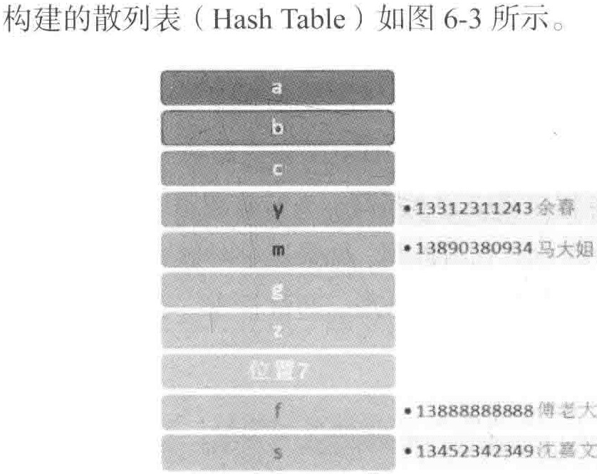
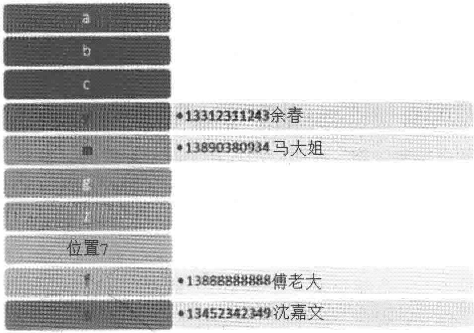

## 散列表

在编程实现中，常常面临两个问题：存储和查找。这二者的效率往往决定了整个程序的效率。

一起来看下面的例子：小明是一个粗心大意的人，忘记了指甲刀放在哪里，通常要在家中的所有抽屉中依次寻找，找到为止。最差情况下，有 N 个抽屉，就要打开 N 个抽屉。这种存储方式叫数组，查找方法称为遍历。

后来，小明改掉了粗心的毛病，成为一个整理控，所有物品必须分门别类放入整理箱，再将整理箱编号，比如 1 号整理箱中放入针线，2 号整理箱中放入证件，3 号整理箱中放入细软，这种存储和查找方式称为散列。如果这个时候要查找护照，小明不需要再翻所有抽屉，可以直接从 2 号整理箱中获取，通常只用一次查找即可。为整理箱编号的方法，称为散列算法。

假设我们有 100 亿条数据记录，那么差距就变得更加明显，遍历需要查找最多 100 亿次，最少 1 次，而使用散列算法查找只需 1 次。同样是查找，差距为何这么大？

散列也称哈希，利用散列算法实现的散列表，是一种与数组、链表等不同的数据结构，它并不需要通过遍历的方法查找数据。散列表设计了一个映射关系 f（key）=address，根据 key 计算存储地址（address），其中 f 称为散列算法。当 key 已知时，可以使用 f 立即获得数据的存储位置。

举个例子，如表6-1所示，我们将几个人物按数组存储。

表6-1

| index | name | phone |
| --- | --- | --- |
| 0 | 余春 | 13312311243 |
| 1 | 傅老大 | 13888888888 |
| 2 | 沈嘉文 | 13452342349 |
| 3 | 马大姐 | 13890380934 |

如果想要找马大姐的电话号码，需要顺序查找对比整个数组，第 1 个不是，第 2 个、第 3 个也不是，直到第 4 个才找到马大姐。

如果以散列存储呢？首先让我们来看看如何设计散列算法。散列算法可以随意设计，教科书上一般会介绍以下几种方法：直接定址法、平方取中法和除数取余法。散列算法的本质是计算一个数字，如果用这几种方法讲解会稍显晦涩，我们取人物姓名的首字母来设计。所以 f（余春）=y，f（傅老大）=f，f（沈嘉文）=s，f（马大姐）=m。

构建的散列表（Hash Table）如[图6-3](#figure-6-3)所示。

<figure id="figure-6-3" tabindex="-1" markdown="1">

{ width="619" height="574" }

<figcaption markdown="span" style="margin:0.5em auto;font-size:0.8em;font-style:normal;line-height:1.5">
图6-3
</figcaption>

</figure>

未来，当我们要查找余春的手机号时，通过计算得出余春在 y 位置，可以通过 1 次查找找到这条号码记录。

读者可能会产生疑问：以首字母为散列函数的话，应该有很多以 y 开头的姓名，还怎么实现一次查找呢？实际上，很多条记录都映射到一个位置上，称为散列冲突。散列冲突是与散列函数的设计正相关的，随机性越大，产生散列冲突的可能性越小。在小概率下如果还产生了冲突，就要做些有损的设计。例如，若有两个首字母为 y 的姓，则可以排在余春的后面，查找时先查找到 y，再顺序查找，如[图6-4](#figure-6-4)所示。

<figure id="figure-6-4" tabindex="-1" markdown="1">

{ width="953" height="670" }

<figcaption markdown="span" style="margin:0.5em auto;font-size:0.8em;font-style:normal;line-height:1.5">
图6-4
</figcaption>

</figure>

还有一些解决散列冲突的方法叫“散列再散列”，也就是针对第一次散列的结果再进行一次散列来减小冲突的概率。

这就是散列表，它是一种数据结构，也是一种效率极高的查找方式。散列表的核心在于散列函数的设计。产生散列冲突不要紧，我们可以增加随机性并对冲突进行适当的有损化的处理。

