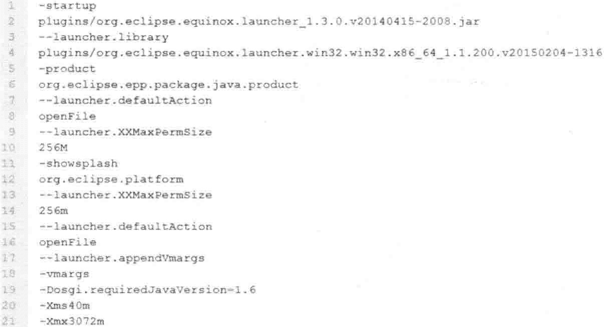

## 配置文件

程序员的世界里，很多词都是唬人的，比如配置文件。几乎每一个软件都有配置的需求，最常见的配置就是软件的“设置”页面。绝大多数这种配置是写在程序代码中的，也是很多产品经理和开发人员一起商量出来的。有的配置直接写在代码中，有的配置写在一个文件中，这个文件就称为配置文件。

以开发工具 Eclipse 为例，在它的目录下有一个文件叫作 Eclipse.ini（如[图6-5](#figure-6-5)所示），这就是 Eclipse 的配置文件。比如 Xms 标识 JVM 初始分配的内存，Xmx 标识 JVM 最大可分配的内存，里面每一个字段都有其含义，但归根结底都是对 Eclipse 这个软件运行时的配置或遵守的一些规则。

<figure id="figure-6-5" tabindex="-1" markdown="1">

{ width="887" height="544" }

<figcaption markdown="span" style="margin:0.5em auto;font-size:0.8em;font-style:normal;line-height:1.5">
图6-5
</figcaption>

</figure>

想想生活中，每买一件物品，比如洗衣机、电视机、汽车，也有一大堆配置文件，一般包括出厂合格证书、说明书等，其实这些就是实物的配置文件，所有操作都应按照说明运行，类比到软件的配置文件也是如此。

此外，配置文件还有改变配置以配合运行时行为变化的重要作用。写在代码中的配置被编译器编到了二进制文件中，程序运行时无法更改，所以对一些动态的配置（例如电商程序中，“双十一”期间商品打五折，时间过了则恢复原价）就需要由运营人员通过更改配置文件完成。

再想想我们常用的软件吧，只要这个软件有“设置”这个选项，在设置界面看到的所有内容，都是对这个软件的配置，这些配置一般存储在一个文件中，只不过软件开发者并没有让用户看到它。

总结起来，配置文件就是一个对软件运行时状态的本地存储形式，我们可以通过改动配置文件来改变软件运行行为或策略。

