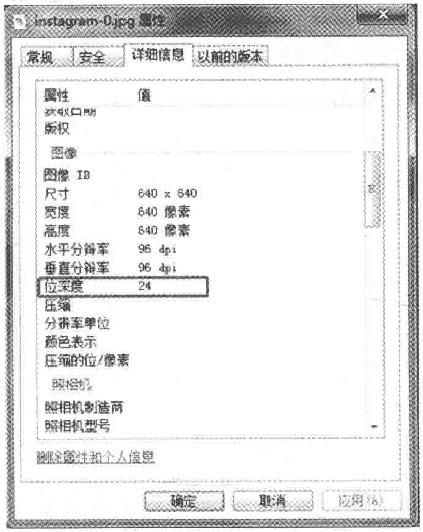

## RGB 通识

任何一个和用户有交互的产品都离不开颜色。读者可能在设计稿或代码中或者任何一个标识颜色的地方看到过类似“#FF00FF”“#169”“#CCFF00FF”的代码，这就是 RGB 值。我们看到的颜色，都是由它们标识出来。

我们先介绍 RGB 的基本原理。RGB 是 Red、Green、Blue 三种颜色的缩写，称作三原色，我们在小学的图画课上就已经接触过它们。三种颜色以最大亮度进行混合的话，会变成白色。假设有一个不透光的小黑屋，墙面展示为黑色，分别打开一束红灯、绿灯或蓝灯，三束光中间颜色交叉的地方，就变成了白色。这些光叠加产生效果，混合成新的颜色。

当前的手机和计算机究竟支持多少种颜色呢？答案是 1670 万种，达到了真彩色的标准，已经超过了人眼分辨颜色极限。1670 万这个数字是如何得出？后文再详细推演。

把三原色中的每一个原色都用 8 bit 表示。以红色为例，用二进制表示的话，它的取值会在 00000000~11111111 这个区间内，对应十进制就是 0～255。其中，数值越大表示红色的亮度越高，例如 255 表示亮度最高的红色，0 则表示完全没有亮度的红色，也就是黑色。把分别表示红、绿、蓝颜色亮度的 8 bit 连接起来，就得到了一个由 24 bit 混合颜色。显然，这个由 24 bit 混合的颜色能表示 256×256×256 种不同的颜色，也就是我们说的真彩色。

平时计算机处理的就是由 0 和 1 组成的字串，所以它读二进制表示比较容易。但对人来说，二进制表示可读性并不好，所以我们转而用十六进制来标识二进制，以缩减字串的长度。十六进制是逢十六进 1 位的进位制，但我们的阿拉伯数字最大是 9，于是分别用 A、B、C、D、E、F 这 6 个字母来表示从 10 到 15 的 6 个数字。1111 应该用 F 来表示，所以白色用十六进制表示为 FFFFFF。在 Web 开发或设计中，前面加上 # 号标识颜色，于是读者就看到了本节开头介绍的颜色表示法“#FFFFFF”这样的形式。在 CSS 设计中，如果出现像 FF 这样重叠的数字，可以再进行一次缩减，标识为 #FFF，类似 #CCFF00FF。前面的 CC 对应的是 Alpha 通道的值，即透明度。

RGB 三种颜色分别有 256 级亮度，那三种颜色的组合数就是 256×256×256=16777216，也就是 2 的 24 次方，所以分别用 8 位 RGB 来表示颜色数量是 1670 万，足以覆盖人类眼睛的辨识程度。

再来介绍经常出现的位深度的概念。在 Windows 系统中，鼠标右键单击一张图片，再选择“属性”选项，可以看到它的详细信息，如[图6-6](#figure-6-6)所示。

<figure id="figure-6-6" tabindex="-1" markdown="1">

{ width="693" height="872" }

<figcaption markdown="span" style="margin:0.5em auto;font-size:0.8em;font-style:normal;line-height:1.5">
图6-6
</figcaption>

</figure>

这里的位深度是指一张图片内用于表示一个像素的位数，如我们刚才介绍 RGB 都是 8 位，位深度就是 24，这种图片叫作 RGB24。当然，这只是指 RGB 总共的二进制位数，也有可能是 32 位叫作 RGB32，除了 RGB 的 24 位，剩余的 8 位表示 Alpha 通道，也就是透明信息。Alpha 用在交互和动画展现中可以表现渐隐渐显的效果，在图片中则可以将层叠的概念表达得更清楚。常见 RGB 格式包括 RGB565、RGB24、RGB32 和 ARGB8888，最后一种格式中的 A 表示 Alpha，跟 RGB32 的表示方法相似。

RGB565 用 16 位表示一个颜色，则总共只能表达 2 的 16 次方即 65536 种颜色，这种表达方式会损失图片的清晰度，但好处是一个像素只用 32 位一半的数据就能存储，能够大幅减少内存的占用，一般用于纯色或本身颜色就比较少的图片。

至此，作者基本介绍了计算机中三原色的原理、一些陌生颜色值表示方法、几个简单的推理方法，以及位深度的概念。当内存和图片质量发生冲突时，在能够达到设计效果的前提下，设计上可以考虑使用纯色或极其简洁的颜色搭配，然后将图片用更少的位数表达，这样会大幅节省内存。

假设一张图片的大小是 1920 像素×1080 像素，那么这张图片至少要占用 1920×1080×4 字节的内存，也就是 4MB。一张带有 Alpha 通道的图片都会是这个大小，唯一有处理空间的是没有 Alpha 通道且颜色比较简单的图，可以将其用 RGB565 表示，这样可以减少一半的内存占用，对于程序性能来说是不小的提升。

