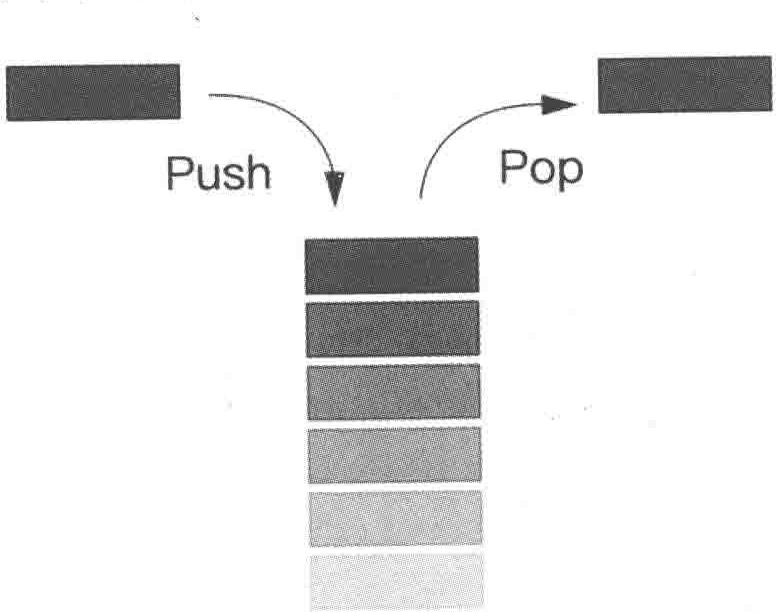
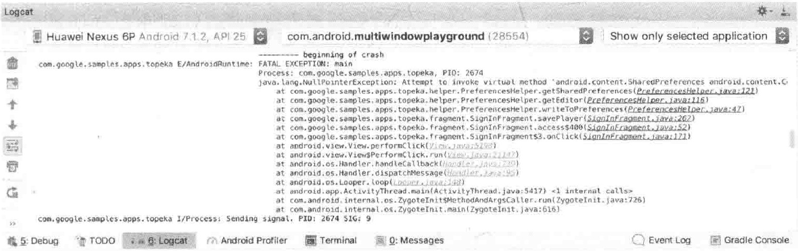

## 栈的含义

如果读者从事软件相关的行业，一定听说过“栈”这个名词。这个词在不同的语境中有不同的含义。

“栈”对应的英文单词是 Stack，意为“堆叠”。百度翻译提供的例句“There were stacks of books on the bedside table and floor”翻译过来就是“床头桌和地板上有几摞书。”所以有关栈的一切，都离不开这个“层叠”的本意。

栈的第一层含义是指一种数据结构，这种数据结构标识了一个有前后关系的列表，该列表要符合先进后出的原则，我们用[图6-7](#figure-6-7)表示。

<figure id="figure-6-7" tabindex="-1" markdown="1">

{ width="778" height="613" }

<figcaption markdown="span" style="margin:0.5em auto;font-size:0.8em;font-style:normal;line-height:1.5">
图6-7
</figcaption>

</figure>

我们针对栈有 Push 和 Pop 两种操作，分别表示向栈中加入一个元素，从栈中退出一个元素。[图6-7](#figure-6-7)中 Push 箭头所指向的位置叫作“栈顶”，这两种操作都只能针对栈顶元素操作，后进入栈的元素要先出去，就像组装手机是从芯片到外壳，但是拆手机要从外壳向里拆一样。那这种结构具体在程序中有什么用呢？它一般被用在递归及回溯的算法中，用来记录整个计算过程中存在的临时变量，当计算到了无法再分解的地步时，再来合并临时变量的结果。整个算法过程有点难理解，有兴趣的读者可以了解一下斐波那契数列的递归计算过程。

总之，栈首先是一种数据结构。栈也表示由操作系统管理和分配的一些内存区域，这些内存区域用来存储程序中的变量及参数，程序员常说的“栈溢出”就是指这块内存空间被用完了，内存不够，程序就崩溃了。与之对应还有一个“堆”的概念，堆是由程序员自己申请并控制一块区域（不用的时候必须做好释放工作），而栈是由操作系统控制。

栈也表示程序员常说的“栈信息”，常指程序出错的打印信息。如果再听到程序员说“栈信息打印出来了吗？”或“把栈发给我看看”，其实是在用栈信息定位问题。我们看一段出错的栈信息（如[图6-8](#figure-6-8)所示）。

<figure id="figure-6-8" tabindex="-1" markdown="1">

{ width="1506" height="323" }

<figcaption markdown="span" style="margin:0.5em auto;font-size:0.8em;font-style:normal;line-height:1.5">
图6-8
</figcaption>

</figure>

图6-8中以“at”开头的那几行文字，表示在程序运行过程中，某一个时刻方法（或者叫作函数）之间的调用关系，这个调用关系是自下而上的。例如，在 ZygoteInit 的第 616 行，main 方法调用了 MethodAndArgsCaller 的 run 方法。依此类推，在这个时刻，最后一个被调用方法是 PreferencesHelper 的 getSharedPreferences 方法。如果在某个时刻程序出现了异常，那么根据时间点查找到对应的“栈信息”后，程序员就可以快速定位到导致异常的原因。

“技术栈”可以理解为一项技术垂直领域，例如前端技术栈、终端技术栈、后台技术栈等。技术栈由该垂直领域内的关键技术点组成。如果某个技术人员同时掌握多个技术栈，就会被称为“全栈工程师”。

