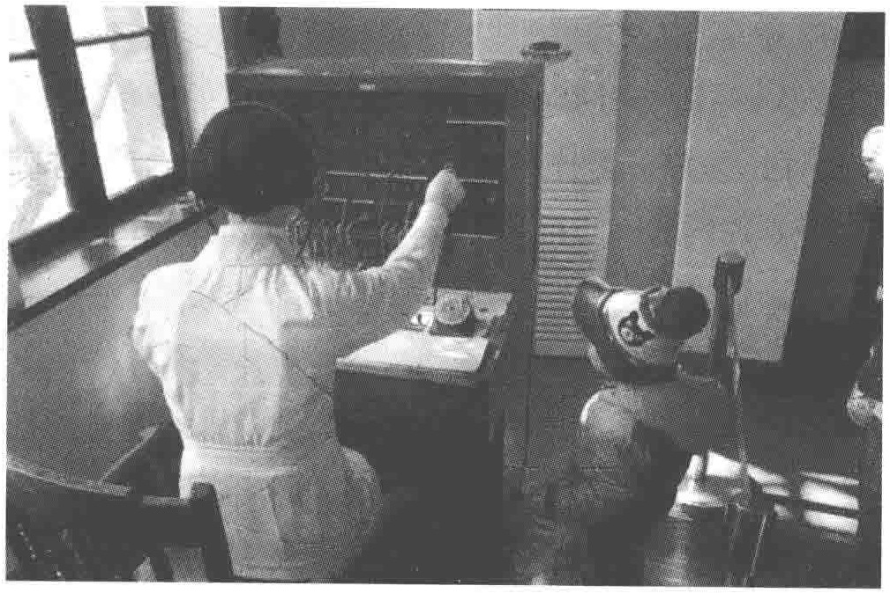

## 引擎

渲染引擎、游戏引擎、杀毒引擎、调度引擎、搜索引擎……被用“引擎”命名的 IT 名词不胜枚举，而这众多的名词常常令人迷惑。引擎这个词是类比汽车的发动机的，一辆汽车最重要的应该就是发动机，作用是为汽车提供动力。汽车装载的发动机越先进，汽车的档次和售价也越高。同理，IT 产品中使用的各种“引擎”越先进，代表产品的能力越强，提供的服务越优质，它是 IT 产品中最重要一个部件。

渲染引擎，我们通常称之为浏览器内核，是浏览器中最重要的呈现 HTML、CSS、JavaScript 的“发动机”。没有它，就看不了网页，一切基于 H5 的 Web 生态即刻崩塌。

游戏引擎，提供了一套用来开发游戏工具的组件，它是制作游戏产品的瑞士军刀，是制作游戏最基础最底层的核心部件。

杀毒引擎，就像发动机的核心功能是提供动力一样，它的主要作用就是辨别和侦测病毒，在杀毒引擎之上再包装 UI 和交互，就形成了一个完整的杀毒产品。

搜索引擎，看起来像是谷歌这样的产品，其实它的核心能力是爬虫、分词和索引。

前面介绍的 4 种引擎，都是提供单一并且可复用到别的领域的核心能力，比如 WebKit 这种内核渲染引擎，不仅被包装为浏览器产品，还有很多安全产品在利用它分析网页的 DOM 树结构，从而发现安全问题。

再来说说调度引擎。这个词也经常被程序员提到，这 4 个字脱口而出，真让外行感觉特别专业。调度引擎也是一个核心部件，但是这个核心部件的主要能力是协调。

如[图6-9](#figure-6-9)所示，这位接线员能准确地记住每个插线孔对应的是什么，具有非常强的调度能力，她的调度能力可以抽象为一个引擎，称为调度引擎。在软件工程里，各个模块之间都会被调度引擎进行组合、协调，调度引擎是一个软件系统中保障各个模块有序运作的、不可缺少的部分。

<figure id="figure-6-9" tabindex="-1" markdown="1">

{ width="1009" height="674" }

<figcaption markdown="span" style="margin:0.5em auto;font-size:0.8em;font-style:normal;line-height:1.5">
图6-9
</figcaption>

</figure>

引擎这个词看着“高冷”，其实内心是“傻白甜”，它就是一个单纯的能力组件或集合。

总结：可以把引擎理解为一套能力。

