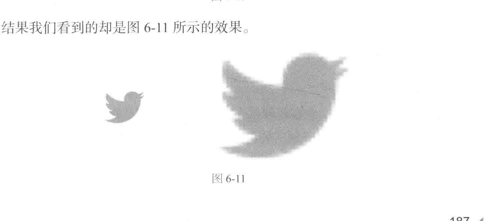
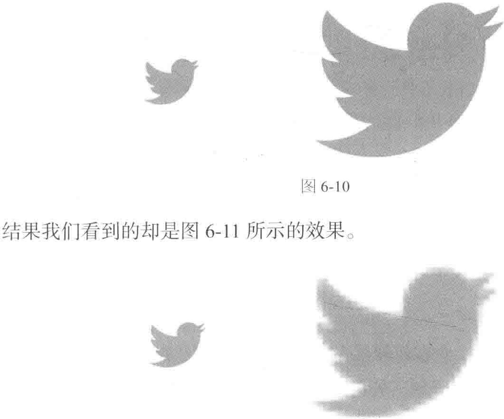

## 位图与矢量图

请读者拿出手机，打开相册，找一张照片，然后将这张照片放大放大再放大。也许在大家的想象中，放大后的效果如[图6-10](#figure-6-10)所示。

<figure id="figure-6-10" tabindex="-1" markdown="1">

{ width="759" height="336" }

<figcaption markdown="span" style="margin:0.5em auto;font-size:0.8em;font-style:normal;line-height:1.5">
图6-10
</figcaption>

</figure>

结果我们看到的却是[图6-11](#figure-6-11)所示的效果。

<figure id="figure-6-11" tabindex="-1" markdown="1">

{ width="721" height="322" }

<figcaption markdown="span" style="margin:0.5em auto;font-size:0.8em;font-style:normal;line-height:1.5">
图6-11
</figcaption>

</figure>

说好的“高清无损”呢，怎么变成这样了！图片为什么会变模糊呢？这要从图片的格式说起。

JPG、PNG、WEBP 这些常用图片格式都有一个共性——用像素点阵来描述一张图片，我们把这种图片称为位图。在一张分辨率为 20 像素×20 像素的位图图像中，一个点表示一个像素，如果你将这张照片放大到 40 像素×40 像素的尺寸，但是图像中仍然只有 400 个像素点，就会变成 4 个点表示一个像素。如果你将它放得更大，那么只可能是在更大的区域内显示一个像素点，这样，在视觉上就更容易看清每个孤立的像素点，从而觉得它变模糊了。所以，用户想放大一张位图，需要找到对应分辨率更高的同一张图片，否则它只是物理尺寸变大了，内容却看上去更模糊了。

与位图对应的另一种图片格式叫作矢量图，矢量图是由点、直线、多边形等几何图形构成的图像，这些点、线和多边形都是可以用数值和方程式描述出来的。所以说，矢量图是不受图片大小限制的，一旦描述它内容的方程式确定了，无论这张图片缩放到多大，它的内容都可以按照等比例计算出来，不会存在多个物理点表示一个像素点的情况。常见的矢量图格式是以 SVG 为后缀的文件。

既然矢量图可以做到缩放不失真，为什么不把所有图片都做成矢量图呢？答案是，做不到。一张普通的图片里，有人物也有风景，每一个细节是无法用数学方程式来描述的，只能按照点对点映射做成一张位图，而这张位图的分辨率就取决于镜头的分辨率。

可是，如果这张图片是我们自己通过想象创造出来的，就有机会将它做成矢量图。毕竟这是我们用点、线的组合来完成的创作，如果在创作过程中，用软件将这些点、线的数学表达式记录下来，最终就可以生成一张矢量图。

矢量图都可以转换成某一个尺寸的位图，所以，我们见到的很多网站的 Logo 都有不同大小，这并不是设计师做了 N 张图片，而是将同一张矢量图导出了 N 个尺寸。

由于位图的格式简单，它在各种系统平台上都得到了良好的支持，而矢量图需要特定的软件才能打开，这也限制了矢量图的广泛使用。

