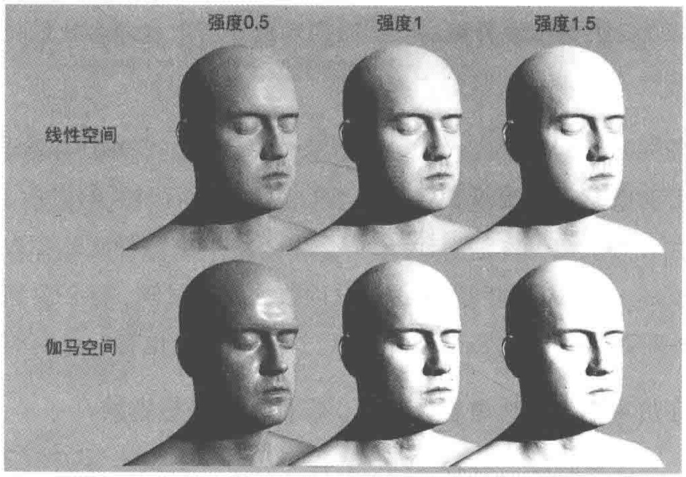
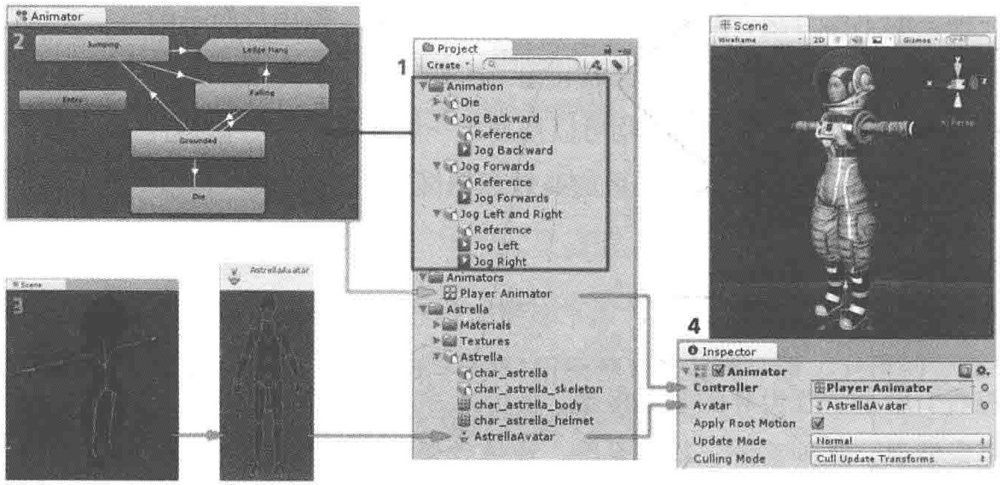
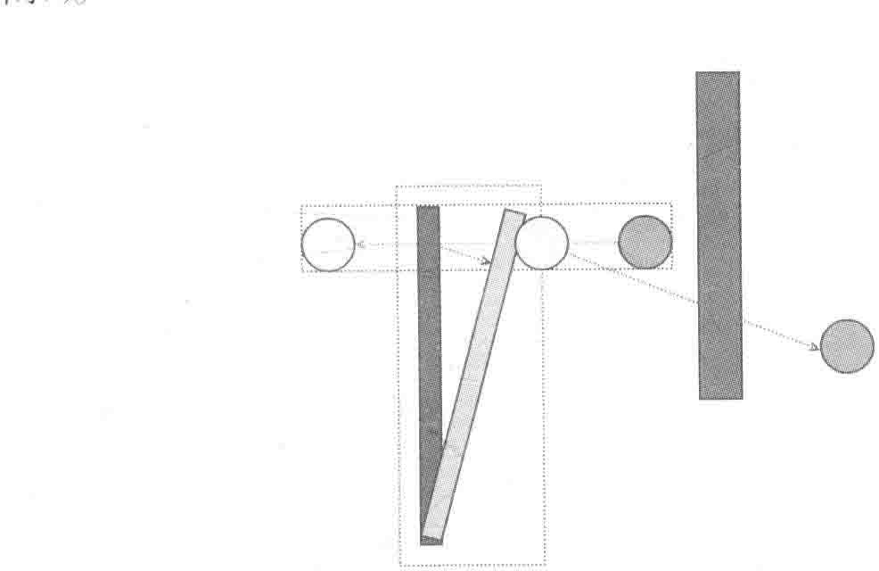

## 游戏引擎

游戏引擎是游戏世界的基础框架，它定义并实现了游戏中自然法则。这些法则包括光影效果、动画系统、物理系统、流体效果和渲染系统。

### 1. 光影效果

同一件物体，当光线以不同的强度和方向照射时，会产生不同的视觉效果。游戏引擎中的光影处理，就是在虚幻的世界中把这种特性展示出来（如[图6-12](#figure-6-12)所示）。透明物体中光的折射效果也是由游戏引擎制造的。

<figure id="figure-6-12" tabindex="-1" markdown="1">

{ width="1024" height="712" }

<figcaption markdown="span" style="margin:0.5em auto;font-size:0.8em;font-style:normal;line-height:1.5">
图6-12
</figcaption>

</figure>

### 2. 动画系统

游戏中的各种动画是由游戏引擎控制的，比如人物的行走动画、攻击动画等。这些动画一般在专业的 3D 动画制作软件中设计完成，在游戏启动时，作为资源加载到游戏中（如[图6-13](#figure-6-13)所示）。

<figure id="figure-6-13" tabindex="-1" markdown="1">

{ width="1340" height="650" }

<figcaption markdown="span" style="margin:0.5em auto;font-size:0.8em;font-style:normal;line-height:1.5">
图6-13
</figcaption>

</figure>

### 3. 物理系统

在现实生活中，除了大家熟知的被苹果“砸”出来的万有引力，还有很多的力存在，这些力作用到物体上，会改变物体的形状和运动方式。物理系统的职责就是在游戏中处理各种力和力作用后的效果。碰撞检测是物理系统中的核心部分。游戏中的物体向墙壁移动，游戏引擎要判定出何时物体会与墙壁发生碰撞，而非穿墙而出（如[图6-14](#figure-6-14)所示）。

<figure id="figure-6-14" tabindex="-1" markdown="1">

{ width="986" height="640" }

<figcaption markdown="span" style="margin:0.5em auto;font-size:0.8em;font-style:normal;line-height:1.5">
图6-14
</figcaption>

</figure>

### 4. 流体效果

流体效果是物理系统中最复杂的部分，对流体效果的支持程度可以用来评估一个游戏引擎开发团队的技术实力。

### 5. 渲染系统

渲染系统负责将每一帧图像实时输出到显示设备，渲染系统的性能和渲染质量直接决定用户的使用体验。

不难看出，游戏引擎是开发游戏的基础，是游戏世界中的“上帝之手”，掌控着游戏内部的自然法则。开发者利用游戏引擎开发游戏，只需负责将自己的故事讲好，不用重新发明一种语言。

