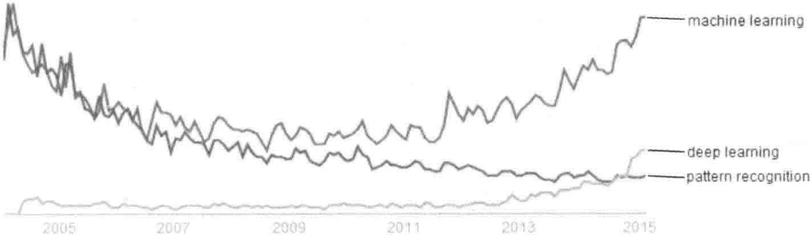

## 如何通俗地理解机器学习

如果要评选近几年最火热的计算机方向，人工智能（AI）必然是当之无愧的候选者。伴随着传统互联网技术走向成熟，人们开始把目光投向遥远的未来，不论大公司、小公司，还是研究机构，对人工智能的重视都达到了史无前例的程度，究其原因，一方面归功于 GPU 性能的大幅提升；另一方面，很多富有创造力的机器学习算法也使这个领域焕发了青春。

我们在谈机器学习（machine learning）之前，先提一下另外两个相关的名词：模式识别（pattern recognition）和深度学习（deep learning）。[图8-1](#figure-8-1)所示为近几年这 3 个关键词在谷歌上的搜索热度。

模式识别是人工智能发展初期最被看好的一项智能技术。“模式”可以理解为特征，模式识别就是利用待处理数据（图像、文字、语音等）的特征，将数据与模板匹配，并输出匹配结果。我们当前常用的语音识别及图片中的文字识别等，都可以看作是模式识别技术的应用。

<figure id="figure-8-1" tabindex="-1" markdown="1">

{ width="1427" height="415" }

<figcaption markdown="span" style="margin:0.5em auto;font-size:0.8em;font-style:normal;line-height:1.5">
图8-1
</figcaption>

</figure>

但归根结底，模式识别还是依赖人类赋予的确定规则对数据进行处理，并不具备“学习”的能力。

在新华字典中，“学习”被解释为“个体由经验或练习引起的在能力或倾向方面的变化，也指变化的过程”。对应到计算机程序中，就是在不修改算法的前提下，其正确性可以通过“经验”（历史数据）和“练习”（用一组有明确结果数据进行训练）逐步提高。显然，模式识别是无法做到这一点的。

深度学习是一个“新生”的名词，其概念于 2006 年由 Hinton 等人提出，它是机器学习领域中的一个新课题。其基本思想是参考人类大脑对数据的存储和处理方式建立计算模型，使算法具有自适应和自组织的能力。深度学习早期的基本算法模型是神经网络模型，现在已经“进化”为卷积神经网络。

前面我们说到了模式识别的局限性：要提高算法的成功率需要工程师不断地对算法进行“人肉调优”，这是一件很痛苦的事情。当“人肉调优”的经验积淀到一定程度之后，突然有个“脑洞大开”的程序员提出了让程序“自我调优”甚至“自我实现”的概念，也就是我们现在说的“机器学习”。

下面我们举个简单例子，看看“机器学习”系统是如何工作的。

假设我们做出了一个可以对物品自动分类的系统，现在，我们要用它在一堆水果中挑出苹果和梨子。整个过程如下：

（1）找一批苹果给系统，作为训练数据。

（2）系统通过训练数据，找到“苹果”这类水果的共同特征，例如红色、较圆、表皮光滑。

（3）找一批梨子给系统，作为训练数据。

（4）系统通过训练数据，找到“梨子”这类水果的共同特征，例如黄色、形状不规则、表皮粗糙。

（5）训练结束后，将待识别的水果交给系统。

（6）系统提取待识别水果的特征，与训练结果匹配，判断是梨子还是苹果。

通过上述过程，我们可以推测，如果想让机器识别更多的水果，我们只需要拿一批同种水果作为训练数据，系统训练后，就可以识别这类水果。要提高系统正确性，在不改变算法的前提下，可以利用加大训练数据量的方式达到目的。

虽然例子很简单，但是要做出这套水果识别系统，不仅需要掌握概率论、统计学和逼近论等学科的知识，还要有计算机视觉及模式识别的技术基础。

