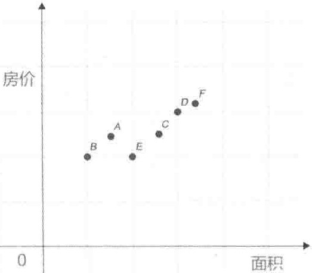

## 一个最简单的机器学习模型

光说概念太抽象，为了让读者对机器学习有一个更直观的认识，作者将带读者了解一个最简单的机器学习模型——线性回归模型。

作者并不是计算机科学专业科班出身，只是因业务需要自学了相关知识，做的大多是工程上的工作。作者在学习线性回归模型的时候，深受斯坦福大学 Andrew Ng 教授的影响，下面我们就用预测房价的例子来讲解。

现在假设我们从二手房网站上爬取了一些现成的数据，这些数据记录了某个城市很多二手房的成交价格，我们尝试用这些数据来预测房价。当然，影响房价的因素有很多，比如地段、楼层、学区、面积等，为了简化，我们只看面积这一个因素。我们可以以面积为横轴，房价为纵轴，把所有数据画在一个坐标图中，如[图8-2](#figure-8-2)所示。

<figure id="figure-8-2" tabindex="-1" markdown="1">

{ width="523" height="457" }

<figcaption markdown="span" style="margin:0.5em auto;font-size:0.8em;font-style:normal;line-height:1.5">
图8-2
</figcaption>

</figure>

显然平面上的这些点的排布没有明显的规律，但是我们希望训练一个机器学习模型，使我们输入一个面积的时候，模型能自动输出最有可能的房价。先不说机器学习，如果让人来根据面积预测房价，最自然的想法是想办法找到这样一条直线，它能够把这些点最大限度地连起来，那么当我们给出一个新的横坐标（房子面积）的时候，这条直线上对应的纵坐标就可以看作“比较接近实际”的房价。

根据初中数学知识可知，直线可以表示为 $y = wx + b$。我们要做的就是根据所有“面积-房价”数据，找到两个变量 $w$ 和 $b$，使得这条直线能最完美地拟合所有的点。其实这句话就已经概括了机器学习的所有过程。

我们手上所有的数据，叫作数据集，每一组数据包含一个（$x$, $y$）对，其中 $x$ 就是我们的训练数据，$y$ 称为真实数据。训练模型的过程，就是不断地尝试新的 $w$ 和 $b$ 的过程，直到找到那条拟合得最好的直线。每尝试一次，我们都会得到一条直线 $y = wx + b$。当我们把 $x$ 输入到这个直线公式中时，能得到一个 $y$，这个 $y$ 其实是当前这个模型的输出结果，叫作预测值或拟合值。

起初，参数 $w$ 和 $b$ 都是随机的，所以它的预测值和真实值差距很大。那么，我们应该如何尝试新的 $w$ 和 $b$ 呢？总不至于每次都随机碰运气吧？其实，要解答这个问题，我们首先要明确，什么样的 $w$ 和 $b$ 是好的 $w$ 和 $b$。

好的 $w$ 和 $b$，应该能使 $y = wx + b$ 这条曲线对所有的点拟合得最好。表达成数学上的概念，就是使所有的点到这条直线的距离之和最短。根据以前学的平面上点到直线的距离公式，我们可以得到一个表示所有距离之和的公式：

$$Loss = \sum_{i=1}^{n} (y_i - (wx_i + b))^2$$

这个公式就叫作损失函数，它表示当前这个 $w$ 和 $b$ 条件下画出来的直线离最理想的直线的误差。显然，Loss 值应该是越小越好，这也就回答了刚才的问题：我们应该挑选那些能使 Loss 值变小的 $w$ 和 $b$，才能让我们的模型越来越接近能拟合所有点的直线，越来越智能。

通俗地讲，机器学习的过程和我们学习的过程很像，先设定一个小目标（使损失函数越来越小），然后不断尝试，最后达到一个再也无法进步的状态，整个模型就训练好了。

在这个例子里，面积和房价之间的关系是线性的，于是我们用线性方程去预测房价，这就叫作线性回归模型。线性模型虽然最简单，但用处不小。现在的很多推荐系统都是基于线性模型实现的，感兴趣的读者可以进一步了解。

