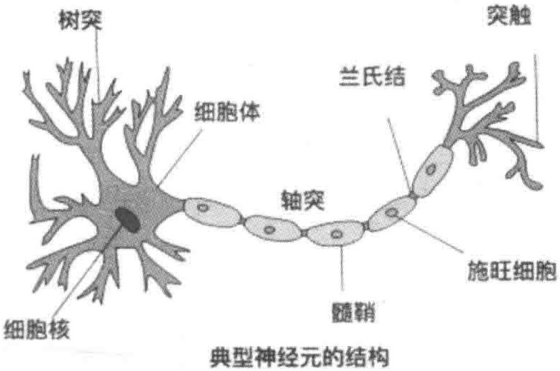
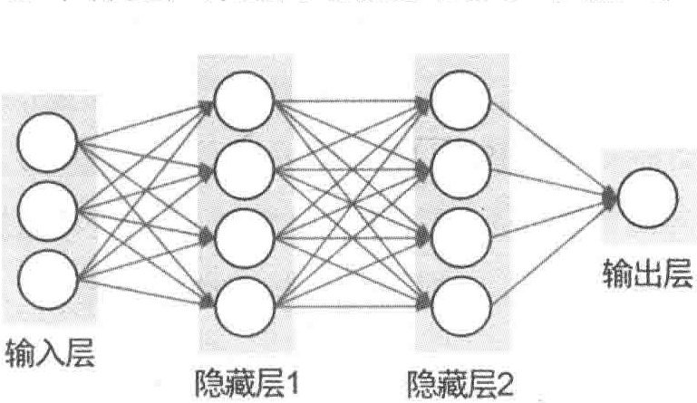
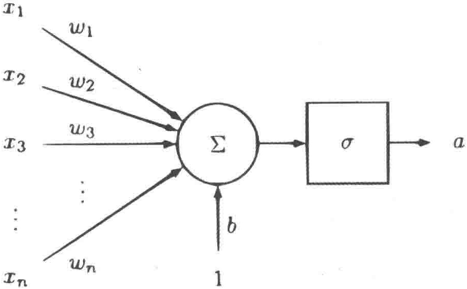

## 什么是神经网络

如果平面上的点分布得比较散落，没有线性的规律，那么我们就放弃线性回归模型，寻找更高级的模型。神经网络就是这样一种高级模型，它能拟合任意一种非线性的关系，是机器学习的终极武器。

几年前，神经网络给人的印象还是高深莫测，像《黑客帝国》里的未来科技，充满了科幻色彩。得益于这几年人工智能的迅速普及，现在路边上已经有了零基础神经网络入门培训班。

但是，这并不能说明神经网络不复杂。神经网络的数学推导算式，是作者见过的最长的算式，也是数学符号最多的算式。所以，作者并不打算讲述烦琐的理论推导，取而代之的是在概念层面的通俗讲解，希望读者对神经网络有一个更直观的认识。

神经网络由很多神经元构成，它们像极了生物的神经元（如[图8-3](#figure-8-3)所示）。生物的神经元通常有几个树突，主要用来接收信息；神经元有一个细胞核，负责接收信号；细胞核后面还有一条轴突，轴突末端分出很多神经末梢与下一个神经元的树突产生连接，从而传递信号。

<figure id="figure-8-3" tabindex="-1" markdown="1">

{ width="784" height="520" }

<figcaption markdown="span" style="margin:0.5em auto;font-size:0.8em;font-style:normal;line-height:1.5">
图8-3
</figcaption>

</figure>

神经网络的神经元，也有多个输入，可以类比生物神经元的树突。输入信号到达神经元后，经过计算，输出到下一个神经元。一个个神经元连接起来，组成神经网络。

如[图8-4](#figure-8-4)所示，神经系统的最左边，连接的是整个网络的输入，还以介绍线性模型时举的预测房价的例子说明，输入就是房子的面积。只不过神经网络面临的问题往往更复杂，影响房价的不仅是面积，还有房子的地段、学区、楼层等因素，这些因素的学名叫特征。有多少个特征，神经网络就会有多少个输入。

<figure id="figure-8-4" tabindex="-1" markdown="1">

{ width="769" height="445" }

<figcaption markdown="span" style="margin:0.5em auto;font-size:0.8em;font-style:normal;line-height:1.5">
图8-4
</figcaption>

</figure>

神经网络的输入会连接到第一层神经元。之前介绍线性模型的时候，我们的核心目的是训练两个参数 $w$ 和 $b$，使得最后的损失函数的值最小，那神经网络模型的参数在哪里呢？答案是在每个神经元和神经元之间的连接上。每一条连接都自带一个参数 $w$，也叫权重，训练神经网络就是训练所有的 $w$，如[图8-5](#figure-8-5)所示。

<figure id="figure-8-5" tabindex="-1" markdown="1">

{ width="909" height="563" }

<figcaption markdown="span" style="margin:0.5em auto;font-size:0.8em;font-style:normal;line-height:1.5">
图8-5
</figcaption>

</figure>

输入的数据乘以权重后，会汇集到下一层神经元处，神经元把所有的输入加起来，把计算结果当作本神经元的输出，传递给下一层神经元。这个过程中发生了什么呢？

答案是发生了信号传递。想象一下，当你闭上眼睛触摸一只杯子的时候，产生的刺激信号会首先到达手指的神经元，只有经过层层传递到达大脑，也就是最后一层神经元，大脑才能做出相应的判断，识别出输入信号的来源。我们假设大脑也是由许多神经元组成的，那么大脑凭什么判断输入信号是来自一只杯子还是一根针呢？这就要依赖神经元上的权重信息了。每次信号传递都会把权重加到信号上去。当信号通过最后一层神经元后，会有一个类似于备忘录的东西。上面记载了：如果最后信号强度在 1～50，那输入信号可能来自一只杯子；如果最后的信号强度在 100～200，那输入信号可能来自一根针。

上面描述的是一个成熟的大脑，它能够轻易地判断杯子和针的区别。那么，这样的成熟大脑是如何得来的呢？肯定是学习得来的。比如人刚出生的时候，所有神经元的权重都是随机的，他触摸了一只杯子，经过神经系统信号传递，大脑收到一个强度为 80 的信号。别人会告诉他，他的大脑得到的信号强度是不对的，杯子的信号强度应该是 0～50，这时他需要更新他的神经元的所有参数。经过不断的试错、更新，当他学习完毕的时候，再触摸一个杯子，大脑收到的信号强度是 23，这说明这个人的大脑已经能够识别杯子了。

这就是神经网络的原理。在神经网络学习的时候，输入层连接我们的训练数据。训练数据进入神经网络之后，与神经元之间的连接的权重相乘，传入下一层神经元。

下一层神经元把上一层神经元的输出当作输入，经过权重计算后一层一层向后传递。神经网络的最后一层中会有一个损失函数来统计整个神经网络当前的误差水平。学习的过程就是不断根据误差水平调整所有参数的过程，最后使神经网络达到智能状态。

达到智能状态的神经网络的所有参数都是合适的参数，这时我们把要预测的东西（比如上文的杯子）交给神经网络，神经网络就会自动输出一个值，来判断它到底是杯子还是针，这个过程叫推理。例如，你已经训练好了一个自动识别车牌的神经网络，然后交付给小区物业。门禁系统将摄像头拍到的车牌输入这个神经网络，经过推理，神经网络就能输出车牌号码。

当然，这只是一个非常不严谨的大概介绍，读者只需要记住一句话：神经网络由很多神经元连接起来，每一条连接都有一个参数。训练神经网络的过程就是不断调整这些参数使得最后的损失函数的值不断变小的过程。最后，算出来的损失函数的值小得不能再小，神经网络就训练好了，可以通过推理来满足我们的产品需求。

