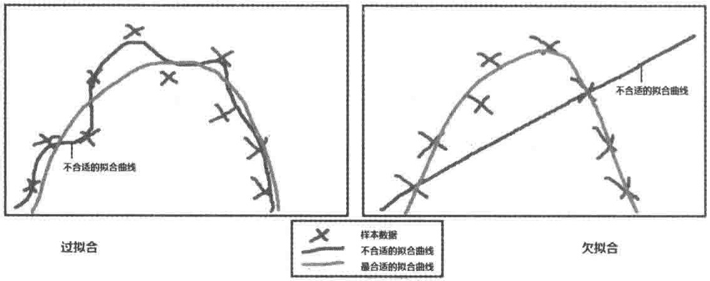

## 为什么你的神经网络像个傻瓜

同样的算法，同样的数据，为什么别人的神经网络叫人工智能，而你的神经网络叫“人工智障”？其实神经网络的训练过程充满了不确定性。现在的神经网络虽然是经过数学严格推导出来，但其实践过程还是有一些类似老中医看病的地方：很多非常有用的“黑科技”都是排列组合试出来的。

训练神经网络往往是一个很漫长的过程。一方面，训练一个网络需要海量的训练数据，比如 ImageNet 数据集有 1500 多万张图片，训练用 ILSVRC 2012 数据集也包含 125 万个样本。另一方面，神经网络需要调节的参数规模非常庞大。例如，经典的图片识别模型 VGG-16 一共有 1.38 亿个参数需要调节，可以想象，每次迭代需要的计算量和参数更新复杂度有多大。

在这个漫长的过程中，程序员一般会阶段性地评估当前模型的水平。其中一个最重要的指标就是损失函数的值，也叫 Loss 值。我们知道，训练神经网络就是让 Loss 值不断变小的过程。如果输出的 Loss 值在变大，则说明模型算法或者数据是错的，需要调一下 Bug。如果 Loss 值在下降，但是降得很慢，就说明调节的参数不对，需要把模型调得更激进一点，参数更新的步子迈得大一点儿。

只要 Loss 值一直在下降，就说明我们的训练大方向是对的。那模型性能到底如何呢？我们之前讲过，在训练开始时，我们会把数据划分为训练集、验证集和测试集。在训练的过程中，我们会不断用验证集来验证我们的模型准确性（或其他性能指标）。这样我们就可以画出一条曲线，横坐标是训练的次数，纵坐标是准确度。可以看出，正常情况下，随着训练次数的增加，验证集的准确度一直在提升。那么，测试集的情况怎么样呢？我们也可以每隔一段时间测试一下测试集的准确度。正常的话，这条曲线也在不断提升，并且按道理来说，因为验证集的数据更接近训练集，所以它的准确率应该一直比测试集高。

但实际操作中情况并没有这么完美，经常会遇到下面两种状况，如[图8-6](#figure-8-6)所示。

过拟合的意思是，模型能力非常强，它已经把所有能想到的情况都考虑到了，就像[图8-6](#figure-8-6)中左图中的不合适的拟合曲线，几乎完全涵盖了所有的训练数据。读者可能会有疑问，这难道不就是我们想要的结果吗？其实不是的。就好比一个学生，平时做习题做得很好，考试成绩却很差，考试时候很多题是他没见过的，而他举一反三能力恰恰比较弱。过拟合就是这样，因为现在神经网络的规模非常大，参数非常多，能够容纳的信息量也很大，所以模型很有可能已经把训练集“背过”了，从而无法预测未知的东西。

<figure id="figure-8-6" tabindex="-1" markdown="1">

{ width="1132" height="449" }

<figcaption markdown="span" style="margin:0.5em auto;font-size:0.8em;font-style:normal;line-height:1.5">
图8-6
</figcaption>

</figure>

过拟合了怎么办呢？我们自然会想到增加训练集，让模型见多识广，自然能轻松应对测试集。但是，增加训练集的成本非常高，人工标注是一个非常耗时费力的活儿。所以，程序员会想到用程序生成很多训练集样本。最常见比如花朵识别，会对输入数据做翻转、颜色变换、模糊等随机操作，再送到模型里去训练，这样成本相对低一些。还有就是选用合适的模型。如果你的任务很简单，就没必要用非常复杂、参数非常多的模型。还有一种情况：过拟合不是一开始就有的，往往是模型训练的时间太久，导致模型开始“死记硬背”训练数据，才产生了过拟合。所以，一个常用的策略就是“提前停止”，即趁模型还没有开始死记硬背的时候结束训练，也能在一定程度上防止过拟合的产生。

欠拟合又是另一个极端。欠拟合发生的时候，模型性能不强，没有学到有用的特征，当前的状态可以用“瞎蒙”来形容，所以无论面对验证集还是测试集，都表现得不好。就像[图8-6](#figure-8-6)中右图中的不合适的拟合曲线，完全跟现实情况搭不上，用它来预测房价，别人肯定会笑话你。

欠拟合了怎么办呢？一是继续训练，观察它的情况会不会好转。二是检查自己数据集是否有误，比如训练集的数据特征不清晰，或者有标注错误之类的。

本节讲的这些也是一个调参程序员每天做的事情。在神经网络领域中，实践出真知是不变的道理。

