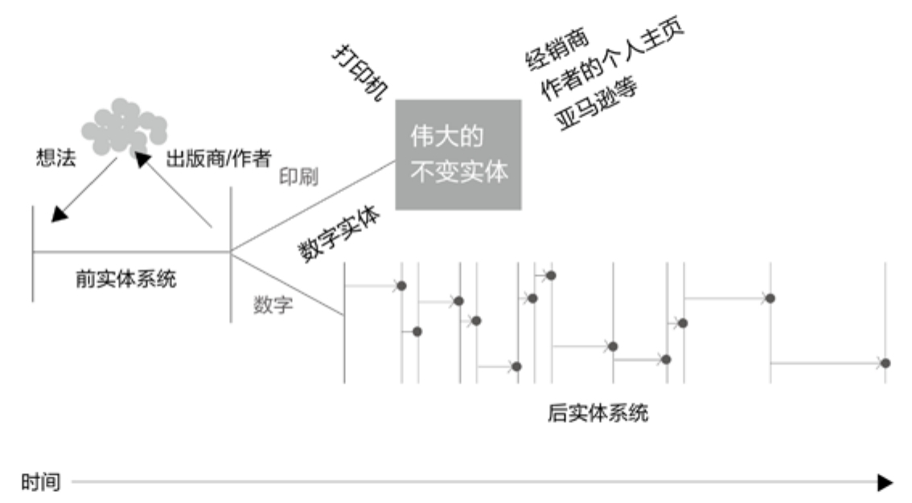

## 0.2　本书的产品定位

**目标用户**

本书继续定位在-1～3岁的产品经理。我始终认为3岁以后已经很难通过看书、学方法论提升了。这里特别要强调，“-1岁”指的是自认为是“产品新人”的“职场老人”，比如需要自己做产品的早期创业者，对产品感兴趣、并且工作中可能要承担部分职责的技术、设计、运营人员，其他行业对互联网产品感兴趣的从业者等，本书将这些人定义为“泛产品经理”群体，这本书可以说是为他们量身定做的。

**需求场景**

对于“泛产品经理”，可以通过阅读本书，理解一套方法论体系，让你今后在工作中可以更好地和产品经理交流，甚至可以自己动手做部分任务。

而对于产品经理，这本书有点像一个知识图谱，可以粗读一遍，然后在有困惑时针对性地查阅。它也有点像一个索引、一个目录，试图串起更多的学习素材。

对于更多的职场人士，如果你想了解产品经理如何解决问题，以期获得一些启发，建议重点阅读本书提出的“Y模型”相关章节（关键内容在第05章，可以扩展到第02～第06章）。我认为这是目前对“用户需求场景”讲解得最为透彻的内容，而这些话题，可以泛化为通用的“解决问题的思路”。

**产品概念**

这几年我对书的理解，已经有了很大的不同，其中最主要的转变是开始把书看作一个过程而非物品。这一定程度上来自于KK[[3]](../04/index.md#footnote_content_txt001_3)
在《技术元素》里“后实体的出书”一节中对“书”的定义。

我们的文化正在从“书本的文化”变成“出书的文化”。我们的关注点不再是作为名词形式的书，而是动词形式的书——这是一个连续不断的过程：思考、写作、编辑、写作、分享、编辑、观看、书写、观看、分享、思考、写作——这个过程中我们偶尔会抛弃书本。书，甚至是电子书，只是出书这个过程的副产品。

这是KK在2011年的思考，可以表达为[图0-1](#figure-0-1)。

<figure id="figure-0-1" tabindex="-1" markdown="1">

{ width="477" height="263" }

<figcaption markdown="span" style="margin:0.5em auto;font-size:0.8em;font-style:normal;line-height:1.5">
图0-1　《技术元素》里的插图
</figcaption>

</figure>

图中的左侧“前实体系统”会更加重要，意味着互动。社区与对话的建立，在前实体系统阶段就已经开始，永不停歇。比如有的作者，在图书出版之前，就通过自媒体与读者分享部分章节、讨论内容、建立微信群保持沟通。

传统的作者、书、读者的关系，会变成产品经理、产品、用户的关系。

所以，出版行业的人可以从产品经理身上学到很多。更进一步，产品经理及其团队包含了作者、出版商、渠道等，产品包含了书本身和借此形成的社群与用户关系，用户也可以从读者的概念泛化开来，社群里的人，也许并没有买一本实体的书，但也同样是用户。

图中右侧的“后实体系统”，分化为两种：“狭义物质的”和“数字的”。

打印出来的实体，这两年也有一些小变化，比如植入二维码就是一种很好的线下到线上转化的入口，很多书里都有了“延伸阅读”、“参与讨论”、“更多资料”。而数字化的实体，更加灵活多变，可根据反馈实时优化，优势毋庸多言。这两者互相补充，好比果粒酸奶里，酸奶让果粒更有风味，果粒让酸奶显得更有干货。

本书在构思的时候，就已经通过一个“读书会”的社群组织在与用户保持着沟通，加上相应的培训咨询服务、工具包，以及积累多年的微信公众号、微博、知乎等网络媒体，都和本书构成了一个有机的整体。这一点，“写在正文之后”里会再次谈到。

**竞争优势**

本书的竞争优势简单来说有以下三点：

第一，本书的底层逻辑、方法论取自序中提到的那5本和我有关的图书，并非凭空搭建，而这样的内容源头，也使得本书具备了一些独一无二的积淀。

第二，基于个人经历，我在阿里期间，除了做一线产品，还做过很多关注“产品经理岗位”、“创新”的事情，而在离开阿里之后，也曾有意识地在用各种方式补充自身的短板，接触了很多各行各业的大公司和创业团队，在序中也已经做过回顾。

第三，写书的过程中，我通过读书会的活动引入了国内产品经理圈内，几乎所有“写过书 & 打过仗”的朋友作为“嘉宾团”[[4]](../04/index.md#footnote_content_txt001_4)
，他们的一些分享，加上读书会优秀学员的一些建议，也融入本书框架，共同构建了更加经得起推敲的内容。

