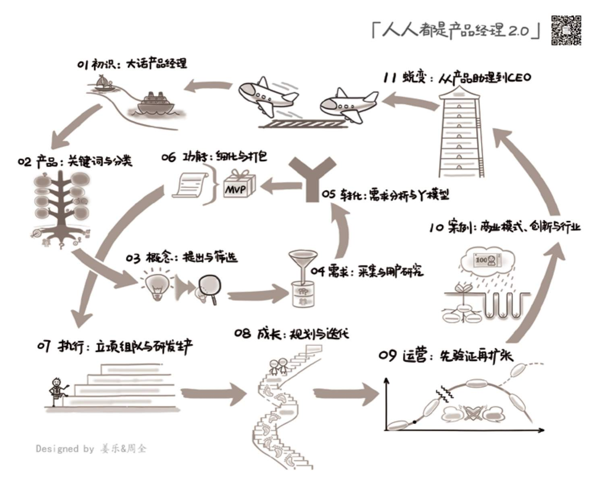

## 0.3　本书内容与阅读方法

2014年，我第一次接触了“视觉引导”的概念，感到十分受用，在深入了解之后，更是充分体会到图形与文字在认知上的互相促进。在这个时代，感性与理性同等重要。所以，本书的大框架和每一章的要点，都会采用[图0-2](#figure-0-2)所示的这种图形化的方式来表达，希望大家喜欢[[5]](../04/index.md#footnote_content_txt001_5)
。

本书从人开始，以人结束，中间说事，以一个产品从无到有的过程为框架——想清楚、做出来、推出去，外加一章综合案例。其中，最重要的想清楚、做出来、推出去，对应着互联网公司里三个最核心的岗位——产品、技术、运营，而本书的内容重点，则对应着“产品”。

<figure id="figure-0-2" tabindex="-1" markdown="1">

{ width="622" height="503" }

<figcaption markdown="span" style="margin:0.5em auto;font-size:0.8em;font-style:normal;line-height:1.5">
图0-2　全书视觉引导图
</figcaption>

</figure>

接下来简单介绍一下各章的主要内容。

**00 开始：写在正文之前**

让用户了解本书的定位、整体架构和内容、阅读方法、局限性，以便更好地决定是否要花时间读下去。

**01 初识：大话产品经理**

介绍产品经理这个岗位的前世今生。从社会发展的角度，讨论这个岗位为何会出现，又会往哪里发展。然后，谈谈产品经理的思维方式与性格特点，以便读者进行自我判断：自己是否合适以此为业，需要做哪些改变。最后，聊聊产品经理如何入行、典型任务，以及身边的团队。

**02 产品：关键词与分类**

了解了产品经理这群人，再来看看他们做的产品应该怎么定义。世界上的产品多如牛毛，哪怕只是互联网行业里的产品也都已是千奇百怪。为了更清晰地理解它们，本书试着从多个角度，比如用户关系、用户需求、用户类型、产品形态等方面对产品进行分类，希望读者看完以后可以想清楚自己喜欢、适合做什么样的产品。

**03 概念：提出与筛选**

如何找到一个真正的机会？这不仅仅是灵光一现的idea，还要想清楚核心用户、刚性需求、典型场景和竞争优势。然后，从团队的能力与意愿、外部的价值与机会、成本与风险等多方面来衡量，这到底是不是一件值得继续做下去的事情。

**04 需求：采集与用户研究**

做产品就是解决问题，我们知道要对解决方案精雕细琢，但在“问题到底是什么”上花费的时间总是太少。本章，会讲解收集信息的各种方法以及各自的优劣。随着信息的逐渐充分，将会理解需求的三种深度，以及用户从抽象到具象再到抽象的过程。同时，也可以试着理解一些概念——用户故事、人物角色、产品原则。

**05 转化：需求分析与Y模型**

用心听，但不要照着做。本书认为这句话是产品经理思维方式和做事方法里最核心的一点，Y模型就是这句话的具体操作方法。本章将通过各种案例，从表面的用户观点、行为，到动机与目标，再到人性与价值观对需求进行讲解。了解需求的本质以后，又该如何从用户需求的角度匹配出合适的产品功能，让用户满意而归，这些都本章的重点。

**06 功能：细化与打包**

从用户需求推导出产品功能之后，到底做不做，还要看功能的价值高低、成本大小，以及类别归属。确定了实现的先后顺序，接着就要决定“下一个版本”到底做多少，这取决于很多因素。这个过程，也引出了需求与功能管理的话题，至此，“想清楚”大模块结束。

**07 执行：立项组队与研发生产**

从这章开始进入“做出来”的模块。首先会拿到各种资源，简单地讲就是“人和物”，其中团队又是最最关键的。在研发生产阶段，作为产品经理，对设计、开发、测试、运维等岗位的工作内容，多少得有些了解，才能做到顺畅配合。

**08 成长：规划与迭代**

产品的1.0上市，不是结束，而是开始。任何一个好产品都是慢慢变好的。本章将加入时间维度，聊聊规划与迭代这两个词的异同。二者都有一步步来的意思，实则有着截然相反的方法论内核。具体怎么做，本章会给大家讲一些真实的案例，作为“做出来”的收尾。

**09 运营：先验证再扩张**

一个产品做出来了，如果没人用就相当于零，所以还要“推出去”。本章将会聊聊产品与运营这对“死敌”，希望借此化干戈为玉帛。对于运营来说，不同的产品阶段有不同的目标和手法，验证、爆发、平台、衰退……方法错了，可能“彼之蜜糖，吾之砒霜”。至此，我们前面详细后面粗略地聊完了产品的整个生命周期。

**10 创新：商业模式与行业**

本章从模式、创新的角度综合来聊“整个产品”，教大家一个理解“行业如何运作”的小方法，谈谈各类型的公司在做创新时都会碰到什么坑。最后，谈几个作者感兴趣的行业，作为案例来提升大家的商业感觉。

**11 蜕变：从产品助理到CEO**

终于又回到人的话题：如何从一个菜鸟长成一个高手？本书把产品经理分成了7个层级。总有一天，大家都可能都不再做产品经理了，那么，我们的归宿是什么？最后，将本书的方法论进行升华：为什么它有可能成为对个人生活态度以及整个社会进步的推动力？

**12 结束：写在正文之后**

全书的最后，给出一些周边资源——盘点了十年来国内作者写的产品相关的图书，介绍了作为本书延伸的“读书会”，并列出更多可以去学习的资料，希望对大家有所帮助。

阅读本书，可以先浏览一下全书和每章的视觉引导图，对整体内容有个感性的认识。不一定需要按章节顺序阅读，大家可以根据每章的内容，结合当前工作的需要，自主挑选主题来阅读。在每一章最后，会根据本章主题，提供更多的阅读材料。

对于已经在做产品经理的读者，建议可以先读一下第11章，这样可以判断出自己目前的位置，从而更清楚接下来的努力重点。对于广义的创业者，可以先读一下第10章，特别是关于创新各种坑的内容，避免在上路之前就埋下隐患。对于想了解产品经理核心思维的人，建议先读第05章，了解“Y模型”这个通用的解决问题思路。

每一章的最后，还会布置几个任务，都是一些有实际作用，应该做，但很可能忙于日常事务而一直没做的事情，希望你能补上。

当你读完本书的全部或部分章节时，可以再看看对应章节的视觉引导图，建立起自己的知识地图，以便需要的时候可以更快地找到相关内容。

最后，再说说这本书的内容与《人人都是产品经理》V1.X版本的关系——是升级，但不是替代，有点儿像上下册，表现为以下几点：

第一， V1.X版本是以“从新人到老鸟的**个人成长**
”为章节顺序，本书是以“从无到有的**产品生长**
”为内容框架。

第二， V1.X里提到的很多细节，多为一个产品新人工作中每天的任务，本书中不再赘述。

第三， 本书也说了一些V1.X中没有的内容，比如创新、创业、小公司的做法、行业案例，等等。

所以，一定要区分定位的话，V1.X更合适初入职场的产品经理，有励志作用，更偏实操，涉及更多做事方法。是道法术的术。本书更适合自认为是“产品新人”的职场老人，更偏理念，涉及更多思维方法是道法术中的法，适合想了解怎么做产品的“泛产品经理”。

