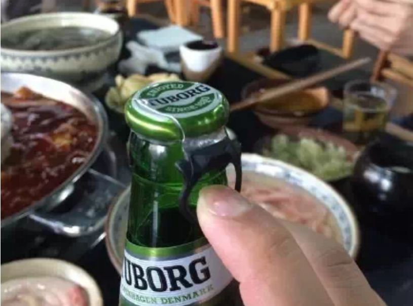
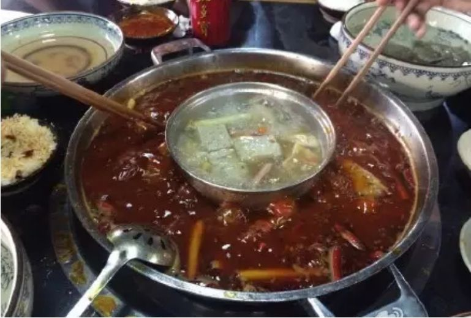
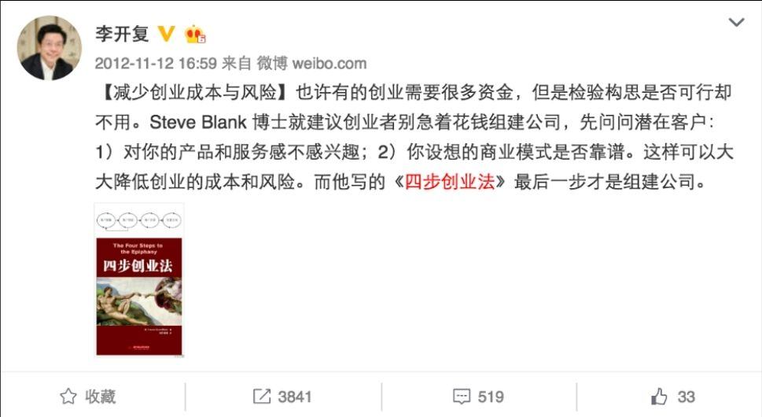
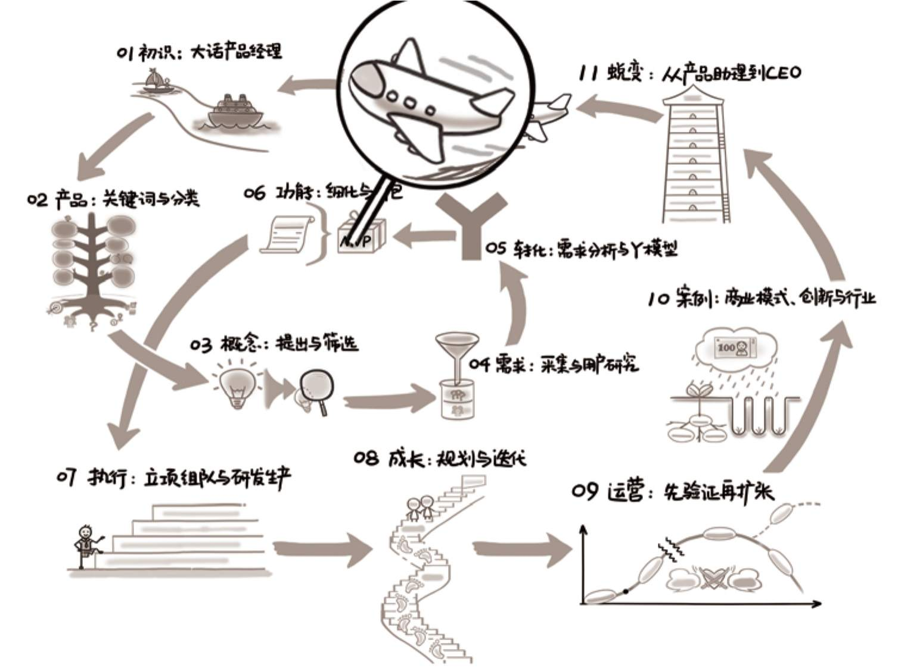

## 内容简介

本书继续定位在-1～3岁的产品经理。这里特别要强调，“-1岁”指的是“泛产品经理”群体，比如自认为是“产品新人”的“职场老人”，需要自己做产品的早期创业者，对产品感兴趣并且工作中可能要承担部分职责的技术、设计、运营等人员，其他行业对互联网产品感兴趣的从业者等，这本书可以说是为他们量身定做的。

内容方面，本书全然不同于上一版《人人都是产品经理》，可以算是给上册（个人成长）配了下册（产品生长）。本书将从人开始，以人结束，中间说事，以一个产品从无到有的过程为框架——想清楚、做出来、推出去，外加一章综合案例。其中，最重要的想清楚、做出来、推出去，对应着互联网公司里三个最核心的岗位——产品、技术、运营，而本书的内容重点，则对应着“产品”。

## 自序

**从一顿火锅说起**

若干年前在重庆，和朋友一起吃火锅，我第一次见到[图1](#figure-1)这种啤酒瓶盖子，它有点像易拉罐的拉环，开瓶体验不错。朋友说很多人就因为这种啤酒可以无工具开瓶，加上拉开的那一声“Biu”而成为了忠实用户。

<figure id="figure-1" tabindex="-1" markdown="1">

{ width="342" height="254" }

<figcaption markdown="span" style="margin:0.5em auto;font-size:0.8em;font-style:normal;line-height:1.5">
图1 某品牌啤酒的盖子
</figcaption>

</figure>

再看看如[图2](#figure-2)所示的鸳鸯锅，相比更常见的左右分隔，这个内外分隔的锅解决了以下几个问题。

第一，入座的时候不用再讨论吃辣的坐哪边，不吃辣的坐哪边，通吃的坐中间这个话题。

第二，永远不会出现“夹红汤里的菜，红油滴进清汤里”的情况。

第三，红汤、清汤沸点不同，左右分隔不会同时开锅，而内外分隔，配合合理的火头，可以同时开锅。

<figure id="figure-2" tabindex="-1" markdown="1">

{ width="323" height="217" }

<figcaption markdown="span" style="margin:0.5em auto;font-size:0.8em;font-style:normal;line-height:1.5">
图2 内外分隔的鸳鸯锅
</figcaption>

</figure>

“人人都是产品经理”这句口号，已经提出小十年了，我们看到世界美好了一些，但生活中的Bug依然很多。只要用心，人人都可以发现，并提出自己的想法，直接或间接地为优化这个世界做出贡献，我也渐渐体会到《人人都是产品经理》的神奇之处。

**阶段一：**
很多人入行看的第一本书就是它，并且见不得老人黑它（画外音：我和别人不一样，不是那种做不了产品经理的人）。

**阶段二：**
接着做熟练了，发现说说容易，做到好难，开始加入黑这本书的阵营（画外音：我懂了，童话里都是骗人的，谁提我跟谁急）。

**阶段三：**
再然后开始带新人了，想想又推荐新人先看这本书（画外音：小孩子嘛，先看看励志故事也好，别被吓到了，也能省我不少口水）。

循环往复……

而在这么多年中，我也逐渐意识到《人人都是产品经理》的不足之处，希望自己能把坑填上。所以，自序里，我就分享一下最近若干年发生的一些事情吧。

**与我有关的五本书**

先说五本书，它们是《人人都是产品经理》、《启示录：打造用户喜爱的产品》、《四步创业法》、《淘宝十年产品事》、《有的放矢》，2010年到2014年每年一本，它们是本书的内容源头。其中，两本是我写的，三本是我组织的网络协作翻译团队@七印部落[[1]](#footnote_content_fow005_1)
翻译的，它们都在说产品，和你手里这本新书的话题一样。

下面简单说说这五本书的逻辑。

《人人都是产品经理》，是新手产品经理的方法论，适合-1岁到1岁的产品经理。2010年出版第1版，业内不少已经很优秀的产品经理，跟我说“是看这本书长大的”，我表示很无语。2012 年出版 V1.1，2014 年出版 V1.2（也叫纪念版），截止2016年年底，实体书销售超20万本，不算正版和盗版的电子书。

《启示录：打造用户喜爱的产品》是做产品的高阶方法论，作者Marty有20多年的产品经验，适合产品管理者或资深的产品经理阅读。如果你认为上面那本太初级、太局限，那这本书就最适合你了。于2011年翻译引进，今天看依然不过时。

《四步创业法》是一本在国内被严重低估的书，2012年引进，其实这才是硅谷的创业圣经。《精益创业》的作者是《四步创业法》作者的学生和忠实信徒，李开复老师也推荐过它，如[图3](#figure-3)所示。做产品久了会发现，产品和创业的方法论其实很像，只是创业更难。在创业的方法论中，我们能学到很多对产品经理有用的东西。

<figure id="figure-3" tabindex="-1" markdown="1">

{ width="407" height="221" }

<figcaption markdown="span" style="margin:0.5em auto;font-size:0.8em;font-style:normal;line-height:1.5">
图3 李开复点评《四步创业法》
</figcaption>

</figure>

《淘宝十年产品事》是一本案例集，正好于2013年淘宝成立十周年的时候出版。淘宝系产品的复杂度和多样性，可以说是国内互联网行业20年来独此一家，从前台到后台，从2B（to Business）到2C（to Customer），从Web到App，不一而足。产品经理成长到一定阶段，再看方法论已经作用不大，只能通过案例来提升。自己犯错后的成长最扎实。比如，早在2008年，阿里和微软合作的一个项目上，我就花掉了公司1000多万人民币的项目经费，这种机会不是每个人都能有的，所以通过别人的案例来学习会更加高效。

《有的放矢》于2014年引进，它更加适合2014年开始的略显癫狂的全民创业时代。全书只讲了一件事情——创业、做产品的过程中，怎样可以有的放矢，不做无用功，不浪费各种资源。不管你何时读到这里，都不妨回忆一下自己去年这个时候在做什么。是不是很多事情，如果当时不做，对现在的自己和公司也没有任何影响？再回忆一下，三年前红红火火的创业公司，是否绝大多数已经销声匿迹？如果你的回答是肯定的，那么这本书就能帮到你。

2015年到2016年，我把它们的精华合并在了一起，开发了一门课程，叫“互联网产品的从无到有”，给不少大小公司、机构、大会分享过，借这些机会也接触到不少新的案例、理解了一些方法论的局限性，愈发感觉有必要好好整理一下。

**2016年，工作十年**

《人人都是产品经理》里写到的各种局限性，我在工作十年内一直努力打破，下面汇报一下成果。

2006年到2012年，我在阿里一线做产品，试了2B的，比如中小企业的管理软件、CRM、进销存等；2C的，比如淘宝卖家的各种效率工具、天猫买家的会员体系与积分系统；平台型的，比如天猫的营销产品线、会员体系；垂直型的，比如淘宝的鞋类、运动、海外商品市场……这个阶段，出版了第一本书《人人都是产品经理》。

2012年到2014年，我开始关注人，从“做产品改变世界”进化为“通过改变产品经理来改变世界”，去阿里集团人力资源部负责产品大学，专门研究了产品经理成长，设计了岗位模型、学习路径图等，同时也在做讲师，培训阿里的产品新人；搭建了阿里集团在线学习平台，服务了当时的两万多名员工，麻雀虽小五脏俱全，包括类似“内部网易云课堂”“内部知乎”等系统；负责阿里集团内部的创新孵化器——赛马，探索大公司内部的创新机制与文化。这两年，出版了第二本书《淘宝十年产品事》。

2014年上半年，在离开阿里前的最后几个月，是有一小段插曲——为响应集团All in无线的号召，我做了一段时间“来往”[[2]](#footnote_content_fow005_2)
，虽说产品没起来，但对我来说收获也很大，一是接触了移动互联网，二是发现自己还是可以承受996[[3]](#footnote_content_fow005_3)
的。

2014 年 8 月，我从阿里离职，做了半年自由职业，全国各地到处跑，一边通过讲课、做顾问，感受各种行业、各类公司的做法，一边思考接下来做什么。接触过的公司包括电信、移动这类运营商以及他们的乙方公司；上证所、中国银联、国泰君安、汇添富、建行、招行、兴业、平安等金融相关公司；网易、携程、京东、苏宁、同程这些互联网公司；中兴、华为、联想、用友、万科、海南航空、上海航空、上汽集团、中航信等泛IT类公司；各种媒体、培训、会议公司；还有一些创业公司和创业服务机构……这半年，扩展了视野，逐步确定了自己想做的事情。

2015年春节后，我开始创业，方向是“创业者服务”，为了自己预想的最后一份职业——投资，做准备。于是，我又了解了各个行业的很多小公司，从三五个人到小几百人的都有，自己也尝试孵化了一些小项目。现在，我在杭州有两家小公司，分别是“良仓孵化器”和“B12”[[4]](#footnote_content_fow005_4)
，后者主要做的是科技媒体与周边服务。

从2016年春天开始，我在整理积累的各种经验时，发现还差一些案例，于是做了“读书会”[[5]](#footnote_content_fow005_5)
，邀请了几十位“打过仗 & 写过书”的好朋友作为嘉宾，带来了更全面的视角，学员们也提供了更丰富的案例。

有了上述准备，终于在2016年二季度开始正式动笔，编写《人人都是产品经理2.0》，也就是本书。

**迟到的致谢**

没想到写下这句话的时候，比计划晚了半年，已经是2017年的二季度了。本书总算快要出版，在这里感谢一下各位帮助我的亲朋好友。

离开大公司以后，作为一名创业者，我深深地感受到一种漂泊感，感谢一路同行的良仓孵化器和B12团队的小伙伴，让我知道我还是一个有组织的人。

感谢各路网友，是你们在微信公众号、微博、知乎等平台里对我不断的鼓励和鞭策，让我有了继续前行的动力。

感谢电子工业出版社的侠少及其团队，这是我们合作的第三本书了，话不多说，合作愉快。

感谢为本书视觉引导图做出贡献的创新引导师金沙浪、浙江大学语言与认知研究中心的徐慈华老师、设计师姜乐和周全，是你们让这本书图文并茂，增色不少。

感谢家人，特别是我的妻子江咏梅和我们双方的父母，是你们的支持与包容，让我可以做一个半自由职业者，并安心写作。

要感谢的人还有很多，这里没法一一列出——比如参与试读、提意见和建议、给本书写推荐语的各位前辈和同行；对本书内容、案例做出贡献的“读书会”嘉宾与学员；参与本书封面讨论、周边素材完善的诸多朋友……

以上，依然难免遗漏，诚惶诚恐，再次感谢大家。

苏杰

2017 年 4 月 杭州家中

---

[[1]](#footnote_quote_fow005_1)
详情可参见12.3节。

[[2]](#footnote_quote_fow005_2)
阿里在社交之路上的一次失败尝试，但也有很大价值，比如，它为后来的企业级应用“钉钉”积累了技术资本，也让大家进一步认识到，做产品要从用户需求出发，而不仅仅是从公司战略需要出发。

[[3]](#footnote_quote_fow005_3)
玩命的互联网公司发明的词，每天早9点上班，晚9点下班，一周工作6天。

[[4]](#footnote_quote_fow005_4)
详情参见11.4.1　节。

[[5]](#footnote_quote_fow005_5)
详情参见12.2节。

## 阅读导图

<figure markdown="1">

{ width="634" height="474" }

</figure>

