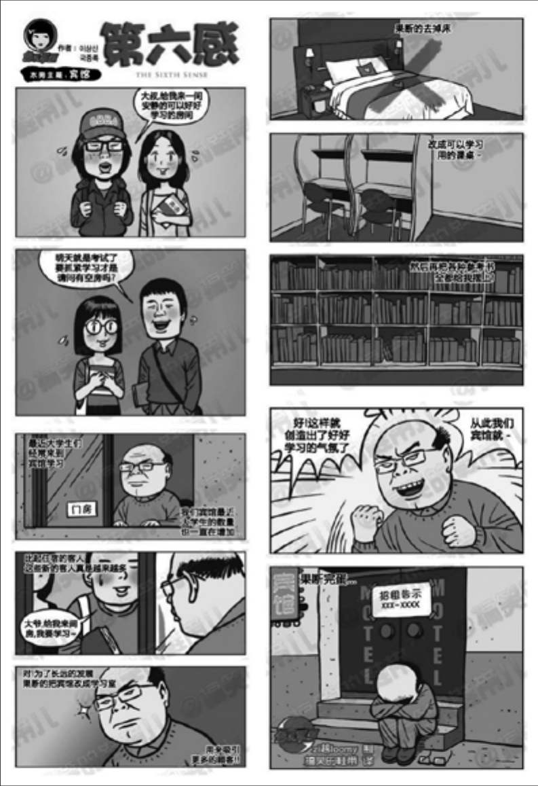
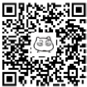

## 1.1　从一个小故事谈起

这是我在知乎上获得最多赞的一个回答。没有字，只有一张网上找来的图，如图1-1[[1]](../05/index.md#footnote_content_txt002_1)
。

问：什么是“伪需求”？能否举例说明？

{ width="333" height="486" }

图1-1　伪需求的故事

时隔多年，我觉得不应该光抖机灵，还要来点有用的。

宾馆大爷的故事，其实在工作生活中经常发生——这个大爷，就是产品经理；这家宾馆，就是一个产品；而学生们，就是用户。不合格的产品经理处处可见，他们共同创造了一个可怕的世界。那么，这个例子中到底有哪些坑？

{ width="73" height="73" }

**产品定位阶段**

原来的定位是宾馆，因为几个用户的只言片语，直接修改定位，意味着进入完全不熟悉的市场，原来的竞争对手是其他宾馆、酒店，现在变成了学校里的图书馆、自习室。

**需求采集阶段**

各种方法要灵活应用，比如“不但要听用户怎么说，还要看用户怎么做”。此外，我们也经常提到，要看需求的普遍性，以及有没有特定时间、特定人群。不能用户说什么我们都满足。

**需求转化阶段**

从用户需求到产品功能，不能直接照着用户说的做，而要分析用户的目标。这依赖于领域知识和对目标用户的理解——从其“观点”、“行为”到其“目标”、“动机”。产品经理和用户通常不是一种人，这很考验“同理心”。

**产品概念验证**

即使自认为已想清楚新功能，在动手开发前，还是要再找几个用户沟通一下。还要注意方式方法，比如可以问用户：如果我们这里有自习室，你会推荐同学来学习吗？

**新功能上线时**

多使用灰度测试。简单地说，就是建议大爷不要一下子把整个宾馆都改成自习室，先改个一两间，看看市场反馈好不好。而且，上新功能时，也没必要把旧功能去掉。

人人都爱出主意，类似“用户提出的解决方案”这种伪需求是实践中的常态，而本例中“用户为了掩盖真实目的而欺骗”的情况反倒不是很多。作为产品经理，在面对这样的场景时，就需要找到这个用户提出解决方案背后要解决的问题，然后给出自己的方案。这就是产品经理思维方式和做事方法的核心：“**用心听，但不要照着做**
”，说起来简单，但做起来并不容易。

