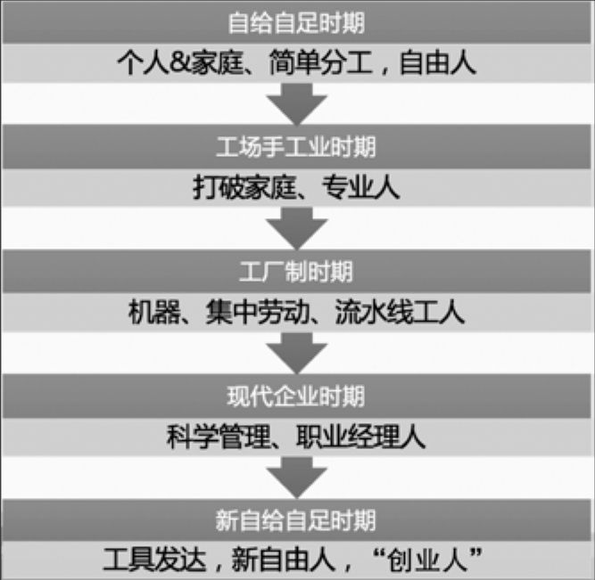

## 1.2.1 　从人类社会出现分工说起

人之所以为人，至少有生物和社会两重意义，而社会意义要通过一群人构成的组织体现出来。有社会组织以来，个人的社会角色可以说经历了几个大的阶段，如图1-2所示。

{ width="280" height="273" }

图1-2　社会组织的几个阶段

在第一阶段的自给自足时期，个体、家庭是基本的社会单位，有了“男耕女织”这样的简单分工，每个人都是自由的，不属于某个具体的社会组织。

在第二阶段的工场手工业时期，人们发现彼此各有所长。于是，把一些有特定专长的人聚在一起做事，诞生了一批专业的手艺人，比如铁匠等。他们不再自给自足，而是靠手艺吃饭，社会生产力提升，产品有了剩余，也有了更多的商品交换。

在第三个阶段的工厂制时期，出现了资本主义萌芽，分工更加细致，大机器、流水线是典型的代表。工厂里的人数也比工场手工业时期大大增加，工人已经没什么能养活自己的手艺了，变成了流水线上的一环，个人只能依靠组织生存，卓别林的电影《摩登时代》描绘的就是这一场景。

到第四个阶段的现代企业时期，时间已进入二十世纪，公司的经营目标日益复杂，对管理的要求也不断提升，出现了矩阵式组织和职业经理人。很显然，产品经理作为一个岗位，在这个阶段诞生了。

第五个阶段的新自给自足时期，是我自己起的名字，就是现在所处的这个时代。因为科技的发展、工具的发达，每个个人能发挥的作用越来越大，对组织的依赖越来越小，诞生了一批新的自由人，而组织也开始为个人服务。

上述历史规律，也适用于一家公司组织的成长轨迹。开始必然是按职能划分部门，强调分工以提升效率、应对单一目标，这时候的“产品经理”就是组织的领袖。而公司经营出现多目标，以及从单一产品变成产品线以后，就有了管理上的矩阵式结构，于是出现了通常意义上的产品经理。

