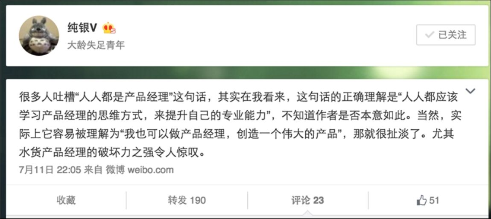
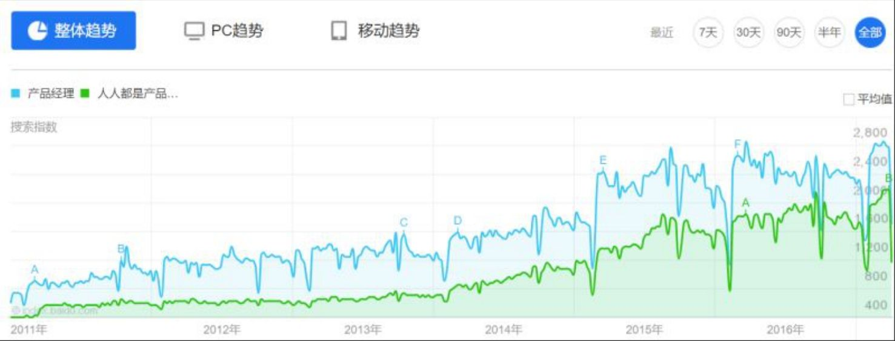

## 1.2.5 　十年，产品经理逐渐成熟

首先看看十年前发生了什么事情吧。

十年前，腾讯股价还不到2元港币，2016年中已经在200元左右了，所以十年间腾讯股票几乎翻了一百倍。

十年前，百度在和刚刚进入中国的Google厮杀。李开复老师也刚来中国，在各地巡回演讲，为Google招募他的50名门徒，还没毕业的我也参加过一场。

十年前，阿里集团主要靠B2B卖会员费的方式养活自己，还没有天猫、聚划算、阿里云、菜鸟等一系列产品，淘宝还是一个不大的购物网站，而支付宝，几乎就是淘宝的财务部。

也是在十年前，2006年，前金山副总裁，现馒头商学院院长王欣，出版了中国产品经理界的第一本书《产品经理实战手册》，这本书的定位有点偏IT行业的产品经理，和互联网行业的产品经理还不完全一样，所以鲜有人知。

十年前我也已经参加工作了，当时的岗位是需求分析师，那时业内还很少听到产品经理这个词。

我们在十年前的蛮荒时代慢慢走了几年。一群人经常聚在一起，大家渐渐意识到自己好像是在做“产品经理”这个岗位。我也渐渐意识到，产品经理是非常重要的一个岗位，它的思维方式和做事方法，是学校里根本不教授的，但这些才是商业环境里真正重要的东西。

于是，我希望每一个人都应该拥有这些能力。2009年初，我提出了一个口号：人人都是产品经理。当时没有人知道我，也就没有人觉得有什么问题。但随着同名的书渐渐被人知道，这句话的争议就越来越大。当然，也有人会觉得这句口号还不错，比如原网易的产品总监纯银，他对口号的理解和我是非常一致的，如图1-3所示。

{ width="484" height="216" }

图1-3　纯银对人人都是产品经理的理解

当然有些人认为产品经理这个岗位就是纯扯淡的，只要技术、设计强一点，团队就根本不需要这个岗位[[3]](../05/index.md#footnote_content_txt002_3)
。所以，产品经理这个岗位，也是在争议中一点一点成长起来的。从整个业界的关注度来说，这个岗位是从2010年左右才算真正火了。

图1-4是百度指数的截图，如果同学们也想看看其他时间跨度的大趋势，完全可以在百度指数上去搜一下相关的关键词，就能看到一个跨年度的趋势。大家可能会发现，虽然这个岗位的争议那么多，但是它的热度还是在不断上升，而且“人人都是产品经理”的热议更是有增无减。

{ width="622" height="236" }

图1-4　“产品经理”、“人人都是产品经理”的百度指数趋势

对于互联网行业，十年间产品经理岗位经历了“前产品经理时代”、“产品经理时代”，已经即将进入“泛产品经理时代”。如果把“产品经理岗位”当作一个产品，从它的初创期、成长期、平台期来看，这个产品现在正处于爆炸式的成长期，这个岗位也从早期的粗放式定位，渐渐定义明确、出现细分，并且也可以选择把部分职责交给周边的团队。

一个岗位出现细分，说明成熟度和专业度增加，也就是说“不好混了”。比如技术岗位明确分为开发、测试、运维等，而开发还可以继续细分为客户端、服务端开发等。那么，现在产品经理岗位都有哪些常见的细分角度呢？

第一， 明确的层级定义。本书第11章“从产品助理到CEO”，会专门从职业发展的角度聊这个话题。

第二， 按照产品生命周期不同阶段的主要任务，细分为四个发展方向：产品架构、产品设计、产品管理、产品运营，这些在1.4.2　节中将会细说。

第三， 产品类型不同，背后需要产品经理具备的能力也不同，据此的细分也可视为产品的细分。2.2节会对此展开详述。

