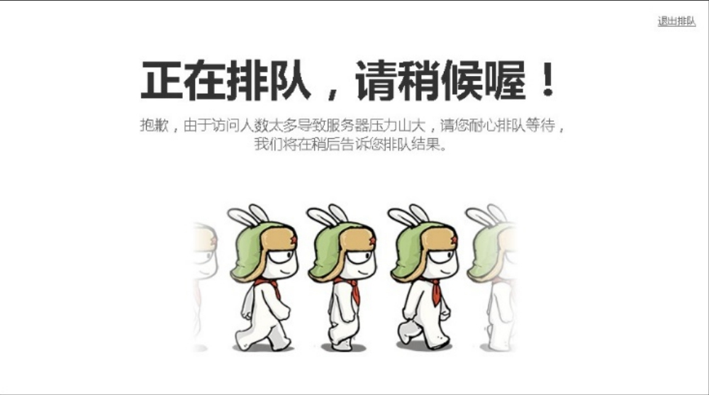

## 1.3.3 　从“现象”到“本质”

不再被表象蒙骗，追问逻辑的尽头，你会发现任何事情的本质其实都是很简单的。

产品经理看到一个现象时，会问为什么会有这样的现象，希望了解现象背后的本质原因。来讲一个真实的产品案例，这个案例从提出问题到最终想清楚，用了9年时间。

这个问题就是：在淘宝的交易过程中，到底何时减库存？

大家都知道，淘宝的交易分以下几个主要步骤——买家拍下、买家付款、卖家发货、买家确认。更早的选购过程和确认收货之后的评价等环节，与库存无关。

如果不考虑电子商务和系统，仓库里减库存的实际动作一定是发生在“卖家发货”时。后来，有了IT系统，系统的优势就在于能提前知道一些事情，从而通过预判做出更好的管理决策。所以，系统一定是在真实的减库存发生之前，先做预留库存的动作。于是，争议的焦点发生在买家“**拍下减库存**
”与买家“**付款减库存**
”之间。

现在暂时不考虑卖家后台的库存管理怎么做，只看在商品详情页面上，展现给用户的库存数字，应该什么时候减少？

“拍下派”的主要观点：

买家既然拍下，就是有购买意向，应该把库存给他留着。否则，拍了以后，过一段时间付款却被告知缺货，买家会很恼火。“拍下派”很重视用户体验，更“亲”买家。他们会碰到的问题，是“拍了不买”，这个问题最极端的表现就是“恶拍”。比如，竞争对手把你的商品的所有库存全拍掉，也不用付钱，你的商品就全下架了。

“付款派”的主要观点：

他们也重视用户体验，但更“亲”卖家，认为买家拍下也不一定会买，有人把拍下当收藏夹用，导致卖家无法准确预估库存，并且真正想买的人反而买不到。买家付款成功以后，才是真的确定要买了，这时才留一个库存给他。“付款派”会碰到最严重的问题，是“超卖”，因为系统在付款成功之前，都不减库存，所以总是会发生“短时间内多人都在付款，钱都扣掉了，但是系统却发现库存不够了”。这很可能带来很多投诉，让客服的工作量，甚至公关部门的工作量剧增。可见，产品经理一定要有大局观，否则你的一个简单设计，就可能导致其他团队加班，甚至要多招几个人。

两种选择都有优点，也都有问题，现在先来看看各自问题的对策。

首先是对付“**恶拍**
”的几个办法。

系统可以增加“库存保留时间”，聚划算及很多独立B2C都这样做了。具体的做法是，“拍下减库存，但是如果你在N分钟内不付款，就取消订单，库存回加”。但这对于秒杀这种业务没用，因为所有拍下的动作都发生在几秒钟之内，系统总不能把库存保留时间设置为几秒——如果真这样的话，正常的交易行为都来不及付款。所以，限购是另一种办法。

限购，是指用某种条件来限制买家的购买件数，比如一个淘宝账号、一个IP等只能买1件。这样的话，恶拍的成本就会被大大提高，而对于秒杀，其实卖家在乎的不是卖给谁，重要的是流量和人气。

此外，还可以通过一些安全策略来对付恶拍的问题。比如，通过模型判断，直接干掉恶意账号，或者禁止其购买。

然后再聊聊对付“**超卖**
”的几个办法。

先分析一下超卖的本质。买家拍下后，付款的动作拆解开来是这样的：先确认订单，再到支付宝，再到网银（非必须），网银支付成功，返回信息给支付宝，支付宝再返回信息给淘宝，再减库存。最后一件宝贝可能有三五个人同时确认订单并进入支付宝，如果这三五个人都付款成功，就都会相应地减库存。只要付款的动作是在几个不同的系统之间传信息，这个过程就一定有时间差，“超卖”就难以避免，特别是对于那些超级火爆的商品。

解决的办法也有很多，最容易想到的就是在付款过程中，尽可能晚地验证是否有库存（相对拍下的时间而言）。比如，在用户确认订单要付款的时候，再验证一下。但彻底解决不可能，除非各种网银和淘宝、支付宝的系统完全打通。你也可能想到把减库存的时机提前，比如在“确认订单”时减，但严格意义上来说，只要付款未完成，都不能算“付款减库存”，会遭遇“拍下减库存”（指占着库存但并没真买）的问题。

采用的另一种办法，就是各种提示——在商品详情页面及订单各步骤页面，都告诉用户“这个商品比较火爆，如果不及时付款，不能保证有库存”。这样做的成本很低，也的确能减轻很多客服的压力，是个好办法[[5]](../05/index.md#footnote_content_txt002_5)
。

近年，也有不少电商网站采取了“排队”的做法，既然人太多了，干脆限流——不让部分用户进入拍下、付款的流程，也可以缓解各种问题。当然，这与何时减库存关系不大。如图1-8所示，小米手机在抢购时，需要排队。

<figure markdown="1">

{ width="420" height="233" }

<figcaption markdown="span" style="margin:0.5em auto;font-size:0.8em;font-style:normal;line-height:1.5">
图1-8　小米手机抢购时的排队界面
</figcaption>

</figure>

这个问题表面是拍下减库存还是付款减库存的选择，背后其实是犹如“豆浆甜咸两党之争”的严肃问题。买家和卖家都是淘宝的用户，淘宝到底该亲买家，还是亲卖家？

淘宝是平台，作为平台，最怕各方利益失衡。所以，为了可持续发展，淘宝其实希望买卖双方能够“势均力敌”。那么，答案就出来了——帮哪边，需要对市场供求关系进行判断。如果某个市场是卖方市场，那么就要多帮帮买家，反之亦然……

然而，整个淘宝肯定不是一个有统一属性的市场，还需要细分。比如，“聚划算”就是一个典型的卖方市场，所以应该帮买家，采用拍下减库存。对供需关系的判断，需要根据各种场景来不断细分以提升效率。有几年，淘宝的产品技术团队就投入了很多精力对各种场景做细分，对减库存时机判断的代码也越来越复杂。直到有一天，系统复杂到大家都崩溃了，谁也不敢再改这个系统。相信做过大型网站架构的同学可以体会其中艰辛。

怎么办？再一次追问逻辑本质：最细分的场景到底是什么。是一个垂直市场？一个卖家？一个商品？都不对，最细分的场景应该是每一笔交易。那么问题来了，淘宝可能知道每一笔交易到底是卖家还是买家强势吗？答案是：“不能”。

这时候，淘宝已经成立9年了。这一年，凯文·凯利的《失控》一书在互联网圈大火，意外地成为破局的关键。忽然有一天，淘宝的产品经理说：我们不知道，但是卖家知道啊，何须我们来决定用哪种方案呢？至此，大家恍然大悟。

最后，只须告诉卖家两个方案各自适合的应用场景，就可以把选择权彻底交给卖家。当然，这个放手也不是一下子全放，基本的策略是先放权给一些成熟的大商家。

而这个决定背后，产品经理思考的是“控制”还是“放手”。淘宝作为一个平台，应该自己定规则么？还是只提供基础设施，让卖家更多地来决定自己的规则？一个看似简单的技术规则的问题，深究到背后，其实是一个类似于治理国家的问题——大政府和小政府孰优孰劣，各自的适用场景是什么……这也是为什么到了后来，淘宝会请很多人类学家、社会学家、经济学家来讲学的原因。

减库存的故事讲完了。除了看问题的深度，这个案例还告诉我们，产品经理碰到的实际问题，往往没有完美的方案，只有去用心研究，才能够找到相对合理的方案。更重要的是这个过程对产品经理自己的提升。

