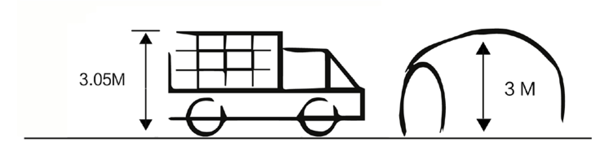
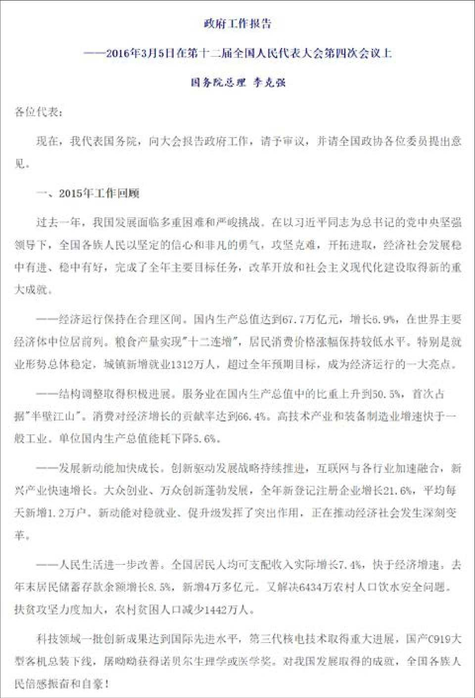
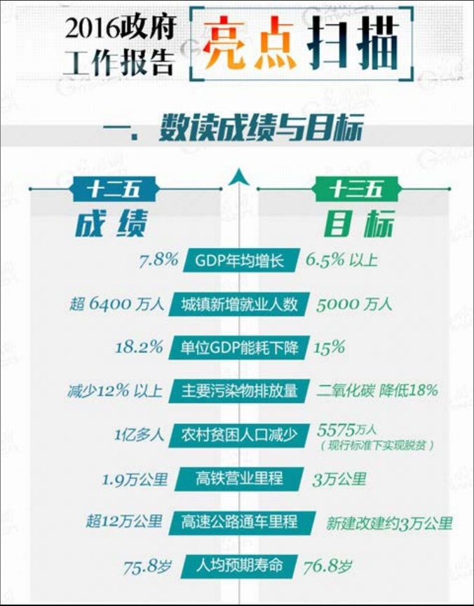

## 1.3　思维方式与性格特点

产品经理这群人，到底有什么特别之处？或者说，泛产品经理们要做好产品，需要具备哪些非技能层面的素质？下面来说几个要点。

### 1.3.1 　从“学生”到“职场”

先要学会面对真正的“问题”。

见[图1-5](#figure-1-5)，图里是个题目：一辆3.05米高的货车要过一个3米高的山洞，怎么办？

大家可以先不要往下看，试问自己的第一反应是什么。

<figure id="figure-1-5" tabindex="-1" markdown="1">

{ width="621" height="166" }

<figcaption markdown="span" style="margin:0.5em auto;font-size:0.8em;font-style:normal;line-height:1.5">
图1-5　货车过山洞
</figcaption>

</figure>

对很多人来说，第一反应无非是：放气？卸货？绕路？再叫一辆车？甚至，挖洞？放弃？等等……

脑洞大一点的同学，可能想出几十种解决方案。很厉害，但你有没有发现，不同的方案，对问题的理解其实并不一致。

比如，有些是“过山洞”，有些是“不过山洞”。而这两类方案，都可以分别给出积极和消极的评价。

过山洞：直面问题，迎难而上VS思维僵化。

不过山洞：思维灵活，巧妙应对VS回避问题，万一老板或用户真的就是要体验“过山洞”呢？

无所谓好坏，关键点在于，这里的“问题”到底是什么呢？

一看到问题，马上就想答案，这是典型的“学生”思维，因为我们所受的学校训练，绝大多数都是针对“经过简化的问题”：有确定的目标、完备的信息，有刚刚学过的解法，有标准答案……而职场中，面对的问题通常目标不明、信息片面、闻所未闻。特别对产品经理而言，各种用户提的问题，一般都是经过扭曲、有欺骗性的，要怎么解决也没有标准答案。

回到例子中，真正的问题到底是什么，其实我们并不知道。第一步要做的，是去收集信息，用产品经理的话来说就是——采集需求。

有一些典型的问句，比如：

为什么要过山洞？可能是因为装着一车西瓜，要运到山洞另外一侧的水果批发市场卖掉。所以，“过山洞”并不是目的本身。

提出这个问题的人是谁？是货车司机？我发现在绝大多数人的第一反应里，都觉得自己是司机、是货主、是批发市场的小老板，或者是路政部门的工作人员。角色不同，对解决方案的选择也会有差异。

是否有路可绕，绕路有多远？思路拓展一下，将问题转换为基于成本的考虑，成本涉及油费、时间，可能还有过路费。

过了山洞以后还有多远？如果还要跑一段高速，可能“放气”这一招的结果就很危险。

此事发生的频次是多少？如果经常发生，假设一个场景，这个山洞是几十年前造的，确实比较窄，如今经常有一些大车过不去，得绕路。这时候，也许“挖洞”扩建一下，反而变成了最应该做的事情，甚至新开路都值得。这叫“只做一次的事情找可行解，反复做的事情求最优解”。

我们发现，当没有去收集、分析信息时，虽然也能提出很多方案，但在真正实施时会碰到很大的困惑——到底怎么做更好呢？

而转变为产品经理式的思维后，可以获得两大好处：

第一， 有了更多选择。也许一些更优的方案就在这个“更多”里。这应了“更多选择，更多欢笑”这句麦当劳多年前的广告词。打个比方，也许我们可以打一个电话，让批发市场的小老板开一辆小车来运掉一部分西瓜，车就能过去了。

第二， 可做价值判断。对性价比的评估是产品经理的必修课。如果正在执行紧急任务，绕路很远，时间很赶，说不定丢掉一小部分货物反而成为最佳选择。

其实，各种方案无所谓好坏，只取决于是否适合对应的场景。

最后提一下“放弃”。这个在学生时代面对作业题、考试题时较少使用的解决方案，在产品工作中，反而成了最常用的方案——100个需求中，被放弃掉的往往是大多数。

小结一下，面对问题时如何理解和做出基本应对，产品经理给出的答案是“先搞清问题，后选择方法”，而不是直接去设法解决。中国教育的不足，体现在封闭式的问题太多，而开放式的问题太少，这一弊病在做产品的过程中，正好可以得到纠正。

### 1.3.2 　从“用户”到“产品经理”

人类从远古发展到今天的过程，就是不断意识到自己有多么渺小的过程——自我中心、小区域中心、全人类中心、地球中心、太阳中心……渐渐发现越来越大的世界。而从“用户”到“产品经理”的心理切换，强调的就是要改正以自我为中心的思维惯性。

举个例子，如[图1-6](#figure-1-6)的政府工作报告，读者中有谁是每年都认真看的？

<figure id="figure-1-6" tabindex="-1" markdown="1">

{ width="403" height="594" }

<figcaption markdown="span" style="margin:0.5em auto;font-size:0.8em;font-style:normal;line-height:1.5">
图1-6　政府工作报告文字版的开头
</figcaption>

</figure>

估计不多。想想其中原因，无非是：感觉和自己关系不大；字太多了，看起来很累，抓不住重点；各种内涵看不懂，看了也白看……没错，我也有类似的感觉，所以原来也是不看的。但最近几年开始看了，并不是因为思想觉悟提高了，而是因为我发现，每年三月政府工作报告发布之后不久，网上就会出现一种如[图1-7](#figure-1-7)的版本，我把它称作“脱水版”。

<figure id="figure-1-7" tabindex="-1" markdown="1">

{ width="284" height="363" }

<figcaption markdown="span" style="margin:0.5em auto;font-size:0.8em;font-style:normal;line-height:1.5">
图1-7　政府工作报告脱水版部分截图
</figcaption>

</figure>

它以一种“信息图标”的方式，保留了90%以上大众关心的信息，省掉了90%以上的文字，我很喜欢。那么问题来了，大家体会一下这两个问题的差别。

政府工作报告作为一个产品：

1\. 你喜欢哪个版本？

2\. 哪个版本更好呢？

对于第一个问题，我想大多数人都会给出轻松的答案——喜欢后者。这是典型的用户思维——千金难买我愿意。但，对于第二个问题，就没那么简单了——它没有问你的喜好，而是试图分析产品的优劣，这是产品经理的视角。

想一下，其实答案也很简单——各有利弊。一个产品的好坏，要看对应的用户需求场景。很明显，第二个版本更合适普通大众，用来简单了解政府工作概况。而第一个版本，更适合政府工作人员，因为工作原因，他们需要了解得更细致。公务员们甚至可以通过对比同一句话在前后两年报告中用到的“强烈”一词的多少，解读出国家政策的调整。

每个人每天都会以用户的角色接触成百上千件产品，所以习惯以用户的视角来看待这个世界，因为这是一种简单、直接、更舒适、以自我为中心的方式。

作为产品经理，日常工作中如果经常用“我觉得”、“我以为”、“我用过”这样的句式，意味着可能要犯错了。要做好产品经理，就必须摆脱以自我为中心，转向以用户为中心，换句话说，即具备“同理心”。但说起来容易做起来难，而难上加难的是，用户还是千差万别，甚至利益互相冲突的。到底应该以哪个用户为中心，后面的章节会细说。

所以，需要时刻提醒自己，用户和我们是不一样的，我们并不懂用户，但必须要有能力切换成用户视角来发现产品问题。有些讨巧的做法是做一个自己需要的产品，或做一个自己就是典型用户的产品。有些公司在招人时，也用了类似的思路，招聘领域玩家做产品经理。例如，做户外社区，要求产品经理必须是一个资深的户外爱好者；做母婴电商，要求产品经理最好有个还不大的宝宝……

我们更习惯做用户，但做产品经理显然能创造更大的价值。当你掌握了产品经理式的思维，甚至只是知道有这种思维后，就很可能乐此不疲。每个人都喜欢做上帝，为什么很多人沉迷于玩游戏，就是因为控制着游戏世界的体验，给了玩家上帝的感觉。若把用户比作人类，产品经理就是上帝[[4]](../05/index.md#footnote_content_txt002_4)
。

所以，很多人喜欢做产品经理，至少自认为喜欢做产品经理，有可能仅仅是迷恋“指手画脚”的感觉。在我看来，每个用户都是没有开启上帝模式的产品经理。或者说，每个人心中都潜伏着一个产品经理，最终还是那句话——人人都是产品经理。

### 1.3.3 　从“现象”到“本质”

不再被表象蒙骗，追问逻辑的尽头，你会发现任何事情的本质其实都是很简单的。

产品经理看到一个现象时，会问为什么会有这样的现象，希望了解现象背后的本质原因。来讲一个真实的产品案例，这个案例从提出问题到最终想清楚，用了9年时间。

这个问题就是：在淘宝的交易过程中，到底何时减库存？

大家都知道，淘宝的交易分以下几个主要步骤——买家拍下、买家付款、卖家发货、买家确认。更早的选购过程和确认收货之后的评价等环节，与库存无关。

如果不考虑电子商务和系统，仓库里减库存的实际动作一定是发生在“卖家发货”时。后来，有了IT系统，系统的优势就在于能提前知道一些事情，从而通过预判做出更好的管理决策。所以，系统一定是在真实的减库存发生之前，先做预留库存的动作。于是，争议的焦点发生在买家“**拍下减库存**
”与买家“**付款减库存**
”之间。

现在暂时不考虑卖家后台的库存管理怎么做，只看在商品详情页面上，展现给用户的库存数字，应该什么时候减少？

“拍下派”的主要观点：

买家既然拍下，就是有购买意向，应该把库存给他留着。否则，拍了以后，过一段时间付款却被告知缺货，买家会很恼火。“拍下派”很重视用户体验，更“亲”买家。他们会碰到的问题，是“拍了不买”，这个问题最极端的表现就是“恶拍”。比如，竞争对手把你的商品的所有库存全拍掉，也不用付钱，你的商品就全下架了。

“付款派”的主要观点：

他们也重视用户体验，但更“亲”卖家，认为买家拍下也不一定会买，有人把拍下当收藏夹用，导致卖家无法准确预估库存，并且真正想买的人反而买不到。买家付款成功以后，才是真的确定要买了，这时才留一个库存给他。“付款派”会碰到最严重的问题，是“超卖”，因为系统在付款成功之前，都不减库存，所以总是会发生“短时间内多人都在付款，钱都扣掉了，但是系统却发现库存不够了”。这很可能带来很多投诉，让客服的工作量，甚至公关部门的工作量剧增。可见，产品经理一定要有大局观，否则你的一个简单设计，就可能导致其他团队加班，甚至要多招几个人。

两种选择都有优点，也都有问题，现在先来看看各自问题的对策。

首先是对付“**恶拍**
”的几个办法。

系统可以增加“库存保留时间”，聚划算及很多独立B2C都这样做了。具体的做法是，“拍下减库存，但是如果你在N分钟内不付款，就取消订单，库存回加”。但这对于秒杀这种业务没用，因为所有拍下的动作都发生在几秒钟之内，系统总不能把库存保留时间设置为几秒——如果真这样的话，正常的交易行为都来不及付款。所以，限购是另一种办法。

限购，是指用某种条件来限制买家的购买件数，比如一个淘宝账号、一个IP等只能买1件。这样的话，恶拍的成本就会被大大提高，而对于秒杀，其实卖家在乎的不是卖给谁，重要的是流量和人气。

此外，还可以通过一些安全策略来对付恶拍的问题。比如，通过模型判断，直接干掉恶意账号，或者禁止其购买。

然后再聊聊对付“**超卖**
”的几个办法。

先分析一下超卖的本质。买家拍下后，付款的动作拆解开来是这样的：先确认订单，再到支付宝，再到网银（非必须），网银支付成功，返回信息给支付宝，支付宝再返回信息给淘宝，再减库存。最后一件宝贝可能有三五个人同时确认订单并进入支付宝，如果这三五个人都付款成功，就都会相应地减库存。只要付款的动作是在几个不同的系统之间传信息，这个过程就一定有时间差，“超卖”就难以避免，特别是对于那些超级火爆的商品。

解决的办法也有很多，最容易想到的就是在付款过程中，尽可能晚地验证是否有库存（相对拍下的时间而言）。比如，在用户确认订单要付款的时候，再验证一下。但彻底解决不可能，除非各种网银和淘宝、支付宝的系统完全打通。你也可能想到把减库存的时机提前，比如在“确认订单”时减，但严格意义上来说，只要付款未完成，都不能算“付款减库存”，会遭遇“拍下减库存”（指占着库存但并没真买）的问题。

采用的另一种办法，就是各种提示——在商品详情页面及订单各步骤页面，都告诉用户“这个商品比较火爆，如果不及时付款，不能保证有库存”。这样做的成本很低，也的确能减轻很多客服的压力，是个好办法[[5]](../05/index.md#footnote_content_txt002_5)
。

近年，也有不少电商网站采取了“排队”的做法，既然人太多了，干脆限流——不让部分用户进入拍下、付款的流程，也可以缓解各种问题。当然，这与何时减库存关系不大。如[图1-8](#figure-1-8)所示，小米手机在抢购时，需要排队。

<figure id="figure-1-8" tabindex="-1" markdown="1">

{ width="420" height="233" }

<figcaption markdown="span" style="margin:0.5em auto;font-size:0.8em;font-style:normal;line-height:1.5">
图1-8　小米手机抢购时的排队界面
</figcaption>

</figure>

这个问题表面是拍下减库存还是付款减库存的选择，背后其实是犹如“豆浆甜咸两党之争”的严肃问题。买家和卖家都是淘宝的用户，淘宝到底该亲买家，还是亲卖家？

淘宝是平台，作为平台，最怕各方利益失衡。所以，为了可持续发展，淘宝其实希望买卖双方能够“势均力敌”。那么，答案就出来了——帮哪边，需要对市场供求关系进行判断。如果某个市场是卖方市场，那么就要多帮帮买家，反之亦然……

然而，整个淘宝肯定不是一个有统一属性的市场，还需要细分。比如，“聚划算”就是一个典型的卖方市场，所以应该帮买家，采用拍下减库存。对供需关系的判断，需要根据各种场景来不断细分以提升效率。有几年，淘宝的产品技术团队就投入了很多精力对各种场景做细分，对减库存时机判断的代码也越来越复杂。直到有一天，系统复杂到大家都崩溃了，谁也不敢再改这个系统。相信做过大型网站架构的同学可以体会其中艰辛。

怎么办？再一次追问逻辑本质：最细分的场景到底是什么。是一个垂直市场？一个卖家？一个商品？都不对，最细分的场景应该是每一笔交易。那么问题来了，淘宝可能知道每一笔交易到底是卖家还是买家强势吗？答案是：“不能”。

这时候，淘宝已经成立9年了。这一年，凯文·凯利的《失控》一书在互联网圈大火，意外地成为破局的关键。忽然有一天，淘宝的产品经理说：我们不知道，但是卖家知道啊，何须我们来决定用哪种方案呢？至此，大家恍然大悟。

最后，只须告诉卖家两个方案各自适合的应用场景，就可以把选择权彻底交给卖家。当然，这个放手也不是一下子全放，基本的策略是先放权给一些成熟的大商家。

而这个决定背后，产品经理思考的是“控制”还是“放手”。淘宝作为一个平台，应该自己定规则么？还是只提供基础设施，让卖家更多地来决定自己的规则？一个看似简单的技术规则的问题，深究到背后，其实是一个类似于治理国家的问题——大政府和小政府孰优孰劣，各自的适用场景是什么……这也是为什么到了后来，淘宝会请很多人类学家、社会学家、经济学家来讲学的原因。

减库存的故事讲完了。除了看问题的深度，这个案例还告诉我们，产品经理碰到的实际问题，往往没有完美的方案，只有去用心研究，才能够找到相对合理的方案。更重要的是这个过程对产品经理自己的提升。

### 1.3.4 　还有什么性格特质是加分项

上述三点，都是知易行难，即使是做产品多年，也要记得时刻自律自省。下面，再看几个经常被提到的对于产品经理的加分项。

**热爱生活，好奇心**

产品经理就要站在行业的潮头，如果你是一个畏惧改变、因循守旧的人，那建议重新考虑是否要入这行。只有对各种新鲜事物都了如指掌，才能发现先机。很多时候，机会的时间窗口只有不到三个月。在移动互联网刚开始时，就有一些产品经理，随身四五个手机，每天研究各种系统、各种机型，以至于每次坐飞机过安检都要被盘问很久。

类似地，还需要具有**“创新精神”，要勇于尝试和持续学习**
。

**理想主义，完美主义**

这话要辩证地理解，一方面要有“处女座”人格对关键细节的追求，另一方面也要有大局观，知道战略比战术更重要，知道合理妥协的必要性。而要掌握这一平衡，经过现代科学训练的逻辑思维能力不可或缺。

有一个被问过无数次的问题：理工科还是文科生更适合做产品经理？

我的答案是，就产品逻辑而言，理工科出身的同学更有优势，但文科同学的优势会在“用户洞察”这方面更容易发挥。最终谁会胜出，还要看综合能力。比如，有科学素养的文科生和有人文精神的理科生，都是这一岗位的上佳人选。理科生容易上手，但文科生的职业天花板更高。因为科学和技术只能保证你不犯错，但人文和艺术可以让你达到新高度。另一方面，也要结合产品形态。比如，定位在专家用户和2B业务的产品，其产品经理必须要有强大的技术背景。

类似的问题还有，技术还是市场运营更适合转型做产品经理，答案的思路也很相似。

**善于沟通，团队精神**

要承认自己的力量是有限的，因为做产品是需要靠团队来拿出结果的。用非行政命令的手段，带领团队向着一个目标前进，是一件很具挑战性的事情。

**抗压，自我激励，情绪调节**

最后，强调一种“淡定”的心态。比如，碰到下面这些事情，你能受得了吗？

你会被“强奸”：比如一个很强势的运营同学，被逼着做自己不认可的需求。

你会听到产品上线后无数用户在劈头盖脸地骂“这是哪个傻帽做的”，而你就是那个傻帽。

你会无奈地回滚：比如，因为自己没想到一个小细节，导致产品只能回到几个月前的版本。

你会被老板逼着2周做出一个功能，然后被开发告知至少要2个月。

你会突然得知项目取消，然后老板要你把这个消息告诉那帮天天加班到12点的兄弟。

你会被扔来一个烂尾产品，除了你以外，团队没有任何士气。

你会发现老板和老板的老板观点不一致，最终的方案却要你来决定。

你会和其他产品经理吵架，老板怪笑着表扬你，说这是对工作有要求。

你会通宵发布，然后拉上同学们一起聚餐——是早餐。

……

