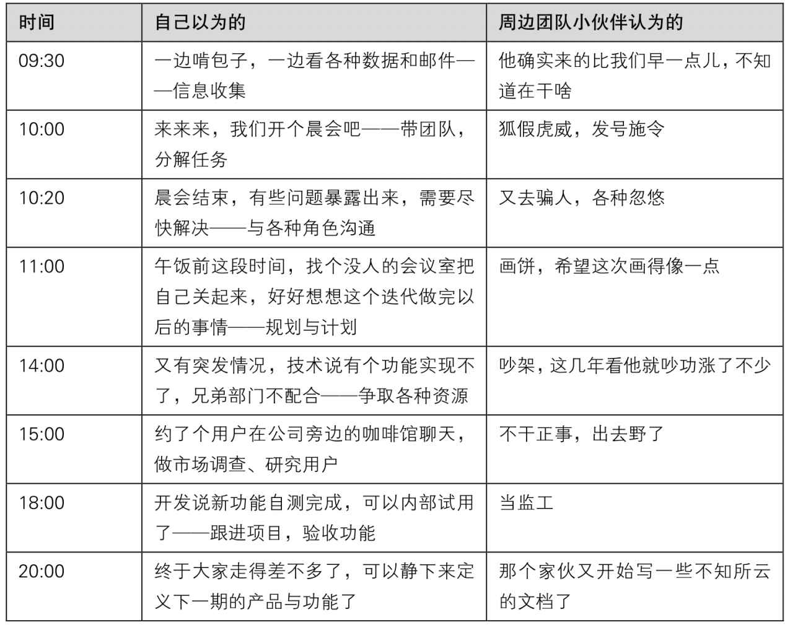
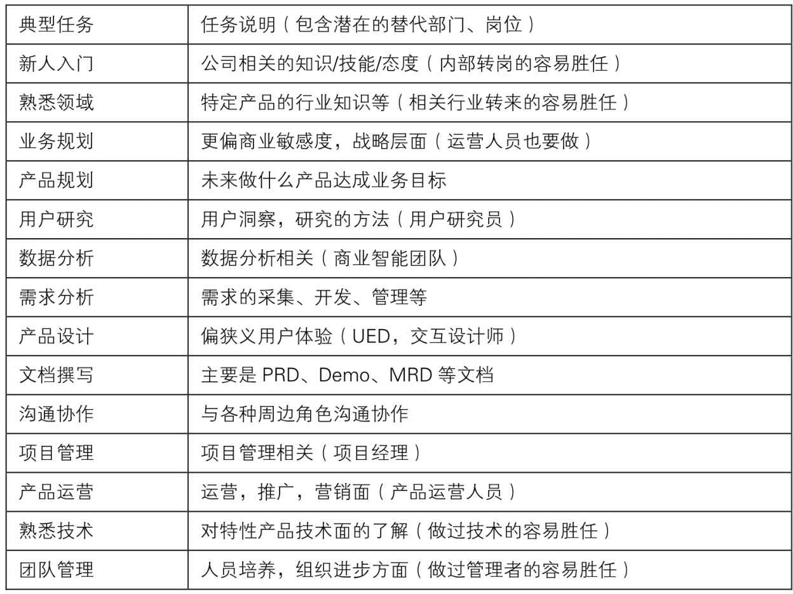

## 1.4.2 　一天里的典型任务

终于开始要做产品了。下表是产品经理典型的一天，“你以为的”和“周边团队的小伙伴认为的”状态对比：

{ width="625" height="496" }

产品经理们喜欢自黑，常说自己是“产品狗”，白天开会，晚上写文档。要做的事情的确很多，列出来就是下面这个典型任务表格。

{ width="617" height="461" }

显然，一个产品经理不可能同时做这么多事情，需要分阶段、分任务类型。最开始是产品的定义与架构，然后是产品设计，接着做出来，最后推出去，这个过程逐渐发展成四个可能的发展方向。

►**产品架构**
：定义、规划产品，确定产品定位，规划、把握产品的节奏，对产品进行宏观把控，对经验要求较高。

►**产品设计**
：负责产品细节设计。2C的产品，需要和交互设计紧密配合，注重用户体验；对于海量用户的产品，细节设计会产生很大价值（腾讯就是这个方面的典范），但职业天花板相对低；2B的产品，主要是业务逻辑、流程、规则的设计。

►**产品管理**
：狭义的管理，偏资源协调、跟进实施和团队建设，有点像项目管理，负责把产品做出来。

►**产品运营**
：负责产品大运营，解决产品“有人用”的问题，建立产品与用户的通路，负责营销推广。

一个产品经理能做到四项都强最好，这样可以节省巨大的沟通、管理成本，但培养这样的一个神，至少需要十几年。所以，在国外，常常看到一些40岁左右的产品经理，他们确实是能大包大揽的“真·产品经理”。而国内互联网行业以及产品经理岗位，发展时间还很不够，这种人至少要5～10年后才可能成批出现。现在，这批人就是行业里的CEO，他们根据实际情况来分权，带领几个各有擅长的产品经理，甚至把部分任务分给技术、设计这类“泛产品经理”，从而完成整件事情。大家也可以考虑自己擅长哪方面，根据公司需要和个人兴趣选择发展方向。

