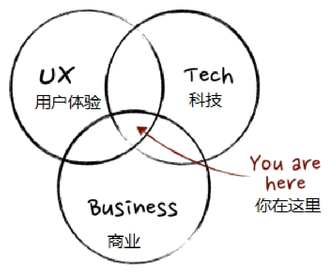

## 1.4.3 　周边团队从小到大

先看一张经典的图。产品经理应该是一个交叉的核心，是在设计、技术和商业中间的那个什么都懂一些的人，如图1-9所示。

{ width="274" height="226" }

图1-9　产品经理在团队里的位置

从一个人发展为一个整编团队，创始人一定要承担起产品经理的角色，因为最开始要想清楚的是：要做什么来解决什么人的什么需求。

产品经理把要做的产品想得差不多的时候，团队就会开始扩张。团队成员一般会分为以下三个角色。

►产品：让产品有用。

►技术：让产品可用。

►设计：让产品好用。

注意，这里说的是角色，不是自然人。所以，个人认为最佳的初创团队，其实是一个“会写代码，有点商业感觉，又有点审美”的技术人员，比如Facebook的扎克伯格。

这个时候，商业的事情通常由产品经理兼着思考，产品做出来之后，会引入第四个角色：运营。广义的大运营，是让产品“有人用”。

产品、技术、设计和运营四个角色可以构成相对完整的团队，随着产品的迭代优化，团队会越来越大，每个角色又开始逐渐细分。

技术团队细分出开发、测试，运维等岗位。而开发又可以分为客户端和服务端开发，客户端还可以进一步细分为iOS、Android、Web等。

设计团队开始细分出视觉设计、交互设计、工业设计（实体产品）、服务设计等。

广义运营团队开始细分出销售（卖产品）、市场（空中轰炸）、客服（服务客户）、狭义的运营（用户、活动、内容）等。

公司越来越正规，开始出现HR、行政、法务、财务等精细化分工。

对了，还有一个很关键的角色没说——外部用户。有一句很值得仔细体会的话：“用户是产品的一部分”。比如，对于游戏来说，“如果你在免费玩一个游戏，那么你其实是这个游戏提供给付费玩家的一个功能”。

所以，产品经理除了在公司内是各个角色的粘合剂，还是公司内外的接口，要负责把用户的声音带给团队，甚至把用户发展成广义团队的一部分。

举个高德地图的例子：如何知道某条道路的拥堵情况？

传统的做法是在路口安置摄像头。相信大家都见过晚间新闻报道交通情况，一个大大的监控画面，细分为几十个路口的画面，由此来判断是否拥堵，这是典型的“自上而下”的做法。而高德，可以利用海量用户在每条路上使用高德的数据，包括密度大小、移动快慢等来获得拥堵情况，这是典型的“自下而上”的互联网做法。

可以推测一下，如果产品要获得“指数级增长”，而不是“线性增长”，“自下而上”的做法明显更有可能。

而随着团队越来越大，最早的几个人的身份也开始发生变化。如果他们跟得上团队发展，技术成为了CTO，运营成为了COO，设计可能会留在产品团队里，在特别重视设计的公司，还会有CDO，而产品经理会发展成为CEO。

所以，有一句特别鸡汤的话：“产品经理是CEO的学前班”。

