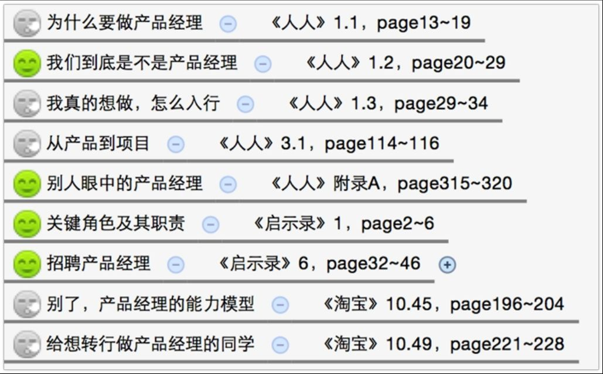
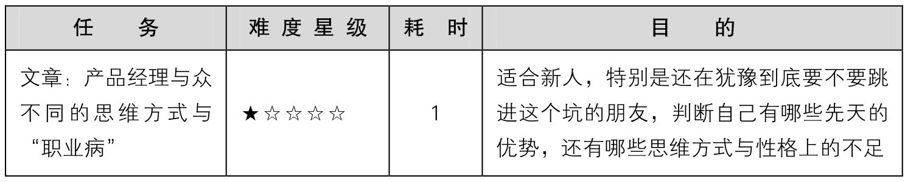
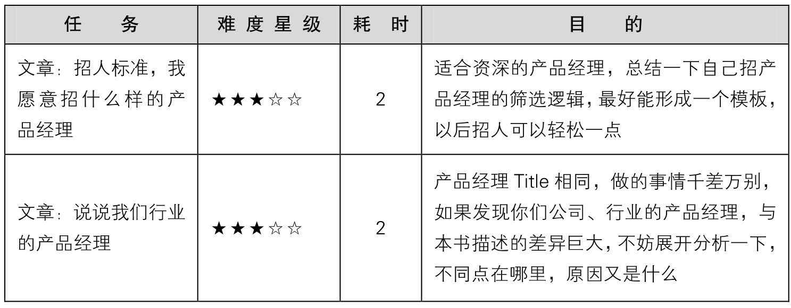
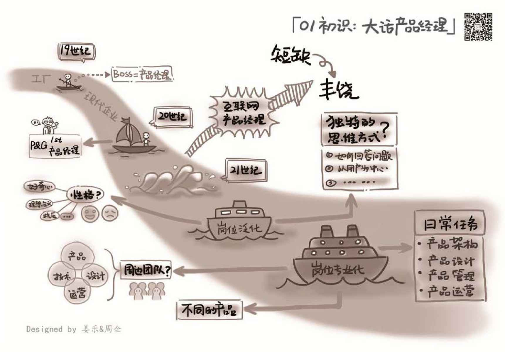

## 1.5　延伸阅读与练习

本书在每一章的最后（除了第00章以及第12章），会提供“和我有关的5本书”[[6]](#footnote_content_txt002_6)
里与本章内容关联的章节，作为扩展阅读。其中的笑脸图标表示推荐阅读，冷漠脸图标表示选择阅读。书名与对应章节，这里采取了一些简化的写法，相信大家可以看懂。另外，也可以根据每一章提到的各个关键词来进行扩展阅读。

<figure markdown="1">

{ width="432" height="269" }

</figure>

最后，每一章都会给出一些练习作业。本书的练习作业多为文章，也有少量的案例分析、模板设计，输出的形式不限，可以是Word、PPT、Excel，甚至几张图。我个人就因为多年来不断地总结、输出而受益颇多。所以，建议读者可以从现在开始，开通一个属于自己的自媒体账号，微信公众号、个人博客、知乎专栏、简书等都可以，关键是要坚持，哪怕一周一篇，坚持一年，收获必定不菲。

如果你真的这么做了，记得告诉我。也许，它们会作为更新的内容，出现在本书的新版本里。

<figure markdown="1">

{ width="619" height="119" }

</figure>

<figure markdown="1">

<figcaption markdown="span" style="margin:0.5em auto;font-size:0.8em;font-style:normal;line-height:1.5">
续表
</figcaption>

{ width="619" height="236" }

**注：**
表中耗时的单位是“小时”。

</figure>

<figure markdown="1">

{ width="824" height="575" }

</figure>

---

[[1]](../01/index.md#footnote_quote_txt002_1)
读者可扫描右侧二维码访问原知乎页面。

[[2]](../02/index.md#footnote_quote_txt002_2)
笔者对此并不认同，认为产品和技术应该是并列的两个部门。

[[3]](../02/index.md#footnote_quote_txt002_3)
2016 年 10 月我去硅谷考察，确实发现那里的技术、设计人员做掉了部分初级产品经理的工作。但这需要整体人才结构的支撑，国内的技术、设计人员还做不到。另外，对高级产品经理的需求，无论哪里都很旺盛。

[[4]](../03/index.md#footnote_quote_txt002_4)
这句话需要大家辩证理解，说的只是看问题的视角，而在服务心态上，产品经理要把用户当上帝。

[[5]](../03/index.md#footnote_quote_txt002_5)
有时，技术层面的小动作能带来商业层面的大效果，反之，技术层面的大动作也可能没什么商业价值。

[[6]](#footnote_quote_txt002_6)
五本书分别为：《人人都是产品经理（经念版）》、《淘宝十年产品事》、《启示录：打造用户喜爱的产品》、《四步创业法》、《有的放矢》。

