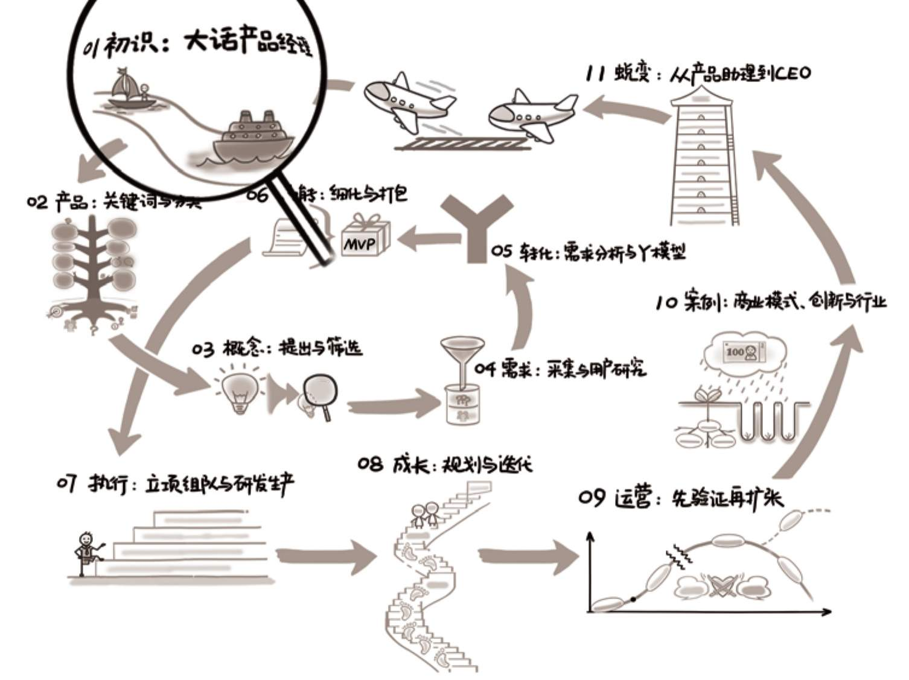

## 第01章　初识：大话产品经理

{ width="633" height="473" }

**第01章　初识：大话产品经理/13**

**1.1　从一个小故事谈起/15**

**1.2　产品经理的前世今生/16**

1.2.1　从人类社会出现分工说起/17

1.2.2　岗位诞生，宝洁的故事/18

1.2.3　从项目经理到产品经理/18

1.2.4　与“传统”产品经理的区别/19

1.2.5　十年，产品经理逐渐成熟/20

**1.3　思维方式与性格特点/22**

1.3.1　从“学生”到“职场”/22

1.3.2　从“用户”到“产品经理”/24

1.3.3　从“现象”到“本质”/27

1.3.4　还有什么性格特质是加分项/30

**1.4　产品经理的日常/32**

1.4.1　入行，社招与校招/32

1.4.2　一天里的典型任务/34

1.4.3　周边团队从小到大/36

**1.5　延伸阅读与练习/38**

