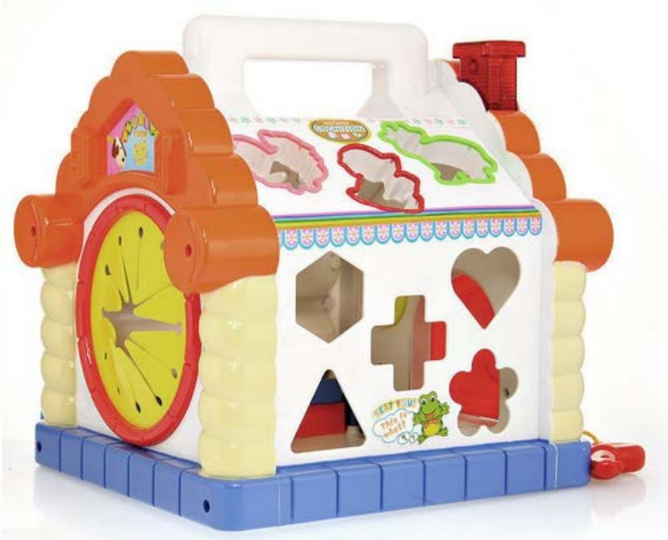

## 2.1.2 　问题：用户、需求、场景

“问题”包含了三个关键词：用户、需求、场景，分别用来讲述一个重要的概念。

►**用户：**
这个问题是谁的问题。

►**需求：**
问题的核心是什么。

►**场景：**
用户在什么情况，以及何时何地碰到这个问题。

接下来，对这三个词展开详述，这是任何一个产品人都需要掌握的最核心的概念。

**用户：谁的问题**

第一，本书里提到的用户，除非特殊说明，都是指广义用户，即产品干系人，指与产品有关的所有人，也包括公司内部人员。所以，平时与产品经理有工作配合的技术、运营、销售、客服，甚至老板，都是用户之一。

说到老板，有这么一个常见但很棘手的问题：很多需求都是老板提的，到底要不要听呢？这个问题很难找到标准答案，这里只能给出一些忠告：当然不能言听计从，要有自己的主见和原则。但也不能太过，像有些互联网公司，把对抗老板变成一种“政治正确”，甚至以此在技术团队那里树立“敢于反抗权威”的光辉形象，就没必要了。

第二，任何产品的用户都是多种多样的，但又的确有主次之分，因此，不要为了次要用户的需求干扰核心用户。当然，满足好核心用户之余去照顾次要用户则另当别论。

比如，公司的HR要组织一次团建，老板和员工就是两种诉求不同的用户，如果需求有冲突，先照顾谁，这就是个很关键的问题。关于用户的细分，在后续章节里会做更多的展开。

对于需求和场景，也有这种主次关系，下文不再赘述。

第三，这里说的用户，更多指“角色”，而不是“自然人”。

自然人是指生物意义上的人，角色是指社会意义上的人。产品经理的语境里很少提及生物意义，所以这里说的角色是自带社会场景的。比如说，你可以即是爸爸又是儿子，那么我们说你是爸爸的时候，应该涉及一个有你儿女的场景，说你是儿子的时候，就涉及一个有你父母的场景。我们说你是一个产品经理的时候，就自带工作场景，说你是班长，场景就可能是你在和同学聚会。

再举一个能够有助于加深对“用户”理解的综合案例。

以最常见的一对用户角色：客户和终端用户为例。客户（customer），指付钱买产品的人；终端用户（end user），指最终使用产品的人。

对于玩具来说，当成年人购买智力玩具时，客户和终端用户这两个角色通常是重叠的，背后是同一个自然人。但给小朋友购买玩具时，角色就分离了——客户是小朋友的父母，终端用户是小朋友。所以，在设计这类产品的功能、卖点时，一般都有相应的明确目的。比如图2-2中的玩具，强调材质安全、环保、无毒，宣称对小朋友的智力开发有益，是指向客户的；而外形设计得可爱、颜色鲜艳，则是指向终端用户的。

<figure markdown="1">

{ width="348" height="280" }

<figcaption markdown="span" style="margin:0.5em auto;font-size:0.8em;font-style:normal;line-height:1.5">
图2-2　一个典型的儿童玩具
</figcaption>

</figure>

通过例子就可以发现产品用户的多种多样，以及自然人和角色的关系是可重叠可分离的。

现在还有这样一个现象，互联网的“脱媒、去中介”特性，使得对终端用户的重视程度越来越高，而一些需要通过渠道销售产品的传统企业，则往往更重视客户。其中一些做2C类产品的传统企业，由于只抓住客户而忽视终端用户，就很可能在新形势下受挫。电视行业里，长虹、康佳这些传统强势品牌，与乐视、小米这类更互联网化的新生力量的市场消长对比，就是一个很好的例子。

**需求：问题的核心**

第一， 需求即“问题”的核心，它是分深浅的。最浅的一层，是需求的表象，包含各种要求和欲望，就是经常听到用户说的“我要A”、“我想B”这样一些反映用户需求的观点和行为。第二层是观点和行为背后的目标、动机，对应用户要达成的一个愿望，或完成的一件事情。最深的一层是人性，虽然指向比较虚的价值观层面，但影响深远。

第二， 每一个需求，挖到最后，都可以归结到人性层面。比较常见的“马斯洛需求层次理论”，有非常精到的阐述。还有其他一些或正面或负面的人性需求，各举一例[[2]](../03/index.md#footnote_content_txt003_2)
：公益众筹类的产品，把握住了人们的“大爱”；微信里的标题党文章，如“活不到一百岁是你的错”、“人生十大忌，千万不能犯”，则利用了老人们的恐惧、从众心理。

第三， 满足需求其实有三种办法：提高现实、降低期望、转移需求。

抛出这样一个问题来加以说明：大家觉得物质生活水平太低，怎么办？

►提高现实：自己努力、公司加薪、国家减税。

►降低期望：忆苦思甜、比下有余。

►转移需求：寻找新关注点、转移注意力。比如，和平年代用国与国对抗的体育赛事来激发集体主义、爱国主义。

这三种方法都有效，可以灵活应用。降低期望的方法，虽然可以暂时解决需求，但对产品的美誉度有负面影响，要慎用。转移需求也可以暂时解决问题，但其实在把用户往外推，用得太多用户就和我们没关系了。“做产品”在大多数情况下是在提高现实，是一种很累的方式，但这种累也是值得的，它最容易与用户建立长期的良性关系。因而，本书主要集中在“提高现实”这种需求满足方法上。

**场景：何时何地，各种条件**

之前说过用户是带着场景的，需求更是和场景紧密关联。从下面一些案例可以看到，即使给定用户、需求，不同的场景也会导致我们采取完全不同的解决方案。

**用户：**
IT白领人群，典型的是30岁左右的程序员。

**需求：**
每天都希望了解时事新闻。

**场景一：**
上班路上，如果坐地铁，对应的产品是手机App，比如今日头条。

**场景二：**
上班时坐在电脑前，偷闲会看新闻网站，或者有突发新闻时，看到电脑右下角浮出的新闻窗口。

**场景三：**
中午和同事一起下楼吃个快餐，通过八卦的方式互通有无，特别是娱乐、体育类的新闻。

**场景四：**
下班搭同事的顺风车回家，除了八卦聊天，还可以听广播。因为私家车越来越多，路越来越堵，现在每个城市的交通台都挺红火。

**场景五：**
晚上和家人一起吃晚饭，也会看看电视新闻。

**场景六：**
出差坐飞机，或许会在登机口拿一张报纸。

……

因为总会有不同的场景，所以不存在哪个解决方案能替代哪个。每个解决方案都会随着时间的推移，找到自己合适的位置，以解决对应场景下的特定问题。只是，这些场景有大有小。

再来一个例子。

**用户：**
一位24岁的互联网公司运营同学。

**需求：**
某次要从北京中关村到首都机场。

可以一下子想到很多解决方案：打车、坐地铁+机场快线、坐机场大巴、搭顺风车……

场景依赖也很强，比如：是不是晚高峰，晚高峰地铁最靠谱，在时间上最好控制；同行有几个人，人多打车划算；离飞机起飞还有多久，时间不紧张可以先叫个顺风车，看看有没有人接单；是自费还是公司报销，自费也许会选择机场大巴，价格便宜还省得换乘。

**为何移动时代更看重场景**

曾几何时，产品经理们经常只说“用户”和“需求”，但这几年，越来越多提到“场景”，这背后有一个很大的因素，就是互联网从PC时代过渡到了移动时代。

我个人是在2011年左右体会到移动崛起这个大势的不可阻挡，已经有点后知后觉了。那么接下来，就来帮助还没跟上大势的朋友们了解一下这其中的差别。除了场景与PC端产品相比更加丰富以外，移动端产品还具有很多明显特征。接下来从用户、需求、场景、解决方案几个角度来加以对比。

**用户：用户多样化、触达用户的渠道复杂化**

用户群体更广、更多样化。比如，很多学生、打工者，原来是没有电脑的，但他们都有手机。与大多数80后“先PC后移动”不同，90后一代是“先移动后PC”的。具体而言，他们通过手机第一次接触互联网，先入为主的“默认值”就不一样，他们也不知道你这款移动产品对应的PC产品的逻辑。所以，一些依赖于自身经历的80后产品经理，会简单地从PC端“移植”产品，这很危险。

这一点，使得年轻的90后产品经理拥有了一个加分项。他们更具备天然的“移动基因”，也更适应比PC变化快得多的移动产品行业。

用户生理上的一些特性，也开始需要考虑。比如，用户是用右手、左手还是双手用手机，都会直接影响到对产品屏幕布局的设计。

产品触达用户的渠道变得复杂，不像PC，整个互联网是一个整体，直接用URL链接即可触达用户，网站之间互相导流量也很方便。移动端要通过各种应用市场铺渠道，要等待平台审核[[3]](../03/index.md#footnote_content_txt003_3)
，然后还要确保用户能找到你，愿意下载和打开，甚至愿意把你放到首屏，你才有机会最终和用户互动。另一方面，各种App互相引流也比网站更难。所以，产品黏性更加重要，对产品体验细节要求更高。

**需求：更加丰富多样，也更加碎片化**

临时兴起的需求变多，需求也更加碎片化，经常要在短时间内快速满足很小的一个需求点。比如，坐电梯时看一眼股票的最新价格；等上菜的时候刷刷新闻标题，而不是新闻内容，把需要仔细阅读的新闻先收藏起来；早晨起来一边洗脸刷牙一边听几分钟的音频新闻……这些需求，如果要打开电脑做，就显得太费事了。与PC产品更正式、更侧重工作场景相比，移动产品更随意、更侧重娱乐或生活场景。

**场景：随时随地，在各种环境下**

用户场景从电脑屏幕前变成了生活中随时随地，有了新的使用时间、使用地点，需要更多地考虑用户使用产品时周围环境的因素，比如是否吵闹，是否人多，是否光线昏暗，是否移动摇晃，以及会如何与所见所闻互动，等等。

做设计时，我们在办公室里试用产品可能不会遇到的问题，在用户身上却有可能遇到。因为，用户可能会走在路上用、开着车用、躺着用（虽然这些行为并不值得提倡）；我们有高速的WiFi，但用户用的可能是2G或信号不稳定的3G；我们用iPhone 7、华为的高配机器，但用户用的可能是性能较差的iPhone 4S或比较便宜的Android机器……而PC端产品就不存在这类问题，所有用户都是坐在电脑前，而且现在的主流PC几乎已经没有性能瓶颈，主流固网宽带也能确保流畅访问网站。

**解决方案：移动特有的领域知识**

移动时代对产品经理的要求高于PC时代，下面从六个角度来说一下。

►**要掌握移动领域的基础知识：**
要去学习移动产品基础知识，这是基本的要求，比如同样的删除操作，在iOS上是左右滑动，在Android上则是长按。一些技术基础也要知道，比如哪些功能是系统自带，几乎不用开发的；而哪些功能又是可以通过调用第三方服务简单实现的。

►**要熟悉各种可利用的硬件：**
引用Kentzhu[[4]](../03/index.md#footnote_content_txt003_4)
所说，在移动设备里，常见的可以被利用的硬件包括话筒、GPS、距离感应器、环境光感应器、影像传感器、磁阻传感器、重力感应器、方向感应器、加速感应器、三轴陀螺仪、RFID、NFC、温度计、震动感应器等。虽然要熟悉这么多的硬件，但只要能用在产品上，就很有可能让产品具有创新点和新的特性，比如基于地理位置的各种应用。而这些在PC端基本不用考虑。

►**要理解互动方式的变化：**
PC时代的鼠标、键盘等“人造物”，在移动时代变成了更自然的语音、手指、动作（比如摇晃）。有了各种硬件传感器，不只是人与机器可以交互，还可以通过机器和周围的环境交互。因为设备与使用者绑定，关联性更强，所以更容易获取行踪信息、个人习惯等隐私数据，安全性也就变得更加重要。

►**要明白产业链的结构：**
BSP硬件层[[5]](../03/index.md#footnote_content_txt003_5)
和OS操作系统层、OS suite层（如MIUI等）及App层等都需要了解。每个层都有对应的不同厂家，最终产品需要考虑的适配情况复杂多变，比如iOS和安卓平台、多种屏幕分辨率、各种手机厂家对UI层面的改造，等等。相比而言PC端就比较简单，只需要考虑几个主流浏览器的支持情况。

►**要懂得用简单逻辑完成任务：**
很多PC端产品的逻辑包含复杂的主干流程、分支流程、异常处理等。而移动端则不得不放弃大而全的想法，更强调聚焦——一屏解决一个问题，流程能串行就不并行；更强调减法和“单核思维”；更强调任务简单——尽量几秒内完成，大任务要拆解，单个任务要实现浸入式体验，以应对屏幕小、操作时间短和碎片化的场景。这样的转变也与移动设备的一些使用瓶颈有关，比如需要考虑电池续航能力、发热、流量消耗，以及程序运行卡不卡、会不会闪退，等等。

►**要采用更灵活的实施过程：**
产品设计的方法论也明显不同，虽然新的方法论大家还都在摸索，但移动时代的确不能再像开发软件那样按部就班地做规划、写PRD、评审、发布。因为移动端产品版本迭代节奏更快，需要引入“版本控制”的概念，比如开发一个、内测一个、发布一个。此外，对于移动端产品的实施，相比Web产品，PC客户端软件的很多方法论更有参考价值。

好了，小结一下，用户、需求、场景这三个词，共同描述了“问题”：什么人，在什么情况下，想搞定什么事，缺一不可。那么，接下来聊一聊用什么“东西”搞定。

